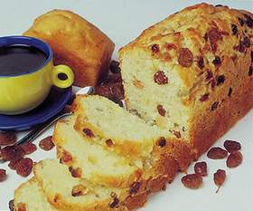

+++
title = "10 أطعمة تساعدك على النوم"
date = 2009-06-22
aliases = ["/articles/20at-health-12428/"]

[taxonomies]
authors = []
sections = ["3abkrino"]

[extra]
section_name = "عبقرينو"
share_image = "/media/images/stories/20at/abqareeno/cake01.jpg"
summary = "هل تعاني من الأرق ولا تستطع التحكم بمواعيد نوم أطفالك، الأمر يتعلق بالتوقيت، جرب بعض من هذه الأطعمة إذا كنت تريد أن تنام بسهولة وراحة طوال الليل."
section_slug = "3abkrino"
section_colour = "#880088"
thumb = "/media/images/stories/20at/abqareeno/cake01.jpg"
n_comments = 2
original_url = "http://20at.com/20at/health/12428-10----.html"
archived = "20100105211831"
date_source = "byline/meta"
aliases_20at = ["/20at/3abkrino/12428-10----.html", "/20at/health/12428-10----.html"]

[extra.provenance]
original_url = "http://20at.com/20at/health/12428-10----.html"
capture_url = "https://web.archive.org/web/20100105211831/http://20at.com/20at/health/12428-10----.html"
capture_label = "٥ يناير ٢٠١٠، ٢١:١٨ UTC"
date_note = "من سطر التوقيع في المقال"
other_urls = ["/20at/health/12428-10----.html"]
comments = "٢"
missing_images = ""
+++

<figure></figure>

هل تعاني من الأرق ولا تستطع التحكم بمواعيد نوم أطفالك، الأمر يتعلق بالتوقيت، جرب بعض من هذه الأطعمة إذا كنت تريد أن تنام بسهولة وراحة طوال الليل.

إذا كنت تأخذ أكثر من 15 دقيقة للدخول في حالة النوم ليلا ، فيمكنك تسريع موعد رحلتك إلى أرض الأحلام من خلال تغيير ما تأكله في المساء. يمكن أن يشكل هذا فرقا كبيرا ما بين التحديق في السقف والنوم مثل الأطفال.

لسنوات ، احتل لحم الديك الرومي قائمة الأغذية التي تحفز على النوم، ولكن وفقا للباحثين، فإن لحم الديك الرومي لا يحتوي على ما يكفي من tryptophan ليحفزك على النوم ، كما وضحت اليزابيث سومر ، في كتابها "كتاب الطبخ: المأكولات والمزاج: وصفات للأكل الأفضل والشعور بتحسن".

بدلا من ذلك ، يعتقد بأن الأطعمة الخفيفة والغنية بالكربوهيدرات لها تأثير مباشر على الشعور بالنعاس، النشويات ترفع مستويات السيروتونين في الدماغ وهو مادة كيميائية في الجسم، دون أن تثقل الجهاز الهضمي. إذا أردت ، يمكنك تناول شراب دافئ ومريح ، مثل كوب من الشاي والأعشاب (البابونج أو الليمون العطري ، أو فاليريان) أو حتى الحليب الدافئ.

10 أطعمة تحفز على النوم:

حاول تناول هذه الأطعمة قبل ساعة من الذهاب إلى النوم للحصول على نوم مريح طوال الليل.

1. نصف كعكة مافن بالزبيب أو خبز.

2. قمح مع العسل.

3. كوبان من البوشار .

4. شريحة صغيرة من كعكة الملائكة بالتوت.

5. بسكويت أو وافل من القمح الكامل مع شراب القيقب.

6. نصف كوب من المعجنات.

7. فراولة طازجة مغمسة في قليل من شراب الشوكولاتة قليل الدسم .

8. نصف كوب من المعكرونة مع صلصة marinara .

9. 4 أوقية من المخبوزات المصنوعة من البطاطا وقطعة من الفاكهة.

10. برتقال أو يوسفي معلب مع الزنجبيل .

تتجاوز فوائد النوم الحصول على مزاج جيد في الصباح والكثير من الطاقة، فالحصول على ست إلى ثماني ساعات من النوم ليلا يمكن أن يجعلك تبدو أصغر بثلاثة سنوات عن عمرك الحقيقي.

ـــــــــــــــــــــــــــــــــــــــــــــــــــــــــــــ

المصدر: موقع البوابة

