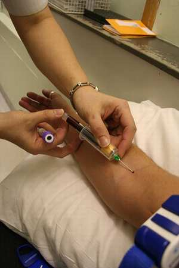

+++
title = "عيادة المريض..عدوى !"
date = 2007-03-07
authors = ["محمد فاروق عجم"]
aliases = ["/articles/harb-n5032/"]

[taxonomies]
authors = ["mohamed-farouk-agam"]
sections = ["harb"]

[extra]
section_name = "الحرب الآن"
share_image = "/media/admins.20at.com/aly/funny_illness.jpg3.jpg"
summary = "باقة ورد بجميع الألوان..حرصت على انتقائها بعناية..تتقدم بخطواتك إلى المستشفى حيث يرقد هناك أحد أقاربك .. تصعد إليه برشاقة.. تذكر : لست مريضا وإنما مجرد زائر.. ت"
section_slug = "harb"
section_colour = "#7A1E1E"
thumb = "/media/admins.20at.com/aly/funny_illness.jpg3.jpg"
n_comments = 2
original_url = "http://www.20at.com:80/20at/3abkrino/3383.html"
archived = "20090726111341"
date_source = "byline/meta"
aliases_20at = ["//harb.20at.com/newarticle.php?sid=5032", "/20at/3abkrino/3383.html"]

[extra.provenance]
original_url = "http://www.20at.com:80/20at/3abkrino/3383.html"
capture_url = "https://web.archive.org/web/20090726111341/http://www.20at.com:80/20at/3abkrino/3383.html"
capture_label = "٢٦ يوليو ٢٠٠٩، ١١:١٣ UTC"
date_note = "من سطر التوقيع في المقال"
other_urls = ["//harb.20at.com/newarticle.php?sid=5032"]
comments = "٢"
missing_images = ""
+++

<figure></figure>

باقة ورد بجميع الألوان..حرصت على انتقائها بعناية..تتقدم بخطواتك إلى المستشفى حيث يرقد هناك أحد أقاربك .. تصعد إليه برشاقة.. تذكر : لست مريضا وإنما مجرد زائر.. تدخل عليه وتقبله.. وبجواره وعلى سريره الأبيض تمضي معه بعض الوقت.. عند الرحيل تحمل نفس الرشاقة.. لكن مع آخر خطواتك على باب المستشفى يستوقفك شعور بالألم ..ماذا حدث.. هل أصبت.. وتهمس في نفسك: لقد صرت مريضا يا معلم ؟!

إذا كنت ممن حدث لهم نفس هذا المشهد أو سمعت بحدوثه ممن حولك..فإن ذلك ما يعرف بـ عدوى المستشفيات (Nosocomial infection ) أو ما يسمى بالعدوى المكتسبة من المستشفيات (Hospital-acquired infection )، والتي تعد من أخطر أشكال العدوى التي تصيب دول العالم غنيها وفقيرها.

<h3>الدراسات تحذر</h3>

ففي دراسة قامت بها منظمة الصحة العالمية على عدوى المستشفيات في 55 مستشفى بأربعة عشر دولة من أربع مناطق بالعالم (أوروبا، شرق البحر المتوسط، جنوب شرق أسيا، دول غرب المحيط الهادي) وجد أن 8.7 % من مرضى المستشفى يصابون بعدوى مكتسبة من المستشفى، وان 1.4 مليون شخص في العالم يعانون من مشاكل سببها عدوى المكتسبة بالمستشفيات، وأكبر المعدلات التي سجلت كانت بمناطق شرق البحر المتوسط ودول جنوب شرق أسيا بنسب تصل إلى 11.8% و 10.0% على التوالي ومعدل منخفض 7.7% و 9.0 بدول الأوروبية وغرب المحيط الهادي عل التوالي.

كذلك فقد أشارت دراسة فرنسية حديثة إلى أن قرابة 10 % من نزلاء المستشفيات وزوارها صاروا معرضين للإصابة بهذه العدوى، وأوضحت الدراسة أن عدد المصابين في دول الإتحاد الأوروبي قدر بنحو مليون شخص كل عام، منهم حوالي 12 ألف تؤدي بهم هذه الإصابة إلى الموت!

<h3>سرعة انتشار</h3>

وهناك عدة أسباب تزيد من حدة عدوى المستشفيات، مثل الإفرازات الملوثة والدم المصاب أو نتيجة عدم استعمال الإجراءات الصحية الآمنة، أو نتيجة ضعف مناعة المريض، إلى جانب انتقال البكتيريا والفيروسات وغيرها داخل جسم المريض، أو وجود ميكروبات داخل المستشفى أكثر ضراوة وأكثر مقاومة للأمراض من الميكروبات خارج المستشفى وسهولة انتقالها في ازدحام المرضى بالأقسام الطبية، إلى جانب ضعف الناحية الصحية من النظافة والتعقيم والتطهير والتخلص من المخلفات المرضى داخل المستشفى.

أما طرق انتقال العدوى فتكون من العاملين أو الزائرين إلى المرضى، أو من المرضى أو الزائرين إلى العاملين، أو من المرضى إلى المرضى.

<h3>سلوكيات خاطئة</h3>

الدكتورة (هالة بدوي)، سكرتير عام مؤتمر "الجديد في مكافحة عدوى المستشفيات" الذي عقد مؤخرا بالقاهرة، أشارت لـ"عشرينات" بقولها:

عدوى المستشفيات نوع من العدوى منتشر في البلاد العربية بشكل كبير ويسبب مشاكل كثيرة لكن لا يتم الالتفات إليه، وبه جزء كبير يخص زوار المستشفيات.

فنحن كعرب ذو سلوكيات خاطئة في أثناء زيارتنا للمستشفيات، فالبعض يتعامل مع زيارة المريض على أنها رحلة، فنجده يصطحب أطفاله معه، ويتركهم يلعبون ويتجولون داخل المستشفى.

وهناك من يفضل الجلوس بجوار المريض بل وتقبيله بمجرد الدخول عليه!!

الأمر أيضا يتعدى ذلك، حيث نرى البعض يحرص بدواعي العاطفة الدخول على المريض في غرفة العناية المركزة، رغم خطورة بعض الحالات وإمكانية انتقال الأمراض والعدوى لهم أو منهم لمن حولهم.

هذه السلوكيات الخاطئة من ناحية تخلق جو مناسب تماما لمقاومة الميكروبات للمضادات الحيوية، وبالتالي نجد أن المريض لا يُشفى وتطول فترة بقائه في سرير المرض وقد يتعرض للوفاة، ومن ناحية أخرى تؤدي لإصابة الزائرين بالأمراض والإصابات الفيروسية.

<h3>- إليكم بعض النصائح التي تفيد في تجنب الإصابة بعدوى المستشفيات بالنسبة للزائرين:</h3>

- بيئة المستشفى بيئة نشطة للميكروبات، لذا يجب الحرص على عدم لمس الأجهزة الطبية أو الأجسام الحاملة للمرض مثل مقابض أبواب غرف المرضى أو الأدوات المعدنية المتواجدة بها، فجميعها وسائل محتملة لانتشار العدوى.

- يجب عدم الاقتراب من المريض، أو حضنه أو تقبيله، كذلك عدم لمس أدواته الشخصية، وعدم الجلوس بجواره على السرير.

- يجب الحرص أثناء الزيارات عدم تواجد أشخاص كثيرين داخل الغرفة، فكلما زاد عدد الأشخاص كلما زادت بيئة المرض.

- لو تداعت الحاجة الدخول على المريض غرفة العناية المركزة، يجب غسل اليدين قبل الدخول وبعد الخروج وارتداء الحذاء الواقي.

- منع دخول الأطفال على المرضى إلا في حالات الضرورة (أن يكون والده أو والدته هم المرضى).

- يجب الاهتمام بتوعية الزائرين بإتباع الطرق السليمة لوقايتهم، وأن المستشفى ليست مكانا للتنزه أو الفسحة، هذه التوعية لها دور كبير في التخفيف من انتقال العدوى.

