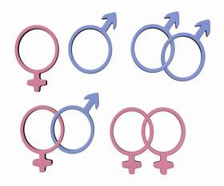

+++
title = "(امتحان البويات)..شرط بمدارس البنات!"
date = 2009-06-16
authors = ["نادر يوسف"]

[taxonomies]
authors = ["nadr-youssef"]
sections = ["7ayatna"]

[extra]
section_name = "حياتنا"
share_image = "/media/images/stories/shaz.jpg"
summary = "أثارت إحدى المدارس الثانوية في قطر جدلا واسعا بين طالباتها وأولياء أمورهن بعد اشتراطها إجراء كشف نفسي على الطالبات يسمى كشف \"البُويات\" يُظهر إن كانت إحداهن مصاب"
section_slug = "7ayatna"
section_colour = "#CA0789"
thumb = "/media/images/stories/shaz.jpg"
n_comments = 0
original_url = "http://www.20at.com/20at/7ayatna/12382-2009-06-16-11-04-38.html"
archived = "20090622103759"
date_source = "byline/meta"
aliases_20at = ["/20at/7ayatna/12382-2009-06-16-11-04-38.html"]

[extra.provenance]
original_url = "http://www.20at.com/20at/7ayatna/12382-2009-06-16-11-04-38.html"
capture_url = "https://web.archive.org/web/20090622103759/http://www.20at.com/20at/7ayatna/12382-2009-06-16-11-04-38.html"
capture_label = "٢٢ يونيو ٢٠٠٩، ١٠:٣٧ UTC"
date_note = "من سطر التوقيع في المقال"
other_urls = []
comments = ""
missing_images = ""
+++

<figure></figure>

أثارت إحدى المدارس الثانوية في قطر جدلا واسعا بين طالباتها وأولياء أمورهن بعد اشتراطها إجراء كشف نفسي على الطالبات يسمى كشف "البُويات" يُظهر إن كانت إحداهن مصابة بمرض الشذوذ أو لديها نزعة رجولية!.

حيث اشترطت "مدرسة الإيمان الثانوية المستقلة للبنات"، أن يكون نتيجة الكشف ورقة رئيسية للالتحاق بها، ومعلنة أن أي طالبة يثبت أنها شاذة جنسيا سيكون قرار الاستبعاد من نصيبها معللة أن ذلك بمصلحة جميع الطالبات.

صائب أم خائب؟

حول هذا الإجراء الجديد يقول حسام محمد، ولي أمر إحدى الطالبات: "أعتقد أن القرار جيد للحفاظ على بناتنا وسلوكهن خاصة بعد انتشار هذه ظاهرة البُويات بشكل كبير في الخليج، حتى أصبحت هناك أماكن مخصصة لهؤلاء الفتيات يلتقين فيها".

وينصح: "أدعو كل ولي أمر فتاة يرى فيها هذا المرض الشاذ أن يذهب بها إلى مركز للتأهيل وسرعة علاجها"، مشيرا إلى مركز "العوين" للتأهيل الاجتماعي الذي يتركز دوره في معالجة حالات الانحراف السلوكي بشتى أنواعها، بدء من العنف والجريمة ومرورا بالشذوذ الجنسي وانتهاء بعلاج الإدمان وهو الأول من نوعه في الشرق الأوسط .

أما سليمان الفهد،40 سنة، فيعترض على قرار المدرسة، ويوضح: "أعتقد أن سلوك هذه المدرسة غير محمود إلى حد كبير، فإذا اتبعت جميع المدارس نفس الأسلوب فأين يمكن أن تتعلم هؤلاء الفتيات، وكيف سنقّوم سلوكهن، فهم بحاجة إلى احتضان المجتمع وليس عزلهن خارجه".

ويضيف: "نحن نحتاج إلى أكثر من مركز لتأهيل بناتنا، فالمجتمع يتعرض للعديد من الهزات السلوكية والثقافية، وأصبحنا اليوم نرى في المجمعات أشكال وألوان من الشباب الذين يطلق عليهم (الإيموز) يرتدون ملابس خليعة وغيرهم".

تؤيد أم أحمد،45 سنة، قرار المدرسة وبلهجة عنيفة تهاجم الأسرة التي تصاب ابنتها بهذا المرض، فتقول: "يتركون بناتهم للسير في طرق شاذة، ثم يندمون علي المصيبة التي حلت بهم، فأين دورهم في الرقابة قبل فوات الأوان، الأسرة المفككة هي فقط من تتعرض بناتها إلى الشذوذ".

فريق دعم طلابي

الدكتورة صفاء فضل أحمد، اختصاصية العلاج النفسي بمدرسة الإيمان، توضح أن الإدارة أعلنت خضوع الطالبات للكشف الدقيق تجنباً لتسجيل طالبات ذات ميول شاذة قد تدفع زميلاتها لانتهاج نفس السلوك، وأيضا لمعالجة أية حالة ذات ميول شاذة في حال اكتشافها.

وتحكي د. صفاء أن المدرسة اكتشفت إحدى الحالات قبل التسجيل ورفضت قبولها، مما أدى إلى غضب والدتها وذعرها عند سماع الخبر، كما أن هناك أحد أولياء الأمور مزق ثياب ابنته بعد تنبيه من قبل إدارة المدرسة بميول ابنته نحو ارتداء الملابس الذكورية، مبينة أن المدرسة تهدف أيضا بقرارها زيادة وعي أولياء الأمور للمساهمة في محاربة الانحرافات السلوكية التي تزيد يوما بعد يوم.

وتضيف: "صفات (البويات) تكون واضحة للمختصين النفسيين من خلال اللغة وطريقة المشي والملابس، لذا شكلت المدرسة فريقا للدعم من الطلاب أنفسهم وتتلخص مهامه في المساعدة على اكتشاف أية حالة اضطرابية، سواء كانت نفسية أو أخلاقية أو سلوكية، في خطوة تهدف إلى رفع درجة الوعي بين الطالبات وخلق بيئة مدرسية سليمة".

