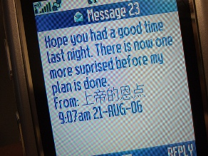

+++
title = "أحلى \"sms\" أردنية!"
date = 2007-01-01
authors = ["طارق ديلواني"]
aliases = ["/articles/20at-lifestyle-2994/"]

[taxonomies]
authors = ["tarek-dilwani"]
sections = ["7ayatna"]

[extra]
section_name = "حياتنا"
share_image = "/media/admins.20at.com/aly/massage_mobile.jpg2.jpg"
summary = "يتبادل الكثير من الشبان والفتيات في الأردن وعلى مدار الساعة وبكثافة ما يصلهم من رسائل خلوية قصيرة \"sms\"، بعضها خاصة وأخرى عامة في مناسبات متعددة.."
section_slug = "7ayatna"
section_colour = "#CA0789"
thumb = "/media/admins.20at.com/aly/massage_mobile.jpg2.jpg"
n_comments = 9
original_url = "http://www.20at.com:80/20at/lifestyle/2994.html"
archived = "20091207033516"
date_source = "byline/meta"
aliases_20at = ["/20at/7ayatna/2994.html", "/20at/lifestyle/2994.html", "/20at/lifestyle/2994.html?layout=default&page=&print=1&tmpl=component"]

[extra.provenance]
original_url = "http://www.20at.com:80/20at/lifestyle/2994.html"
capture_url = "https://web.archive.org/web/20091207033516/http://www.20at.com:80/20at/lifestyle/2994.html"
capture_label = "٧ ديسمبر ٢٠٠٩، ٠٣:٣٥ UTC"
date_note = "من سطر التوقيع في المقال"
other_urls = ["/20at/lifestyle/2994.html", "/20at/lifestyle/2994.html?layout=default&page=&print=1&tmpl=component"]
comments = "٩"
missing_images = ""
+++

<figure></figure>

يتبادل الكثير من الشبان والفتيات في الأردن وعلى مدار الساعة وبكثافة ما يصلهم من رسائل خلوية قصيرة "sms"، بعضها خاصة وأخرى عامة في مناسبات متعددة..

ومؤخرا أثبتت إحصائية للاتصالات الأردنية أن حجم ما ينفقه الأردنيين وتحديدا الشباب على رسائل sms يفوق بأضعاف بعض الدول العربية المجاورة، ففي عيد الفطر الماضي تبادل الأردنيين أكثر من مليوني رسالة قصيرة !

وهو ما يعني أن رسائل الـ sms فرضت نفسها على النسيج الاجتماعي الأردني، حيث باتت تشكل الواعظ الديني والطرافة والنشرة الإخبارية..

<h3>الأعياد .. حمى رسائل قصيرة!</h3>

تتحول الأعياد خاصة عيدي الفطر والأضحى وأعياد الميلاد ورأس السنة وعيد الحب وغيرها من المناسبات إلى ساحة خصبة لتبادل الرسائل القصيرة..

يذكر لنا محمد حسين، أن أول رسالة وصلته عبر جهاز الموبايل خلال عام 2006هي أجمل رسالة بالنسبة له، لأنها حملت تهنئة رقيقة من صديقه الذي أهداه الموبايل، جاء فيها "صديقي محمد..حتى يبقى التواصل بيننا بشكل دائم أهديتك هذا الموبايل"!

بينما تؤكد منى أن اغلب الرسائل التي تصلها فيها كثير من المجاملات، وقليلة هي الرسائل الصادقة المعبرة التي تحمل مضمونا، ومنها رسالة شخصية وصلتها من صديقتها تقول " ليس العيد لمن لبس الجديد ولكن العيد لمن مات شهيد".

وتضيف منى أنها تحتفظ بمثل هذه الرسائل المعبرة في ذاكرة الهاتف حتى تتمكن من إرسالها إلى معارفها وأصدقائها في المناسبات مثل " كل عام وأنت إلى الله اقرب".

<h3>زواج عبر "sms " !</h3>

أما عبيرمحمد، فأجمل رسالة وصلتها هذا العام هي تلك التي تلقتها من زميل لها طلب خلالها يدها للزواج، تقول عبير: وصلتني الرسالة وأنا في أسوا ظروف نفسية وعاطفية فرفعت من معنوياتي المنهارة، واليوم أنا زوجة بفعل الـ" sms".

بعض الرسائل القصيرة لا تخلو من الطرافة والغرابة، كما يذكر لنا وليد العمد، والذي يضيف :" وصلتني رسالة يؤكد مضمونها إنني ربحت مبلغا من المال من إحدى شركات الموبايل، فطرت من الفرحة ولم أتمالك أعصابي، وانطلقت مباشرة إلى مقر الشركة لاستلام الجائزة، ففوجئت بطابور من المنتظرين الذين خدعتهم الحيلة مثلي .. ورغم ذلك لا زلت أرى أنها أجمل رسالة وصلتني على الرغم من أنها لم تكن أكثر من حيلة!

ويقول أيمن حمدان، أن أجمل رسالة وصلته في هذا العام كانت "أنا ما أقول كل عام وأنت بخير..لكن أقول أنت الخير لكل عام"، ويسرد لنا ايمن أيضا بعض الرسائل الجميلة التي وصلته فيضيف وصلتني رسالة تهنئة بعيد الأضحى معبرة تمام تقول "قبل الدم وقبل اللحم وقبل الشحم أقولك يا حبيبي كل عام وأنت بخير".

<h3>للنكتة مكان !</h3>

وفي محاولة للتغلب على أعباء الحياة ومعاناتها اليومية تحتل النكتة والسخرية مكان في هذه الرسائل القصيرة..

يقول مالك عبد الله، أن أحلى رسالة وصلته هذا العام كانت مجرد نكته ظريفة تقول"محشش قالو له شو رأيك في الزواج المبكر قال يعني أي ساعة ؟".

وتسرد لنا ماجدة أجمل نكتة وصلتها وتقول"واحد قال لمحشش أنا بردان من المكيف رد المحشش وقال أنا محمد من الزرقاء".

<h3>رسائل دينية!</h3>

وتحظى الرسائل ذات المضمون الديني بنسبة كبيرة من الرسائل القصيرة لدى الشباب..فيخبرنا عماد الخطيب، أن أجمل رسالة وصلته هذا العام كانت رسالة دينية مضمونها "قبل أن تنام سامح الأنام وأغسل قلبك بالعفو والغفران تجد حلاوة الأمان".

بينما يحكي فارس عورتاني، عن أجمل رسالتين دينيتين وصلتاه، الأولى كانت في صباح يوم جمعة تقول "رجاء وأمنية: لا تنساني هذا اليوم.. المرسلة: سورة الكهف"، والثانية تقول "إن داهمك هم يهد الجبال تذكر: أرحنا بالصلاة يا بلال".

وداد عارف، تقول: أن أكثر رسالة أثرت بها خلال هذا العام كانت من صديقة ملتزمة نصها" القبور تبنى ونحن ما تبنا، يا ليتنا تبنا من قبل أن تبنى".

بينما تقول رناد، أن رسالة وصلتها من شقيقتها في الخليج في شهر رمضان كانت جميلة جدا ومعبرة تقول كلماتها "من وجد الله فما فقد.. ومن فقد الله فما وجد".

<h3>من وحي الخيال</h3>

ويسرد لنا بعض الشباب رسائل من تأليفهم ووحي خيالهم، بعضها خفيف الظل وأخرى ثقيلة الظل، من قبيل " الجو فتنه والبر جنه دق الخيمة وشب النار بلا دراسه بلا اختبار".

ورسالة أخرى تقول" يقولون إن عيد الأضحى باقي عليه شهر أبيك تكثر العلف ترى العين عليك".

فيما تقول ثالثة "لو ذكرتك أنسى كل معلومات الدراسة أكتب اسمك سؤال وأرسم عيونك إجابة".

وكذلك " ذرفت دمعه في أحد المحيطات إن استطاعوا الحصول عليها أعدك بنسيانك".

<h3>خاص للفتيات</h3>

وفي المقابل تقول هبة، أن هنالك رسائل خاصة بالفتيات فقط مثلما هو الحال لدى الشباب، فقد وصلتني رسالة تقول "المرأة الحكيمة هي التي لديها الكثير لتقوله ولكنها تلزم الصمت"، أما أجمل رسالة وصلتها هذا العام برأيها فتقول" يختبر الذهب بالنار وتختبر المرأة بالذهب ويختبر الرجل بالمرأة".

أما أجمل رسالة بنظر رشا صالح، فكانت رسالة حب وصلتها في عيد الحب من خطيبها الذي يعمل في احد دول الخليج وتقول "أحبك من هنا لآخر مدى يتوقعه إنسان، أحس انك مثل عمري وما حد يرخص بعمره".

وأنت أيضا أخبرنا بأفضل رسالة وصلتك هذا العام

