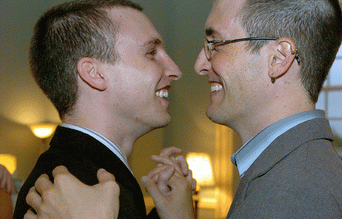

+++
title = "مرة واحد شاذ..!"
date = 2007-04-03
authors = ["شريف الدواخلى"]
aliases = ["/articles/20at-lifestyle-3539/"]

[taxonomies]
authors = ["sherif-eldoakhla"]
sections = ["7ayatna"]

[extra]
section_name = "حياتنا"
share_image = "/media/admins.20at.com/do3a2/ns-marriage-lm.gif"
summary = "هدف واحد يجمعهم ..غاية واحدة يسعون إليها.. طريق واحد يسلكونه ليحققوا إشباعهم الخاص جدا.."
section_slug = "7ayatna"
section_colour = "#CA0789"
thumb = "/media/admins.20at.com/do3a2/ns-marriage-lm.gif"
n_comments = 21
original_url = "http://www.20at.com:80/20at/lifestyle/3539.html"
archived = "20091203030051"
date_source = "byline/meta"
aliases_20at = ["/20at/7ayatna/3539.html", "/20at/lifestyle/3539.html"]

[extra.provenance]
original_url = "http://www.20at.com:80/20at/lifestyle/3539.html"
capture_url = "https://web.archive.org/web/20091203030051/http://www.20at.com:80/20at/lifestyle/3539.html"
capture_label = "٣ ديسمبر ٢٠٠٩، ٠٣:٠٠ UTC"
date_note = "من سطر التوقيع في المقال"
other_urls = ["/20at/lifestyle/3539.html"]
comments = "٢١"
missing_images = ""
+++

<figure></figure>

هدف واحد يجمعهم ..غاية واحدة يسعون إليها.. طريق واحد يسلكونه ليحققوا إشباعهم الخاص جدا..

يعيش الفرد منهم كدودة القز داخل شرنقته الخاصة ومجتمعه الضيق من أقرانه، ولكنه لا يفرز مثلها حريراً وإنما يفرز اضطراباً وصداماً ومزيداً من التشرنق والعزلة.

الشذوذ الجنسي .. يوما بعد يوما في ازدياد، وهناك عدة دراسات غربية تؤكد زيادة عددهم في العالم كله، حتى في عالمنا العربي !

وبما أننا دوما نتقن دور النعامة التي تدفن رأسها في الرمال، فنقوم بمعارضة كل ما يحاول فتح هذا الموضوع الشائك ونتهمه بأنه شخص يسعى للإثارة، وربما يصل الأمر للدعاء عليه بالويل والثبور .. وذلك بدلاً من أن نحاول أن نتعامل مع تلك الأزمة باعتبارها واقعا يجب مناقشته وليس مقاطعته أو التبرؤ منه، لأن الشذوذ ليس شيئا مستجدا ولكنه قديم بقدم الزمان وله روافده في التاريخ القبطي والإسلامي على حد سواء !

حول مسألة الشذوذ وكيفيه التعامل معها والعوامل المؤثرة فيها.. حاورنا الدكتور (خالد منتصر) استشاري الأمراض الجلدية والتناسلية بجامعة قناة السويس والكاتب المعروف.

<h3>- في البداية هل هناك مفهوم معين لكلمة شذوذ ؟</h3>

كلمة HOMOSEXUAL مستمدة من الأصل اليوناني HOMO أي الجنسية المثلية، أي فئة الرجال أو السيدات الذين يفضلون ممارسة الجنس مع شريك من نفس الجنس، ولدينا 3 مصطلحات HETEROSEXUAL يفضل الجنس الآخر، HOMOSEXUAL يفضل نفس الجنس، BISEXUAL مع النوعين أو مزدوج، فموضوع الشذوذ كبير جداً وشائك.. فيكاد الشواذ أن يشكلوا "جيتو" خاصا بهم في المستقبل القريب.

<h3>- وكيف يتحقق هذا الـ"جيتو" !</h3>

موضوع الجيتو نتيجة طبيعية لتراكمات طويلة على مدار تاريخ الشذوذ في العالم كله، والذي بلغ قمة ازدهاره على يد الإغريق منذ قديم الزمان باعتراف أفلاطون نفسه وتأكيده أن الإغريق كانوا يعتبرون عشق الرجال الغلمان وساماً يضعه هؤلاء الرجال على صدورهم، كما كانوا يحتقرون الرجل الذي يفشل في اجتذاب الغلمان إليه، فمثلاً يحدثنا الشاعر هوميروس في الإلياذة عن الحب الذي يحمله البطل "أخيل" للغلام "باتروكلوس"، وفى أساطير الإغريق أن رب الأرباب "زيوس" هو الذي أغتصب الفتى الوسيم "جانيميد" !

بل أن د."رمسيس عوض" في كتابه "الشذوذ والإبداع" يذكر أن تاريخ أول سجل أدبي لظاهرة الشذوذ يرجع إلى أكثر من أربعة آلاف وخمسمائة عام حين تناولته إحدى البرديات المصرية القديمة.

وكذلك الرومان المسيحيين الذين سمحوا بزواج رجلين أو امرأتين، وكان هذا مقبولاً ولكن في الطبقات الأرستقراطية، ونيرون نفسه كان يتزوج الرجال.

<h3>- والتاريخ الإسلامي ؟</h3>

التاريخ الإسلامي ملئ هو الآخر بصور الشذوذ، ويكفى أن نذكر أن الشاعر الكبير "أبو نواس" رغم أنه في عصر الإمام "ابن حنبل" كان يعلن شذوذه دوما في أبيات شعره !، وقد أمتد هذا الأمر إلى بعض رؤوس الدولة وحكامها، فمثلاً الوليد بن يزيد في عصر الأمويين كان مشهوراً باللواط، حتى أنه راود أخاه عن نفسه!

<h3>وما هو سبب ازدياد تلك الظاهرة في هذه الأيام؟</h3>

ربما يعود هذا الأمر لأسباب بيولوجية بحتة ووراثية في الجينات، وربما لعوامل نفسية كما يقول رائد التحليل النفسي سيجموند فرويد "أننا نولد ولدينا هذه الازدواجية الجنسية"، وقد يعود هذا الأمر إلى ممارسات سلوكية عندما يتحول بعض الناس من العلاقة الجنسية التي تفضل الجنس الآخر إلى الشذوذ، كالسيدات اللاتي يتم اغتصابهن فيتحولن تلقائياً إلى شاذات جنسياً LESBIANS.

<h3>- وهل هناك أنواع للشذوذ ؟</h3>

نعم هناك 5 أنواع للشذوذ، الأول: CLOSE- COUPLED HOMOSEXUALS وهم الذين يعيشون علاقات شديدة الشبه بالعلاقات الزوجية فيما بين الرجل والمرأة، وهؤلاء مشاكلهم الجنسية أقل وكل طرف يكتفي بالطرف الآخر فقط.

والثاني: OPEN-COUPLED وهو الذي يمتلك علاقات خاصة جداً وأيضاً علاقات متعددة خارج هذا المحيط الخاص، وهذا النوع منتقد دائماً وآسف على شذوذه ويحاول التخلص منه.

النوع الثالث: FUNCTIONAL أو الوظيفي والذي لا يقيم فيه الشواذ علاقات زواج أو ما يشبه ذلك وهم يمتلكون علاقات متعددة حرة، وهم مثل النوع الأول لا يعانون متاعب جنسية شديدة.

النوع الرابع: DYSFUNCTIONALالذين بقدر ما يمتلكون علاقات جنسية متعددة خارج إطار الزواج، هم يمتلكون أيضاً متاعب جنسية شديدة ومتعددة.

النوع الخامس: ASEXUALأي الشواذ الذين ليست لديهم اهتمامات جنسية أو اهتماماتهم الجنسية قليلة ويميل هذا النوع إلى أن يكون أكثر سرية وغموضاً في علاقاته الشاذة.

ويعد النوع الرابع هو الأكثر الأنواع إحباطاً وإحساساً بالوحشة والاضطراب، أما النوع الأخير فهو أكثر الأنواع عرضة للانتحار.

<h3>كيف يعرف الإنسان إذا كان شاذا فعلا أو أنه يفضل مشاهدة أفلام الشذوذ فحسب؟</h3>

يمكن أن يكتشف ذلك بشعوره وقت مراهقته بأنه يميل لنفس جنسه لأنه يبعث على الراحة والاستمتاع فيستمر في تلك الممارسات، أو أن يكتشف في فترة المراهقة بأنه يفضل الممارسة مع نفس الجنس ثم تحدث بعدها الممارسة، أي أن الشعور يتبع الممارسة في الطريقة الأولى، ويسبق الممارسة في الطريقة الثانية.

