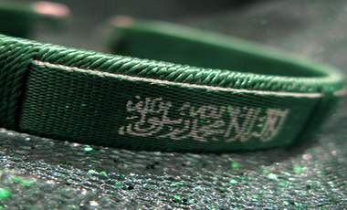

+++
title = "المنوفي منوفي .. حتى لو في السعودية!"
date = 2009-02-01
authors = ["عبد الله الغامدي"]
aliases = ["/articles/20at-ana-saudi-11147/"]

[taxonomies]
authors = ["abdallah-elghamdi"]
sections = ["ana-s3ody"]

[extra]
section_name = "أنا سعودي"
share_image = "/media/currentarticleassets/eeee.jpg"
summary = "- \"أنت منوفي؟!\".. كلمة رددها بصوت عالي، مبديا تعجبه واستنكاره وكأنه يوجه له اتهام."
section_slug = "ana-s3ody"
section_colour = "#0E9C9A"
thumb = "/media/currentarticleassets/eeee.jpg"
n_comments = 3
original_url = "http://20at.com/20at/ana-saudi/11147.html"
archived = "20100105233922"
date_source = "byline/meta"
aliases_20at = ["/20at/ana-s3ody/11147.html", "/20at/ana-saudi/11147.html"]

[extra.provenance]
original_url = "http://20at.com/20at/ana-saudi/11147.html"
capture_url = "https://web.archive.org/web/20100105233922/http://20at.com/20at/ana-saudi/11147.html"
capture_label = "٥ يناير ٢٠١٠، ٢٣:٣٩ UTC"
date_note = "من سطر التوقيع في المقال"
other_urls = ["/20at/ana-saudi/11147.html"]
comments = "٣"
missing_images = ""
+++

<figure></figure>

- "أنت منوفي؟!".. كلمة رددها بصوت عالي، مبديا تعجبه واستنكاره وكأنه يوجه له اتهام.

- "ومالهم المنايفة مش أحسن منك" هكذا رد الآخر.

حوار دار بين مصريين يعملون بالسعودية، أبعاده تلك الصورة التي ترسخت في عقلية المصريين تجاه المنايفة أو أبناء محافظة المنوفية، حتى أن انتماءهم لتلك المحافظة أصبحت لعنة تطاردهم في الغربة!.

أحد المنايفة يوضح أنه في مصر بمجرد أن يكتشف محدثيه أن هويته "منوفي" يحذرون ويحتاطون في التعامل معه، ونفس الهوية عند اكتشافها في الغربة تولد أحاسيس مضاعفة في الحذر وربما الرغبة في عدم التعامل معه واجتنابه، موضحا أن المصريين بالسعودية يرددون مقولة شهيرة يقولون فيها: "إذا كانت الغربة مرة.. فلو منوفي معاك تبقى حنظل" أي أشد مرارة.

<h3>مبادئ المنايفة بالغربة</h3>

محمد عيسى – طبيب- يقول: "المنوفي في الغربة لا يختلف كثيرا عن المنوفي داخل مصر، ولكن يضاف إليها بعض الصفات الأشد سوء مثل الدهاء والمكر والخديعة، حتى أن هناك مثل سائد يحتاط منه المصريين هنا وهو "ازرع المنوفي يقلعك"، فدائما لو قدمت مساعدة لمنوفي وشغلته معاك، يحاول رد الجميل بإبعادك عن العمل".

بدوره يرى محمد السيد – مندوب مبيعات- أن المبدأ الذي يعمل به المنوفي بالسعودية، هو "اتمسكن لحد ما تتمكن"، ويطبقون هذا المثل مع الجميع بداية من الكفيل حتى الصديق!.

وتابع: "لو قدمت للمنوفي مساعدة لا تأمنه أبدا، إنهم يسيرون بمبدأ (إن قابلك أعمى اديله على قفاه وخد اللي معاه)".

أما خالد حسن- محاسب- فيرى أن المنايفة هم أصلح فئة للتعامل مع السعوديين لأنهم يعرفون كيف يأكلون عقولهم، وتابع: "أعرف محاسب منوفي يعمل هنا منذ فترة وما زال عازبا، وعندما سألته عن سبب عدم زواجه حتى الآن قال لي الزواج مضيعة للوقت والجهد والمال".

<h3>لكل قاعدة شواذ</h3>

ومن جهته يرى أسامة عبد الله– مندوب مبيعات- أن الصورة الذهنية عن المنايفة لو كانت سيئة، فلكل قاعدة شواذ، مشيرا إلى أنه تعامل مع عدد من المنايفة كانوا يتميزوا بالكرم وطيبة القلب.

وتابع: "وهناك حتى مثل يدل على اختلاف المنايفة في الطباع هو (منوفي منوف .. غير منوفي الباجور)".

وكما يطلق على المنايفة النكات في بلادهم فالغربة ليست استثناء، يقول حنفي عبد الله- سائق- أشهر النكات عن المنايفة في السعودية نكتة تقول: "واحد منوفي وهو بيحج راح يرجم إبليس.. طلع إبليس قال له .. حتى أنت يا منوفي".

أما مصفى رضوان- مهندس- فيروي نكتة أخرى عن المنايفة في السعودية تقول "مرة واحد منوفي قتل مراته عشان اتعشت قبل ما يجي وعندما بدأو يقطعوا رأسه لم يمت.. ضربوه بالنار لم يمت.. السياف احتار معاه.. فجه منوفي آخر وهمس في أذن السياف.. بعدها توجه نحوه وأخرج من جيب المنوفي مائة ريال وقطعها أمامه.. طب ساكت".

وتابع: "هناك نكتة اخرى تقول (مرة واحد منوفي بالسعودية لقى فانوس سحري وفضل يدعك في الفانوس لحد ما جاب للجني تسلخات.. طلعله الجني قاله شبيك لبيك تطلب ايه: قاله: طلعلي كل المصريين من السعوديه، فالجني قاله: "ليش بس يا ابن العم .. احنا عملنا لك حاجة.. مش مكفيك التسلخات)".

