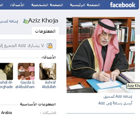

+++
title = "كلم الوزير على (الفيس بوك)!"
date = 2009-06-18
authors = ["ناصر القحطاني"]
aliases = ["/articles/20at-ana-saudi-12404/"]

[taxonomies]
authors = ["nasr-elkhtani"]
sections = ["ana-s3ody"]

[extra]
section_name = "أنا سعودي"
share_image = "/media/images/stories/20at/ana_soaady/ay7aag.jpg"
summary = "تتلقى \"بوست\" على موقع \"الفيس بوك\" من وزير في بلدك، يهنئك بعيد ميلادك أو مناسبة لديك، بينما يمكنك أنت أن تتطلع على صوره الخاصة كأنه أحد أصدقائك!"
section_slug = "ana-s3ody"
section_colour = "#0E9C9A"
thumb = "/media/images/stories/20at/ana_soaady/ay7aag.jpg"
n_comments = 10
original_url = "http://20at.com/20at/ana-saudi/12404-2009-06-18-12-33-33.html"
archived = "20100105232612"
date_source = "byline/meta"
aliases_20at = ["/20at/ana-s3ody/12404-2009-06-18-12-33-33.html", "/20at/ana-saudi/12404-2009-06-18-12-33-33.html"]

[extra.provenance]
original_url = "http://20at.com/20at/ana-saudi/12404-2009-06-18-12-33-33.html"
capture_url = "https://web.archive.org/web/20100105232612/http://20at.com/20at/ana-saudi/12404-2009-06-18-12-33-33.html"
capture_label = "٥ يناير ٢٠١٠، ٢٣:٢٦ UTC"
date_note = "من سطر التوقيع في المقال"
other_urls = ["/20at/ana-saudi/12404-2009-06-18-12-33-33.html"]
comments = "١٠"
missing_images = ""
+++

<figure></figure>

تتلقى "بوست" على موقع "الفيس بوك" من وزير في بلدك، يهنئك بعيد ميلادك أو مناسبة لديك، بينما يمكنك أنت أن تتطلع على صوره الخاصة كأنه أحد أصدقائك!

هذه ليست طرفه بل حقيقة في السعودية أكثر الدول العربية تشددا ورفضا للفيس بوك، فأكثر من 200 شاب وفتاة أصبحوا أصدقاء لوزير الثقافة والإعلام السعودي الدكتور عبد العزيز خوجة وذلك عبر صفحته على الموقع الاجتماعي الشهير.

<h3 class="center">فرصة ثمينة</h3>

يري سعيد الشهراني، فنان تشكيلي، أن فكرة الحوار مع مسئول عبر "الفيس بوك" تسمح بطرح مقترحات وأفكار قد لا تتاح في الظروف العادية، ويتمني الشهراني أن يتخذ وزراء آخرون نفس الخطوة.

وتثني حنان أحمد، على خطوة الوزير، قائلة: "سمعت عن مبادرته وسأحاول التواصل بالأفكار والمقترحات مع الوزير".

سلمى الشهراني، 24 عاما، تقول: "إنها خطوة جريئة ورائعة من الوزير فـ"الفيس بوك" أصبح موقعا مهما واتخذه كبار الساسة طريقا للتواصل مع الناس، من ضمنهم هيلاري كلينتون وزيرة خارجية الولايات المتحدة الأمريكية حيث وضعت صفحة خاصة لها على الموقع".

محمد على الأسمري، 24 سنة، أرسل إلى الوزير بالفعل عدد من المقترحات تخص الشباب، تتعلق بمواهبهم وكيفية تشجيعهم في مجالات الأدب والشعر والرسم بصفة خاصة، وينتظر أن يتجاوب معها.

<h3 class="center">ليس هو الوزير</h3>

على العكس البعض لم تعجبه الفكرة ويرى أن الهدف من وراء هذه الصفحة هو الانتشار الإعلامي، وأن هناك من يتولى الإشراف على الصفحة غير الوزير..

من بين هؤلاء ياسر الغسلان، الذي يقول: "صفحة الفيس بوك التي أطلقها الوزير تجعلني أتساءل لماذا صادف إطلاقها إعلان تعيين متحدث رسمي لوزارة الثقافة والإعلام؟!.. أعتقد أن المتحدث الرسمي الجديد الذي عرف عنه الخبرة الطويلة في العمل الإعلامي والفهم الواسع للخطوط العامة للسياسات الإعلامية السعودية هو نفسه من يسّير هذه الصفحة لصالح الوزير، في عمل يعرفه المشتغلون في الإعلام بأنه أحد آليات وتكتيكات التخطيط في مجال العلاقات العامة".

<h3 class="center">الحوار أسهل</h3>

المبادرة الفيس بوكية التي قام بها الوزير الخوجة، اهتم بها رجال الإعلام والصحافة.. منهم علي العكاسي، الذي وصف الفكرة بأنها "جريئة، وخاصة أن لدى الكثير من الإعلاميين الكثير من المقترحات والمواضيع والمعوقات التي تواجههم في مسيرتهم الإعلامية، وهذه الصفحة ستوفر لهم الحصول على المعلومات بشكل أسهل".

أما الإعلامي ماجد البسام، فينصح الشباب بالتواصل مع الوزير عبر الصفحة، فيقول: "يا ليت الشباب يستفيدون من الفكرة ويتحاورون معه حول قضاياهم وخاصة الثقافية".

