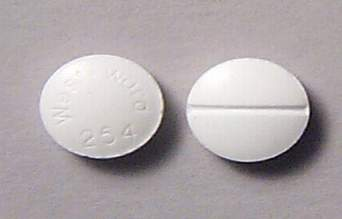

+++
title = "سعوديات  أدمن (القشطة)!"
date = 2008-11-08
authors = ["ناصر القحطاني"]

[taxonomies]
authors = ["nasr-elkhtani"]
sections = ["ana-s3ody"]

[extra]
section_name = "أنا سعودي"
share_image = "/media/currentarticleassets/kshta.jpg"
summary = "انتشرت بين أوساط طالبات المرحلة الثانوية والجامعية خاصة في الرياض وجدة ظاهرة تعاطي \" القشطة \"، وهي نوع من أنواع المخدرات، وهي عبارة عن حبوب يبلغ سعر الواحدة منه"
section_slug = "ana-s3ody"
section_colour = "#0E9C9A"
thumb = "/media/currentarticleassets/kshta.jpg"
n_comments = 1
original_url = "http://20at.com/20at/ana-saudi/10450.html"
archived = "20100105233746"
date_source = "byline/meta"
aliases_20at = ["/20at/ana-saudi/10450.html"]

[extra.provenance]
original_url = "http://20at.com/20at/ana-saudi/10450.html"
capture_url = "https://web.archive.org/web/20100105233746/http://20at.com/20at/ana-saudi/10450.html"
capture_label = "٥ يناير ٢٠١٠، ٢٣:٣٧ UTC"
date_note = "من سطر التوقيع في المقال"
other_urls = []
comments = "١"
missing_images = ""
+++

<figure></figure>

انتشرت بين أوساط طالبات المرحلة الثانوية والجامعية خاصة في الرياض وجدة ظاهرة تعاطي " القشطة "، وهي نوع من أنواع المخدرات، وهي عبارة عن حبوب يبلغ سعر الواحدة منها خمسة ريالات تؤدي إلى الدوخة والنعاس، بل وتؤدي إلى فقدان ذاكرة مؤقت.

خطورة هذا المخدر أن الفتيات قد يفقدن الوعي تماما، وقد يصل الأمر إلى فقدان عذريتهن من قبل بعض الشباب الذين يستغلون إدمان الفتيات للقشطة.

وحذر الناطق الإعلامي لشرطة عسير العقيد عبد الله القرني من انتشار هذه المادة بين الطلاب والطالبات مؤكدا إن الأجهزة الأمنية تتعقب مروجي هذه الحبوب وفق حملات منظمة لهذا الغرض.

وأعلنت وزارة الداخلية السعودية مؤخرا عن القبض على حاج بنجلادشي حاول ترويج المخدر عبر مطار الملك خالد، وضبطت معه مليون حبة مخدرة مخبأة في عبوات معجون الطماطم العام الماضي.

<h3>خلافات عائلية وامتحانات</h3>

عشرينات حاولت من خلال مرشدات وأخصائيات اجتماعيات الوصول إلى بعض هؤلاء الفتيات المدمنات الذين وافقن على الحديث عن تجربتهم مع "القشطة" ربما يكن عظة لغيرهن من الفتيات.

ن م (25 عاما) تدرس بجامعة حكومية في الرياض، بدأت في تناول حبوب القشطة مع تصاعد المشاكل بينها وبين والدها، و تقول:"مللت الجو الأسري المضطرب وقررت أن أجرب الحبوب التي تغيبني عن هذه المشاكل لأبدو أمام أعين أبي وأمي نائمة،و لكني في الحقيقة أكون فاقدة للوعي بكامل إرادتي، حصلت على هذا المخدر الذي يطلقون عليه القشطة عن طريق زميلات لي بنفس الكلية، أو عن طريق عاملات آسيويات يروجن للمخدرات في الخفاء".

وتضيف ن :" لاحظت أستاذة تكبرني بقليل شرودي الذهني وعدم تركيزي، دعتني إلى مكتبها واضطررت إلى كشف معاناتي وأحالتني بسرية إلى قسم الخدمة الاجتماعية وحاولت منذ قرابة الشهرين ترك تلك الحبوب والحمد لله أنا الآن في تحسن".

وتعترف فتاة أخرى تدعى "نوره" أن نوبة القلق التي كانت تنتابها فترة الامتحانات هي التي دفعتها لتناول "القشطة" عن طريق صديقتها في المدرسة، ولكن طبعا تضاعف القلق.

<h3>فقدتا عذريتهما</h3>

وتحدثت فتاتان فقدتا عذريتهما نتيجة إدمان حبوب "القشطة" إلى صحيفة "الوطن" السعودية، وكشفتا كيف بدأتا هذا المشوار، حيث قالت (ل.ص) وعمرها (21 عاما أنها تعرفت على صديق لأخيها زارها بينما كانت وحدها بالمنزل وكانت تعاني من صداع شديد حيث عرض عليها حبوبا بيضاء صغيرة فتناولتها وراحت في غيبوبة أفاقت منها على كارثة فقدانها أغلى ما تملكه الفتاة.

وتقول الفتاة الأخرى، (خ خ) وعمرها (20 عاما)، أن أمها دخلت السجن بسبب قضية حقوق مدنية ولم يكن هناك من يتكفل بها، حيث تعرفت على شاب استدرجها إلى منزله وناولها تلك الحبوب التي جعلتها لا تعلم أين هي، وفعل فعلته، وتركها ورحل دون أن تعلم عنه شيئ.

سارة (22 عاما) حصلت على لقب ملكة المزاج فهي واحدة من مروجي القشطة التي لا تخجل من الحديث عن ذلك، أرشدتنا إليها واحدة من الفتيات اللاتي أدمن ويخضعن للعلاج ، وعن حكايتها مع القشطة تقول سارة " استغلني مروجو المخدرات أسوأ استغلال ولم يتورعوا عن استخدامي في كل شيء و لا استطيع الرجوع عن هذا الطريق، أصبحت أروج للحبوب المخدرة في الجامعات و بين صديقاتي في الحي استغليت ثقة كل فتاة في لأحولها إلي مدمنة مثلي".

<h3>وللشباب حكاية!</h3>

وان امتد شر القشطة المخدرة للفتيات فللشباب قصة معها، و من داخل مستشفى الصحة النفسية للعلاج من الإدمان يروى لعشرينات سالم ( 22 عاما)، وهو طالب بجامعة الملك خالد بأبها انه أدمن تلك الحبوب الصغيرة، بعد إن أقنعه زميل له بتناولها واعتاد على تناولها في الأيام الأخيرة ولايمر يوم أو يومين إلا ويتناول تلك الحبوب لأنه يريد إن يعيش في عالم آخر على حد قوله حتى تم اكتشاف أمره من قبل إدارة الجامعة وتم تحويله لمستشفى الصحة النفسية للعلاج.

وقال ع س( 17 عاما ) أنه كان يحصل على تلك الحبوب عن طريق بنغالي يعيش في حي "عليشة" الشعبي بالرياض، واعتاد على شراء حبات كثيرة من البنغالي تصل قيمة الحبة الواحدة إلى 15 ريال، وهو مضطر إلى تناولها فهو يعاني من ضغوط اجتماعية ونفسية دفعته لإدمان تناول هذه المادة المخدرة ولازال يتناولها.

وحسب المقدم أحمد جمعان الزهراني من إدارة مكافحة المخدرات فأن القشطة إحدى أنواع الحبوب المخدرة يتم تصنيعها في الهند و لونها أبيض و تحتوي على نسبة عالية جدا من المهدئات وتشبه إلى حد كبير حبة (الكبتاجون) المنشطة ومكتوب على أحد الوجهين (AMBDEE) والوجه الآخر (EUNOCTIN) .

وحذر الدكتور محمود حازم أخصائي طب عام بمستشفى خاص بالرياض من أن تناول هذه الحبوب لفترات طويلة قد يؤدي إلي إصابة الدماغ بالشلل وعدم قدرة على التفكير لان مكونات تلك الحبوب تشتمل على مركبات مهدئة تؤثر على النخاع ألشوكي.

