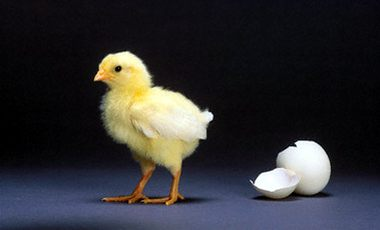

+++
title = "توليد (ديليفري).. جدل سعودي!"
date = 2008-11-11
authors = ["ناصر القحطاني"]

[taxonomies]
authors = ["nasr-elkhtani"]
sections = ["ana-s3ody"]

[extra]
section_name = "أنا سعودي"
share_image = "/media/currentarticleassets/birth-at-home.jpg"
summary = "لن تبذل المرأة السعودية جهدا وهي توشك على الولادة، فالجديد هنا أنها ستلد وهي بمنزلها بإشراف طبي مباشر!"
section_slug = "ana-s3ody"
section_colour = "#0E9C9A"
thumb = "/media/currentarticleassets/birth-at-home.jpg"
n_comments = 1
original_url = "http://20at.com/20at/ana-saudi/10470.html"
archived = "20100105233734"
date_source = "byline/meta"
aliases_20at = ["/20at/ana-saudi/10470.html"]

[extra.provenance]
original_url = "http://20at.com/20at/ana-saudi/10470.html"
capture_url = "https://web.archive.org/web/20100105233734/http://20at.com/20at/ana-saudi/10470.html"
capture_label = "٥ يناير ٢٠١٠، ٢٣:٣٧ UTC"
date_note = "من سطر التوقيع في المقال"
other_urls = []
comments = "١"
missing_images = ""
+++

<figure></figure>

لن تبذل المرأة السعودية جهدا وهي توشك على الولادة، فالجديد هنا أنها ستلد وهي بمنزلها بإشراف طبي مباشر!

فقد أعلنت جمعية الهلال الأحمر السعودية، عن البدء في مشروع توليد النساء في منازلهن، برعاية من طاقم طبي، لا يشمل الممرضات أو المسعفات، وهو الأمر الذي دفع بالجمعية إلى إلى تدريب فتيات سعوديات على الإسعافات والتوليد، مما جعل كثيرون يدعون إلى تأجليه لاعتبارات دينية، رغم أن المشروع بدأت أولى خطوات تنفيذه بالفعل!

<h3>5 فرق</h3>

وقال موفق البيوك مدير عام الخدمات الطبية الطارئة في الهلال الأحمر لـ(عشرينات) أن المرحلة الأولى لمشروع توليد النساء داخل منازلهن، انطلقت في العاصمة السعودية، عبر 5 فرق طبية، تعمل بالتناوب، حيث جاء اختيار الرياض، لاستحواذها على 28 في المائة من حالات الولادة المنزلية التي تتم سنويا في البلاد.

ومضى البيوك يقول أن مسعفات أجنبيات، استقطبهن الهلال الأحمر للعمل في مشروع التوليد المنزلي، أنهين أخيرا، برنامجا تدريبيا تم بالتعاون مع مدينة الملك فهد الطبية، وأوضح أن جمعيته في صدد استقطاب مجموعة أخرى من المسعفات، لبدء العمل الفعلي في المشروع.

وطبقا للدراسة التي أعدتها جمعية الهلال الأحمر السعودي، حول مشروع التوليد المنزلي، فإنه سيتم تجريب الخطة التشغيلية في مدينة الرياض لمدة 6 أشهر، قبل أن يتم نقلها لمناطق أخرى، فيما لم تستبعد امتداد الخدمة لاستخدامات الإسعاف الجوي عند توفره بشكل كامل.

وأشار البيوك أن أعداد المسعفات اللائي سيعملن في مشروع التوليد المنزلي، بـ47 مسعفة، في المرحلة الأولى، وأضاف أنه سيتم تعميم مشروع ولادة النساء داخل المنازل، على جميع مناطق السعودية، إلا أن الأنباء التي ترددت عن أن المسعفات سيكن أجنبيات من جنسيات مختلفة، أغضبت كثير من الفتيات السعوديات.

<h3>ليش أجنبيات؟!</h3>

وإزاء فتح المجال لممرضات للدخول في مشروع التوليد المنزلي، إلا أن فتيات سعوديات وجهن تساؤلاً عبر (عشرينات) للقائمين على الفكرة، ومنهن عائشة المهدي -26 عاما- قائلة: "لماذا لا تتاح للفتاة السعودية العمل في مجال التوليد المنزلي، فهناك فتيات أكملن دراساتهن في مجالات تخصصهن وبخاصة الصحية ينتظرن فرص التوظيف وهن مستقرات في بيوتهن بلا عمل؟".

وقالت دانة أحمد -25 عاماً- أنها تحب العمل التطوعي وتتمنى أن تلتحق بجمعية الهلال الأحمر السعودي، وأضافت أنها سمعت أن الجمعية استعانت بممرضات أجنبيات في المشروع، برغم أن هناك فتيات سعوديات يردن العمل في مجال الإسعاف الميداني!

وفيما كشفت نورة العلى من جدة أن الجمعية أرادت إن تفسح المجال أمام الأجنبيات للعمل في الإسعاف، لأنهن لا يتعرضن لانتقادات المجتمع السعودي، لاسيما وأن الممرضة تعمل مع رجال في سيارات الإسعاف وهي تتنقل ميدانيا وفي وقت تحذر فيه السعودية قيادة المرأة للسيارة، ومضت تقول المشكلة ليست من الجمعية إنما من تخوف الجمعية من آراء المجتمع السعودي وخاصة المتشددين، فهم لا ينظرون للفتاة الأجنبية التي تعمل في مثل هذه الأعمال الميدانية بنفس النظرة للفتاة السعودية.

<h3>لا قدر الله!</h3>

وحول النقطة الأخيرة أكد صالح القحطاني أن للجمعية مبرراتها لعدم مشاركة الفتاة السعودية في مجال عمل الإسعاف الميداني، لاسيما وأنها ستتنقل مع رجال في العمل الميداني وقد تكون سيارة الإسعاف مثار للشبهة والخلوة لا قدر الله، فيتحول الأمر من عمل ميداني تطوعي إلى عمل لا أخلاقي!

ويؤكد سعيد الهاجري أن الفتاة السعودية تستطيع العمل في أي مجال، وإن سنحت الفرصة لها للعمل في الهلال الأحمر، فلابد أن تكون هناك ضوابط ودراسة وافية وشاملة.

وكان رئيس جمعية الهلال الأحمر السعودي، سمو الأمير فيصل نجل العاهل السعودي عبد الله بن عبد العزيز، قد أكد في تصريحات صحفية مؤخراً، أنه ليس هناك ما يمنع من توظيف مسعفات سعوديات في الهلال الأحمر، ما لم يتعارض مع تعاليم الدين الإسلامي الحنيف، مشيراً إلى أن هناك اقتراحات بالاستعانة بهن في الحالات النسائية البحتة، وعند عملية نقلهن وإسعافهن في السيارة.

وفيما تدخلت الفرق الاسعافية التابعة للهلال الأحمر السعودي، في 734 حالة ولادة طارئة في جميع مناطق السعودية، 30 في المائة منها تم التعامل معها داخل منازل في مدينة الرياض، فيما تم التعامل مع 18 في المائة داخل سيارات الإسعاف

وتتراوح تكلفة الولادة الطبيعية في مستشفيات السعودية بين ألفي و4 آلاف ريال سعودي، بحسب الدراسة التي أعدتها جمعية الهلال الأحمر.

وجاء تفكير جمعية الهلال الأحمر السعودي، في إطلاق مشروع التوليد المنزلي، بعد أن كشفت إحصائيات رسمية، عن أن 78 في المائة، من حالات الولادة في السعودية سنويا، تتم بشكل طبيعي.

<h3>الأمهات يفضلنها.. ديلفري</h3>

استطلعنا آراء الأمهات لنعرف منهن موقفهن من "ولادة الهوم ديلفري"، فقالت لنا (أم وليد) من خميس مشيط، أنها تفضل أن تلد بالمنزل لأنها ستواجه صعوبة بالغة إذا ذهبت إلى المستشفى، تبدأ من طابور الانتظار إلى إجراءات روتينية تحدث داخل عيادات التوليد، بخلاف أن هناك بعض الأطباء الرجال سيكونون في تلك العيادات، لذلك فمن الأفضل إن تكون الولادة في المنزل".

أم سعد، من أبها، فهي ترى أن مشروع التوليد داخل البيوت أفضل بكثير من المستشفيات، فالمرأة حينها ستخضع لمتابعة طبية دقيقة من قبل فريق طبي يتم تكريسه لحالتها فقط، ثم أن هناك راحة نفسية تشعر بها المرأة حينما تلد بالبيت، على عكس ولادتها بالمستشفى لأنها تريد إن يكون مسقط رأس ابنها لأول مرة في الحياة في البيت وليس بالمستشفى.

