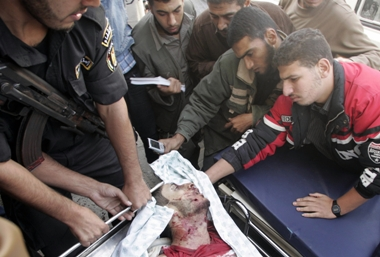

+++
title = "غزة في ظلام.. وشهداء من جديد"
date = 2008-11-16

[taxonomies]
authors = []
sections = ["nashrat-9"]

[extra]
section_name = "نشرة 9"
share_image = "/media/currentarticleassets/images/palgaza1.jpg"
summary = "استيقظت غـزة صبـاح اليـوم الأحد على يوم جديد من التصعيد الميداني الإسرائيلي باستشهاد أربعة مقاومين من \"ألوية صلاح الدين\" -الجناح العسكري للجان المقاومة الشعبية-"
section_slug = "nashrat-9"
section_colour = "#004B80"
thumb = "/media/currentarticleassets/images/palgaza1.jpg"
n_comments = 0
original_url = "http://20at.com/20at/ana-saudi/10506.html"
archived = "20100105233457"
date_source = "byline/meta"
aliases_20at = ["/20at/ana-saudi/10506.html"]

[extra.provenance]
original_url = "http://20at.com/20at/ana-saudi/10506.html"
capture_url = "https://web.archive.org/web/20100105233457/http://20at.com/20at/ana-saudi/10506.html"
capture_label = "٥ يناير ٢٠١٠، ٢٣:٣٤ UTC"
date_note = "من سطر التوقيع في المقال"
other_urls = []
comments = ""
missing_images = ""
+++

<figure></figure>

استيقظت غـزة صبـاح اليـوم الأحد على يوم جديد من التصعيد الميداني الإسرائيلي باستشهاد أربعة مقاومين من "ألوية صلاح الدين" -الجناح العسكري للجان المقاومة الشعبية- في غارة جوية على بيت حانون.

وأكدت مصادر طبية أن القائد الميداني في الألوية عبد الله المنايعة وصل إلى المستشفى شهيدا، فيما أعلن عن استشهاد فوزي حمد متأثرا بجراحه في وقت لاحق.

وأفاد شهود عيان أن طائرة استطلاع إسرائيلية قصفت بصاروخ واحد عددا من المقاومين قرب مقبرة الشهداء شرق مخيم جباليا شمال القطاع.

فيما لا تزال تئن من لسعات تدهـور الـوضع الإنساني الذي خلّفه استمرار غلق المعابر ونفاد الـوقود، وهو ما دعا منظمات دولية للتحذير من وقوع القطاع في براثن "كارثة" قريبة.

وقالت ألوية الناصر وعلى لسان ناطقها الإعلامي "أبو مجاهد": إن التهدئة انتهت وإن رد رئيس الوزراء الإسرائيلي إيهود أولمرت "اللاعسكـري" وصـل, وتوعد أبو مجاهد في تصريحات إذاعية الاحتلال برد قاسٍ ومُوجع.

ومن جانبها قالت حركة المقاومة الإسلامية "حماس": "إن التهدئة لن تكـون ورقة في وجه المقاومة، وأكدت أن الإسرائيليين لن ينعموا بالهدوء وغـزة تعيش في الدماء والأشلاء".

ومـع بـلوغ التـوتر أقصـى حدّته أمس الجمعـة، وتواصله اليوم رأت أوساط إعلامية وسياسية أن التهدئـة الهشـة المُبرمة بين الاحتلال والفصائل برعايـة مصـرّية منذ خمسة أشهر قد انتهت - حسب إسلام أون لاين-.

وذكرت مصـادر إعلامية إسرائيلية أن رئيس الوزراء الإسرائيلي، إيهود أولمرت، عقد اجتماعا مساء أمس لقادة الأجهزة الأمنية الإسرائيلية لبحث كيفية الرد على فصائل المقاومة وفي مُقدمتها حركة حماس.

وأطلقت "كتائب القسام" الذراع العسكرية لحركة "حماس" أمس خمسة صواريخ من طراز "جراد" الروسي الصنع على مدينة عسقلان الساحلية شمال القطاع، وهي المـرة الأولى التي تقصف فيـها كتائب القسام هذه البلدة بصواريخ من هذا الطراز منذ بداية انتفاضة الأقصى الثانية عام 2000.

<h3>مخازن فارغة</h3>

وعلى صعيـد الوضع الإنسـاني فقد تعالت صيحات التحذيـر الحقوقيـة والصحيـة من أن كارثة إنسانية ستضـرب مدينـة غـزة، وتشـل جميع المناحي فيـها وتزيد من حصـارها المفروض عليـها منذ أكثـر من عامٍ.

فمن جانبها حذرت منظمة العفو الدولية من وصول قطاع غزة إلى وضع "كارثي"، متهمة إسرائيل بتنفيذ عقاب جماعي بحق سكان القطاع المدنيين.

وتشهد أجزاء واسعة من قطاع غزة انقطاعا كهربائيا تاما، وتمنع إسرائيل دخول أي مساعدات إنسانية إلى القطاع منذ أربعة أيام.

ونقلت هيئة الإذاعة البريطانية "بي بي سي" عن مدير وكالة غوث وتشغيل اللاجئين الفلسطينيين(أونروا) في قطاع غزة جون جنج أن مستودعات الوكالة "أصبحت خالية الآن".

وقد أعلنت الوكالة الخميس وقف توزيع الغذاء في غزة بسبب الحصار الإسرائيلي.

وتوزع الأونروا مساعدات غذائية على نحو 750 ألف فلسطيني، أي نصف سكان القطاع, لكنها لم تحصل في الأيام الأخيرة على إمدادات بسبب إغلاق المعابر وتشديد الحصار الإسرائيلي على غـزة.

