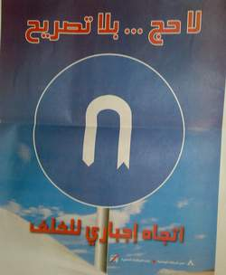

+++
title = "لا حج بلا تصريح"
date = 2008-11-24
authors = ["عبد الله الغامدي"]

[taxonomies]
authors = ["abdallah-elghamdi"]
sections = ["ana-s3ody"]

[extra]
section_name = "أنا سعودي"
share_image = "/media/currentarticleassets/7ag.jpg"
summary = "لا تكاد تمر في مكان الآن في السعودية إلا وتجد لافتة تحمل عبارة \"لا حج بلا تصريح\"، كما يتردد صدى العبارة نفسها في وسائل الإعلام المرئية والمسموعة على مدار الساعة"
section_slug = "ana-s3ody"
section_colour = "#0E9C9A"
thumb = "/media/currentarticleassets/7ag.jpg"
n_comments = 0
original_url = "http://20at.com/20at/ana-saudi/10597.html"
archived = "20100105233547"
date_source = "byline/meta"
aliases_20at = ["/20at/ana-saudi/10597.html"]

[extra.provenance]
original_url = "http://20at.com/20at/ana-saudi/10597.html"
capture_url = "https://web.archive.org/web/20100105233547/http://20at.com/20at/ana-saudi/10597.html"
capture_label = "٥ يناير ٢٠١٠، ٢٣:٣٥ UTC"
date_note = "من سطر التوقيع في المقال"
other_urls = []
comments = ""
missing_images = ""
+++

<figure></figure>

لا تكاد تمر في مكان الآن في السعودية إلا وتجد لافتة تحمل عبارة "لا حج بلا تصريح"، كما يتردد صدى العبارة نفسها في وسائل الإعلام المرئية والمسموعة على مدار الساعة، في إطار حملة إعلامية توعوية أطلقتها السلطات السعودية بهدف حض حجاج الداخل على الحصول على تصريح رسمي قبل التوجه للحج.

"ارتفاع أسعار حملات الحج الداخلية، واشتراط السلطات السعودية على حجاج الداخل عدم تكرار الحج إلا كل 5 سنوات، هو ما يدفع البعض للحج دون تصريح".. هذا ما أوضحه لـ (عشرينات) الإعلامي السعودي علي بلال، مشيرا إلى أنه خلال الأعوام السابقة كان الكثير ممن يرغب في أداء الحج يتوجه لأداء المناسك بدون تصريح، وكان هناك تساهل إلى حد ما، ولكن الأمر اختلف هذا العام، فهناك تشديد في هذا الأمر، بعد الحوادث التي تسبب بها حجاج الافتراش.

حيث تعتبر السلطات السعودية أن الافتراش السبب في وقوع حوادث خلال الأعوام الماضية والتي كان آخرها في يناير عام 2006، حينما لقي 362 حاجا حتفهم في تدافع على جسر الجمرات.

<h3>إجراء غير مسبوق</h3>

الحملة تأتي في إطار حزمة إجراءات اتخذتها المملكة للقضاء على ظاهرة حج "الافتراش"، التي تحملها السلطات المسئولية عن وقوع حوادث لقي فيها حجاج حتفهم خلال مواسم الحج الماضية.

وفي إطار هذه الإجراءات، كشف الأمير خالد الفيصل أمير منطقة مكة المكرمة في تصريحات سابقة أنه سيتم في حج هذا العام تشكيل فرق أمنية ميدانية لتعقب المخالفين من الحجاج داخل المشاعر المقدسة، فيما يعد الإجراء الأول من نوعه للقضاء على ظاهرة الحج غير النظامي.

وحذر بفرض عقوبات تتفاوت ما بين الغرامة والترحيل على المخالفين، ويعد تعقب الحجاج غير النظاميين إجراء غير مسبوق داخل المشاعر المقدسة، حيث كانت الإجراءات الأمنية تتركز في السابق على نصب الأكمنة وتشديد الإجراءات خارج المشاعر المقدسة وعلى المنافذ التي تؤدي إليها.

<h3>تحايل</h3>

ورغم تلك التحذيرات، يلجأ الكثير للتحايل على تلك الإجراءات ومحاولة الحج دون تصريح..

أحد أساليب التحايل يكشفها لنا عامل في أحد حملات الحج- رفض ذكر اسمه- موضحا أن الحافلات قد تحمل معها بعض ممن لا يحملون تصاريح ويرغبون في الحج، اعتمادا على أن السلطات عند نقاط التفتيش تقوم بتفتيش عشوائي للأتوبيس وليس للجميع، وغالبا ما تغض السلطات الطرف عنهم إن كان عددهم بسيط داخل الأتوبيس".

على الجانب الآخر، يوضح أبو عبد الله، بأحد حملات حج الداخل، أن هذا العام يختلف عن الأعوام السابقة لأن هناك تشديد من قبل السلطات ولن يكون هناك أي تساهل، معتبرا أن سبب لجوء الحملات لنقل من لا يحملون تصاريح إلى قلة عدد التصاريح لحجاج الداخل في مقابل الراغبين في أداء الحج.

بعيدا عن الحملات، توجد سوقا رائجة لنقل الحجاج المخالفين، ولا سيما في البطحاء جنوب الرياض.. "م. ع" أحد السائقين الذين ينشطون في عملية نقل الحجاج دون تصريح يوضح أن عملية النقل تعتمد على عاملي الزمان والمكان، الزمان حيث أننا نتعمد الوصول لمكة يوم وقفة عرفات حينها تكون الإجراءات الأمنية خفت، وتركزت الجهود الأمنية لحماية الحجيج، كما نسلك بعض الطرق بعيدا عن نقاط التفتيش للوصول إلى مكة.

<h3>ارتفاع أسعار الحج</h3>

أما عن أسباب اللجوء للحج بدون تصريح من قبل الراغبين في الحج فيعتبر عبد الله القحطاني، أن السبب الأساسي لها هو ارتفاع أسعار الحج بصورة خيالية هذا العام،

ورأى القحطاني أن الحل الفعلي من وجهة نظره للقضاء على الظاهرة هو تدخل الدولة لتخفيض أسعار تلك الحملات.

في المقابل أعرب محمد الشعلان، عن ضرورة الالتزام بأوامر الدولة في هذا الصدد من أجل توفير أمن الحجيج، مشيرا إلى أن الدولة تقدم خدماتها وتعد خططها على أساس عدد الحجاج الرسميين.

وتابع: "ولكن الحجاج غير النظاميين يأخذون حق الرسميين ويعكرون عليهم حجهم"، مشيرا إلى أن الكثير من الحجاج غير النظاميين سبق لهم الحج، ولكنهم يودون تكرار الحج سنويا.

والحجاج غير النظاميين هم من لا يملكون تصاريح رسمية لأداء الحج، وهم سعوديون أو غير ذلك مقيمين بالمملكة، أو أجانب موجودين في المملكة بشكل غير رسمي، وهم لا يلتحقون بحملات حج مصرح بها من قبل وزارة الحج السعودية، بل يفترشون الأرض في المشاعر المقدسة، مما يتسبب في زحام المشاعر المقدسة، وإعاقة تقديم الخدمات لضيوف الرحمن في أماكن إقامتهم بمنى وعرفات.

ويتوافد الحجاج غير النظاميين من خارج المملكة خلال شهر رمضان، ثم يتخلفون عن مغادرة المملكة لحين أداء الحج.

<h3>حج مخالف</h3>

عن حكم الحج بدون تصريح، قال الشيخ عبد المحسن العبيكان، المستشار بوزارة العدل السعودية في تصريحات سابقة أن من حج بدون تصريح فهو "آثم".

قائلا: "لا شك أن الحج بدون تصريح مخالف لأمر الله تعالى وأمر رسوله صلى الله عليه وسلم لأن الله أمر بطاعة ولي الأمر في غير معصية الله وقرنها بطاعته وطاعة رسوله صلى الله عليه وسلم حيث قال تعالى (وأطيعوا الله والرسول وأولي الأمر منكم)".

وتابع: "من حج بدون إذن ولي الأمر فو آثم لعصيانه لأمر الله بمخالفته لولي الأمر الذي أمر الله بطاعته وعصيان الله والرسول من الذنوب التي يحاسب عليها العبد".

