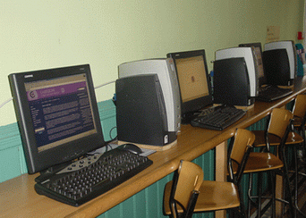

+++
title = "في مقاهي النساء .. كل شيء مسموح!"
date = 2008-12-14
authors = ["رشا أحمد"]

[taxonomies]
authors = ["rasha-ahmed"]
sections = ["ana-s3ody"]

[extra]
section_name = "أنا سعودي"
share_image = "/media/currentarticleassets/internetcafe1.gif"
summary = "قاعة صغيرة أشبه بصالة حفل جماعي، تحتوى على ركن خاص للمشروبات الساخنة، أما دخان السجائر والشيشة الذي ينبعث منها أشبه بمدخنة قطار قديم، الصوت الصاخب المنبعث منها "
section_slug = "ana-s3ody"
section_colour = "#0E9C9A"
thumb = "/media/currentarticleassets/internetcafe1.gif"
n_comments = 0
original_url = "http://20at.com/20at/ana-saudi/10717.html"
archived = "20100105233249"
date_source = "byline/meta"
aliases_20at = ["/20at/ana-saudi/10717.html"]

[extra.provenance]
original_url = "http://20at.com/20at/ana-saudi/10717.html"
capture_url = "https://web.archive.org/web/20100105233249/http://20at.com/20at/ana-saudi/10717.html"
capture_label = "٥ يناير ٢٠١٠، ٢٣:٣٢ UTC"
date_note = "من سطر التوقيع في المقال"
other_urls = []
comments = ""
missing_images = ""
+++

<figure></figure>

قاعة صغيرة أشبه بصالة حفل جماعي، تحتوى على ركن خاص للمشروبات الساخنة، أما دخان السجائر والشيشة الذي ينبعث منها أشبه بمدخنة قطار قديم، الصوت الصاخب المنبعث منها تشعركِ أنك في ملهى ليلي.. ديكورات رائعة، إضاءة خافتة، وستائر سوداء معتمة تخفي ما يدور داخل المقهى لتشعر معها أنك في أحد النوادي الليلية..

هذا هو حال مقاهي الإنترنت النسائية بالسعودية، والتي تكتظ بالنساء ممن يريدون تصفح المواقع أو إجراء المحادثات، أو ممن يردن الإطلاع على الصحف، أو من ذوي النفوس الضعيفة اللائي يهربن من رقابة الأهل.

لكن هناك انتقادات كثيرة لهذه المقاهي، مثل بعض التجاوزات من الفتيات، ووجودها تحت مسميات مختلفة - كأن تكون داخل سوق أو مشغل- مما يصعب على المسئولين أو مفتشي البلدية اكتشاف الأخطاء والممارسات المخلة بالنظام التي قد تحدث داخلها!.

<h3>ملاذي الوحيد</h3>

نوف، ترى أن المقهى الذي ترتاده وفر لها الحماية والخصوصية لتحقيق التواصل مع أصدقائها، تضيف: "أصبحت المقاهي النسائية هي ملاذي الوحيد للهروب من الضغوط النفسية والرقابة الشديدة من الأهل، فعبر الإنترنت أستطيع التحدث بصراحة وعرض مشكلتي في سرية تامة وتلقي الحلول من الآخرين".

أما نوره، فتقول: "على الرغم من تخوفي من الذهاب إلى مقاهي الإنترنت إلا أنني لا أجد مفرا من الذهاب إليها، ولا سيما أني لا أجد هناك ما يدعو للنفرة منها، رغم أن والدي يمانع بشدة شراء جهاز كمبيوتر لي، وكلما سألته عن السبب قال لي أنه يفسد أخلاق الشباب".

<h3>تصوير الفتيات</h3>

وفي المقابل تتعجب سهيلة من الفتيات اللائي يذهبن إلى تلك الأماكن، وتقول: "كيف تسمح فتاة لنفسها أيا كانت الضغوط النفسية التي تقع عليها في مجتمع محافظ كمجتمعنا أن تذهب لتلك القاعات؟ ألا تخاف على نفسها؟".

بينما تنصح أميمة الآباء بتوفير جهاز كمبيوتر في كل بيت بدلا من ذهاب

فتياتهم إلى تلك الأماكن، وتقول: "كنت أرتاد تلك المقاهي إلا أنني عزفت عن الذهاب إليها، بعدما وجدت إحدى الفتيات تقوم بالتقاط صور بجوالها للفتيات اللائى يجلسن في المقهى، حيث يرتدي بعضهن جونلة قصيرة أو بلوزة تكشف ما تحتها أو فستانا قصيرا أشبه بقميص نوم، وأخريات يغطين وجوههن بمساحيق الزينة بشكل مبالغ فيه، ظنا منهن أنهن يجلسن بين سيدات فلا داعي للخوف، لكن هناك من يحاولن ابتزازهن ومساومتهن على أعراضهن، فإما الدفع وإما الفضيحة".

<h3>للنساء فقط</h3>

خديجة، توضح أن الفتاة تمارس كل ما تحب داخل تلك الأماكن كتدخينها للسجائر والشيشة وارتدائها لكل ما يحلو لها من ملابس علاوة على ارتفاع صوت ضحكاتها مما يجعلك تشعر لأول وهلة أنك في ملهى ليلي".

بينما تحذر عائشة - التي سيطر هاكرز على الميل الخاص بها بسبب ترددها على مقاهي الإنترنت- من وجود برامج متخصصة بمقاهي الإنترنت تقوم بإرسال "الباسوورد" من جهاز الضحية إلى بريد المخترق.

صاحبة إحدى المقاهي بمدينة الرياض، نفت ما يتردد عن ارتكاب أي أمر مخل داخل مقاهي الإنترنت، مشيرة إلى أن ذلك ليس قاعدة، وبينت أنها إذا ما لاحظت ارتكاب أي من المراهقات أعمال تتنافى مع الآداب العامة من تصويرهن للفتيات تقوم بطردها فورا ومنعها من دخول المقهى مرة أخرى.

<h3>ملتقيات اجتماعية</h3>

بينما ترى هدى الجريسي، مديرة مركز الأريبة للمهارات النسائية ورئيسة المجلس التنفيذي بالغرفة التجارية الصناعية بالرياض، أن المقاهي هي متنفس وحاجة خاصة مع الضغوط الحياتية وإيقاع الحياة السريع وأيضاً كثرة الضغوط النفسية وزيادة المشاكل الاجتماعية، ونوع من الملتقيات الاجتماعية التي ليس فيها تكلف.

تضيف: "الإنترنت في اعتقادي هي متنفس ممتاز ومريح فالمرأة تستطيع عبر الإنترنت التحدث بصراحة وطرح مشكلتها سواء كانت متزوجة أو مطلقة أو غير متزوجة أو أرملة، فهي تطرح مشكلتها وتستفيد من آراء الآخرين دون خوف وفي منتهى السرية وتستطيع أن تعالج نفسها بنفسها بدلاً من الطبيب النفسي".

لكن المشكلة فقط أن بعض المقاهي توجد بطريقة غير نظامية، مما قد يعرضها للغلق لأن معظمها غير مصرح لها بالعمل.

