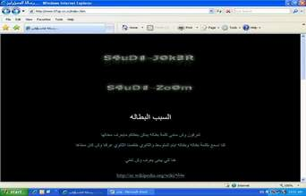

+++
title = "(ملّينا البطالة).. الحل في الهاكرز"
date = 2008-12-18
authors = ["عبد الله الغامدي"]

[taxonomies]
authors = ["abdallah-elghamdi"]
sections = ["ana-s3ody"]

[extra]
section_name = "أنا سعودي"
share_image = "/media/currentarticleassets/hakrs.jpg"
summary = "صدق أو لا تصدق.. السعودية التي تستقدم قسما كبيرا من عمالتها من الخارج أصبح شبابها الآن يفكرون في ابتكار طرق ووسائل للاحتجاج على ما يعانونه من بطالة، لإيصال صوته"
section_slug = "ana-s3ody"
section_colour = "#0E9C9A"
thumb = "/media/currentarticleassets/hakrs.jpg"
n_comments = 1
original_url = "http://20at.com/20at/ana-saudi/10757.html"
archived = "20100105233312"
date_source = "byline/meta"
aliases_20at = ["/20at/ana-saudi/10757.html"]

[extra.provenance]
original_url = "http://20at.com/20at/ana-saudi/10757.html"
capture_url = "https://web.archive.org/web/20100105233312/http://20at.com/20at/ana-saudi/10757.html"
capture_label = "٥ يناير ٢٠١٠، ٢٣:٣٣ UTC"
date_note = "من سطر التوقيع في المقال"
other_urls = []
comments = "١"
missing_images = ""
+++

<figure></figure>

صدق أو لا تصدق.. السعودية التي تستقدم قسما كبيرا من عمالتها من الخارج أصبح شبابها الآن يفكرون في ابتكار طرق ووسائل للاحتجاج على ما يعانونه من بطالة، لإيصال صوتهم للمسئولين والرأي العام.

وفي وسيلة جديدة للاحتجاج على البطالة، اخترق "هاكر" سعودي عاطل عن العمل موقع جريدة "الوطن" السعودية صباح اليوم الخميس، ونشروا من خلاله "رسالة للمسئولين" احتجاجا على مشكلة البطالة بعدما " فشلوا في إيصال صوتهم للصحف"، فيما تعد المرة الثانية بعد نحو 3 أشهر بعد اختراق موقع وزارة العمل لنفس السبب.

يأتي هذا بعد نحو عام من بدء مجموعة من الشباب السعودي تأسيس جمعية للعاطلين عن العمل في محاولة منهم لمشكلة البطالة.

<h3>احتجاج شكل تاني</h3>

وتعذر على مستخدمي الإنترنت دخول موقع جريدة الوطن لوقت محدود صباح اليوم ، حيث كان يتم نقلهم آليا إلى موقع يحمل عنوان" http://www.07up.co.cc/index.htm" ، قام خلالها هاكرز بإرسال رسالة للمسئولين احتجاجا على البطالة.

وبدأت الرسالة بتساؤل للمسئولين قائل"تعرفون وش معنى كلمة بطاله يمكن بعضكم مايعرف معناها"

وفي محاولة استباقية للرد على من سينتقد تصرفه، قال الهاكر أنه يريد للصحف ان تتكلم عن مشكلة البطالة بعد أن سبق وذهب إليها وتجاهلته، قائلا: "انا عارف ان بعضكم او يمكن الي ما اعجبه كلامي لانه صحيح بيقول اطفال انترنت ومن هالكلام الي يكررونه العالم.. طيب كيف تبغاني اوصل رسالتي رحت للصحف السعوديه ماحد عطانا وجهه، نبغا احد يكتب عننا تدرون كم الشباب السعودي العاطل عن العمل".

<h3>أنا مش سربوت</h3>

وانتقد الهاكرز -العاطل عن العمل- بعض الممارسات من توظيف "اصحاب الواسطات"، وقيام المسؤلين بإعلان أرقام غير حقيقية عن نسبة البطالة بالبلاد.

كما انتقد كذلك تعامل بعض أفراد المجتمع مع العاطل على انه "سربوت" دون أن يدركوا حجم معاناته، والسربوت هو وصفٌ يطلق على من وصل إلى مرحلةٍ متقدمةٍ من الصياعه.

وقال:"إذا شافو شاب عاطل قالو لاتمشي مع هذا ..هذا سربوت وفيه وفيه ...الخطيب على يدك يالي ما انت بسربوت عطنا حل نبغى نصير شباب مفيدين لمجتعنا ولشعبنا ونبغى نرفع رأسه عند الدول المتقدمه نعلمهم أنه مافيه احد احسن من احد"

وختم الرسالة بدعوته للمسؤلين والمجتمع بأن "يعطوا فرصة للشباب للعمل حتى لو لم يكن مؤهل للعمل حاليا.

ثم قد اعتذار عن قيامه باختراق الجريدة ، مشيرا إلى انه لم يلحق أذي بالموقع ويمكن أن يعود للعمل كما كان، وزيل الرسالة ببريده الإلكتروني.

<h3>حالة غضب</h3>

وعبر خبير إعلامي عن قلقهم من انتهاج الهاكر تلك الوسيلة للتعبير عن احتجاجهم، مشيرين إلى أن عملية الاختراق تكررت كثيرا في الفترة الماضية، فيما تعد الحالة الثانية لحالة اختراق احتجاجا عن البطالة في أقل من 3 شهور.

وأوضح أن تلك المحاولات تثبت حالة الغضب التي يعاني منها الشباب السعودي، في ظل تجاهل وسائل الإعلام لقضيهم، والاكتفاء بنشر إحصاءات حكومية تشير إلى ان البطالة في طريقها للحل.

وفي مطلع سبتمبر الماضي اخترق "هاكر" يزعم أنه شاب سعودي عاطل من العمل موقع وزارة العمل السعودية على شبكة الإنترنت، واكتفى بوضع عبارة احتجاج على الصفحة الرئيسة من دون أن يعطل الموقع، نصها: «ملّينا من البطالة. ممكن تسمعون؟».

وكان وزير العمل، غازي القصيبي، أحدث ضجة قبل نحو عامين، عندما قال في تصريح ان «البطالة ستصبح ذكرى». وبالطبع لم يتحقق ذلك، بل ارتفع عديد العمالة الخارجية في شكل كبير.

ويشغل معظم الأجانب وظائف يرى كثر أنها يجب أن تكون من حظ الشبان والشابات السعوديين. وعلق القصيبي على ازدياد العمالة الأجنبية بأنه أمر «مرهون بالطفرة الاقتصادية التي تشهدها البلاد».

وتشير إحصاءات وزارة التخطيط والاقتصاد إلى أن عدد سكان المملكة يبلغ نحو 25 مليون نسمة، بينهم ما يقارب 7 ملايين أجنبي وأجنبية، يستحوذون نحو خمسة ملايين فرصة عمل.

وفي سبتمبر 2008 ، قال نائب وزير العمل عبد الواحد الحميد ان معدل البطالة العام لقوة العمل السعودية «الذكور والإناث «انخفض إلى 9,8 % بعد ان كان 11,2% كما انخفض معدل البطالة للذكور الى 8% الى 6,9% وانخفض معدل البطالة للإناث الى 24,9% بعد ان كان 26,6%

وهناك شبه إجماع رسمي وشعبي على أن السبب الرئيس لتفشي البطالة في البلاد، هو استقدام عمالة أجنبية، إضافة إلى عدم توافق غالبية مخرجات التعليم (أو الشهادات)، الجامعية منها بخاصة، مع سوق العمل. ويفضل مسؤولون في القطاع الخاص العمالة الأجنبية على السعودية، «لأن راتب السعودي مرتفع، ويزيد ثلاثة أضعاف أحياناً عن راتب الأجنبي الذي يكون في حالات كثيرة أكثر تأهيلاً».

<h3>جمعية العاطلين</h3>

كانت "عشرينات" قد عرضت مطلع هذا العام تجربة قام بها مجموعة من الشباب السعودي لمكافحة البطالة، خلال إنشاء جمعية للعاطلين عن العمل.

وقال أنيس الأنصاري رئيس الفريق المسئول عن إنشاء الجمعية في حوار مع عشرينات أن أهم أهداف الجمعية القضاء على مشكلة البطالة وذلك من خلال ايجاد الحلول السريعه والدائمه لها، مشيرا إلى أن أعداد الخريجين تتزايد عاما بعد عام ونسب الوظائف الشاغرة تتضاءل وان وجدت لا تكاد تكفي متطلبات الحياة الصعبه في ظل التضخم الاقتصادي وارتفاع الأسعار وتسارع وتيرة الحياة مما ينفر طالبي العمل.

