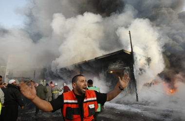

+++
title = "الغارات مستمرة وغزة تستغيث"
date = 2008-12-29
authors = ["وكالات"]

[taxonomies]
authors = ["wakalat"]
sections = ["nashrat-9"]

[extra]
section_name = "نشرة 9"
share_image = "/media/currentarticleassets/motgaza.jpg"
summary = "ارتفع عدد شهداء العدوان الإسرائيلي المتواصل على قطاع غزة إلى 320 شهيدا، فضلا عن سقوط 1400 جريح، مع استمرار الغارات على غزة طيلة الليل وفجر اليوم الأحد؛ وسط تعهد"
section_slug = "nashrat-9"
section_colour = "#004B80"
thumb = "/media/currentarticleassets/motgaza.jpg"
n_comments = 0
original_url = "http://20at.com/20at/ana-saudi/10811.html"
archived = "20100105233412"
date_source = "byline/meta"
aliases_20at = ["/20at/ana-saudi/10811.html"]

[extra.provenance]
original_url = "http://20at.com/20at/ana-saudi/10811.html"
capture_url = "https://web.archive.org/web/20100105233412/http://20at.com/20at/ana-saudi/10811.html"
capture_label = "٥ يناير ٢٠١٠، ٢٣:٣٤ UTC"
date_note = "من سطر التوقيع في المقال"
other_urls = []
comments = ""
missing_images = ""
+++

<figure></figure>

ارتفع عدد شهداء العدوان الإسرائيلي المتواصل على قطاع غزة إلى 320 شهيدا، فضلا عن سقوط 1400 جريح، مع استمرار الغارات على غزة طيلة الليل وفجر اليوم الأحد؛ وسط تعهدات من جانب القادة العسكريين الإسرائيليين باستمرار الغارات.

وشهدت الغارات تحولا نوعيا في أهدافها داخل القطاع، فبعد أن كانت مركزة أمس على المقار الأمنية والحكومية التابعة للحكومة المقالة برئاسة إسماعيل هنية، بدأت تقصف أهدافا مدنية مثل مستودع أدوية ومسجد والسيارات في الشوارع، وقناة القصى الفضائية التابعة لحركة حماس وهو ما يؤشر لمرحلة جديدة من العدوان خاصة مع تأكيد القادة الإسرائيليين على طول أمد العدوان في غزة.

<h3>تحرك باهت</h3>

في الوقت نفسه، دعا مجلس الأمن الدولي اليوم الأحد إلى وقف فوري لكل أشكال العنف في غزة بعد يوم من شن إسرائيل هجمات جوية على القطاع ردا على هجمات بالصواريخ وقذائف المورتر عليها. جاء في البيان الذي تلاه على الصحفيين المبعوث الكرواتي نيفن جوريكا رئيس المجلس "عبر أعضاء مجلس الأمن عن قلقهم العميق إزاء تصعيد الموقف في غزة ودعوا إلى وقف فوري لكل أشكال العنف."

وعلى الصعيد السياسي العربي، تأجل الاجتماع الطارئ لوزراء الخارجية العرب لبحث العدوان الإسرائيلي على غزة في القاهرة إلى يوم الأربعاء القادم، فيما تنتظر الدعوة القطرية إلى قمة عربية طارئة موافقة ثلثي الدول العربية، وسط أنباء عن موافقة 10 دول عربية حتى الآن بالفعل على عقد القمة.

وقال متحدث عسكري إسرائيلي لرويترز: "إسرائيل سعت لتفادي مهاجمة المؤسسات الدينية، ولكن أي شخص مسئول عن الهجمات (على إسرائيل) لن يجد مأوى في أي منشأة".

وأضاف: إن "صواريخ حماس أصابت دور عبادة إسرائيلية، وإن صاروخا أطلق أمس السبت ألحق أضرارا بمعبد يهودي"، دون أن يذكر تفاصيل أخرى عن مكان المعبد أو حجم الأضرار التي لحقت به.

<h3>غارات متكررة</h3>

واستهدفت غارات أخرى موقعا لكتائب القسام الجناح العسكري لحماس في حي الزيتون شرقي غزة؛ مما أسفر عن سقوط شهيدين وجرح عدد آخر.

كما دمرت الطائرات الحربية الإسرائيلية مقر فضائية الأقصى التابعة لحركة حماس في مدينة غزة؛ الأمر الذي أدى إلى انقطاع البث مؤقتا، لكن لم يصب أحد بأذى جراء القصف؛ لأن المبنى أخلي في وقت سابق، وتم نقل المعدات لمكان آخر.

واستهدف القصف الليلي وفجر اليوم أيضا ورش حدادة ومنازل ومستودعا للأدوية دون ورود معلومات عن سقوط ضحايا.

وفي الإجراءات على الحدود بين مصر وقطاع غزة، قالت مصادر إعلامية مصرية وأجنبية متطابقة: إن 3 طائرات إغاثة قطرية وصلت بالفعل إلى مطار العريش محملة بالخيام ومواد الإغاثة الطبية والأغذية، بينما عبرت أول قافلة إغاثة مصرية معبر رفح إلى داخل غزة فجر اليوم.

* شاهد: شهداء ودماء في شوارع غزة:

* شاهد ملفاً مصوراً عن: مجزرة غزة

