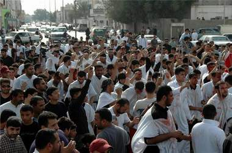

+++
title = "السلطات السعودية: ممنوع التظاهر لغزة"
date = 2009-01-01
authors = ["ناصر القحطاني"]

[taxonomies]
authors = ["nasr-elkhtani"]
sections = ["ana-s3ody"]

[extra]
section_name = "أنا سعودي"
share_image = "/media/currentarticleassets/mozahraqotif.jpg"
summary = "مع تصاعد العدوان الإسرائيلي الغاشم على غزة؛ منعت السلطات الأمنية السعودية قيام أي مظاهرات حتى وإن كانت سلمية، بل وحددت عدة قرارات بأن من يشارك في مظاهرات سيتعرض"
section_slug = "ana-s3ody"
section_colour = "#0E9C9A"
thumb = "/media/currentarticleassets/mozahraqotif.jpg"
n_comments = 4
original_url = "http://20at.com/20at/ana-saudi/10855.html"
archived = "20100105234238"
date_source = "byline/meta"
aliases_20at = ["/20at/ana-saudi/10855.html"]

[extra.provenance]
original_url = "http://20at.com/20at/ana-saudi/10855.html"
capture_url = "https://web.archive.org/web/20100105234238/http://20at.com/20at/ana-saudi/10855.html"
capture_label = "٥ يناير ٢٠١٠، ٢٣:٤٢ UTC"
date_note = "من سطر التوقيع في المقال"
other_urls = []
comments = "٤"
missing_images = ""
+++

<figure></figure>

مع تصاعد العدوان الإسرائيلي الغاشم على غزة؛ منعت السلطات الأمنية السعودية قيام أي مظاهرات حتى وإن كانت سلمية، بل وحددت عدة قرارات بأن من يشارك في مظاهرات سيتعرض للتوقيف والتحقيق..

ومع هذه القرارات تحول شباب السعودية للتعبير عن مشاعرهم بطرق أخرى فهناك من كتب القصائد التي تندد وتشجب العدوان أو ببث المقالات عبر المدونات على الإنترنت، وهناك من توجه للتبرع بالدم، أو رفض العدوان من خلال الرسومات.

<h3>غضب وألم</h3>

محمد القحطاني، 23 عاما، طالب بجامعة الإمام محمد بن سعود الإسلامية بالرياض يوضح لـ (عشرينات) أن الشارع السعودي بمختلف فئاته يشعر بالغضب للعدوان الغاشم ويود أن يعبر عن ذلك من خلال مظاهرات سلمية للتنفيس عما يشعر به وغيره من غضب وألم، لكن لا مظاهرات.

خالد المسعود، 30 عاما، من الرياض، تمنى أن تتحرك الجهات الرسمية في السعودية كي تنظم حملة وطنية يشارك بها الشباب للتبرع بالدم، كأقل ما يمكن أن يقدم لنجدة أهل غزة.

وتقول ندى العمري، 22 عاما: "نريد أن ننفس عن آلامنا، فأهل غزة هم أهلنا، نريد أن تتركونا نعبر عن غضبنا.. لماذا تريدون قمع صوتنا؟".

فيما أشارت عائشة القرني، طالبة جامعية بجدة، أنها اكتفت بكتابة خواطر عبر عدة منتديات تتحدث عن جرح غزة.

أما علوة عسيري، طالبة بجامعة الملك خالد، فباعت بعضا من حليها كي تشتري جهاز كمبيوتر، تستطيع من خلاله أن تسطر قصائد في غزة وتبثها بمواقع للشعر.

كذلك فعلت مها مبارك، فهي تهوى الشعر واستطاعت أن تبث عبر مدونة لها عدة قصائد عن غزة الجريحة.

فيما تحول سعيد الشهراني، وهو فنان تشكيلي يسكن الخميس، إلى التركيز على رسم لوحات تعبر عن المأساة.

<h3>قمع المظاهرات</h3>

كانت الأيام الماضية قد شهدت قمع السلطات السعودية عدة محاولات لتنظيم مظاهرات، كما حدث في القطيف (شرق السعودية)، وبرغم المنع والقمع خرجت في مدينة صفوى شرق السعودية مساء أمس الأربعاء مظاهرة تندد بما يحدث في غزة.

بينما قرر أكثر من 20 إصلاحيا رفع طلب إلى وزارة الداخلية السعودية للحصول على إذن لتنظيم اعتصام سلمي تضامنا مع أهالي غزة، وتضمنت قائمة الإصلاحيين دعاة وأكاديميين وكتاب صحافيين وناشطون حقوقيون، وجاء في الخطاب الذي رفع لوزير الداخلية السعودي الأمير نايف بن عبد العزيز "كافة شعوب العالم عن احتجاجهم عبر الوسائل السلمية ولاسيما البلدان العربية والإسلامية، وليس من الطبيعي أن يبقى مهد الإسلام والعروبة وبلاد الحرمين من دون تعبير عن احتجاج سلمي جماعي".

كذلك يرغب عدد من دعاة العدل والشورى وحقوق الإنسان التعبير عن مشاركتهم عبر اعتصام سلمي محدود في مدينة الرياض، في شارع النهضة من الساعة الواحدة حتى الساعة الثانية ظهر يوم الخميس الموافق الرابع من محرم، أول العام الميلادي الجديد.

<h3>"نمارس حقنا الطبيعي"</h3>

الإصلاحي السعودي خالد العمير، قال في بيان صحافي "اللحظة التي تنتظر الأمة منا أن نبادر ونعلن عن يوم الاعتصام وندعو الناس إليه بجميع أطيافهم بدون الأذن من أحد بقوة وشجاعة وعزم رجال، لأننا ببساطة نمارس حقنا الطبيعي في التعبير السلمي عن الرأي".

وأضاف: "وسواء أعطتنا وزارة الداخلية الإذن أو منعتنا فأنا ومجموعة من الإصلاحيين الأحرار سوف نكون هناك في الموعد المحدد استجابة لنداء الله سبحانه وتعالى حيث قال (وإن استنصروكم في الدين فعليكم النصرة)، فجرح غزة يستحق أن ننسى جراحاتنا وخلافاتنا أفرادا وجماعات وهذا يوم النصرة".

أما الكاتب والأكاديمي السعودي حسن فرحان المالكي، اكتفى بالإشارة "سنرابط ونعبر عن مشاعرنا مهما كلف الأمر".

وكان من ضمن الموقعين على الخطاب الناشط الحقوقي السعودي خالد المطيري، الذي صرح: "وقعت على الخطاب بإرادتي أريد مع غيري أن نعبر عن حجم الألم الذي نشعر به للقتل والدمار وجثث القتلى المسلمين لنا في غزة وهى صور يندى لها الجبين".

في المقابل وفى تصريح لـ (عشرينات) يؤكد المتحدث الأمني بوزارة الداخلية اللواء منصور التركي أن الجهات الأمنية لن تسمح بإقامة أي مظاهرات حسب ما أشيع مؤخراً عن عزم عدد من الأشخاص من القيام بالتجمعات، وأن من يحاول القيام بهذه التجمعات سوف يتم مسائلته قانونياً.

