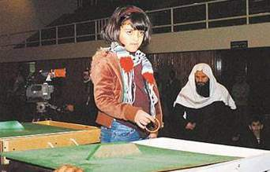

+++
title = "32 مليون دولار.. تبرعات سعودية لغزة"
date = 2009-01-04
authors = ["ا ف ب"]

[taxonomies]
authors = ["a-f-b"]
sections = ["ana-s3ody"]

[extra]
section_name = "أنا سعودي"
share_image = "/media/currentarticleassets/tab.jpg"
summary = "أفاد مصدر رسمي أن مبلغ 32 مليون دولار قد جمع خلال 11 ساعة في إطار برنامج للتلفزيون السعودي لجمع التبرعات للفلسطينيين ضحايا الهجوم الإسرائيلي الدامي في قطاع غزة."
section_slug = "ana-s3ody"
section_colour = "#0E9C9A"
thumb = "/media/currentarticleassets/tab.jpg"
n_comments = 0
original_url = "http://20at.com/20at/ana-saudi/10868.html"
archived = "20100105234132"
date_source = "byline/meta"
aliases_20at = ["/20at/ana-saudi/10868.html"]

[extra.provenance]
original_url = "http://20at.com/20at/ana-saudi/10868.html"
capture_url = "https://web.archive.org/web/20100105234132/http://20at.com/20at/ana-saudi/10868.html"
capture_label = "٥ يناير ٢٠١٠، ٢٣:٤١ UTC"
date_note = "من سطر التوقيع في المقال"
other_urls = []
comments = ""
missing_images = ""
+++

<figure></figure>

أفاد مصدر رسمي أن مبلغ 32 مليون دولار قد جمع خلال 11 ساعة في إطار برنامج للتلفزيون السعودي لجمع التبرعات للفلسطينيين ضحايا الهجوم الإسرائيلي الدامي في قطاع غزة.

وذكرت وكالة الأنباء السعودية الرسمية أن العاهل السعودي الملك عبد الله بن عبد العزيز الذي يقف وراء حملة التبرعات هذه, تبرع بمبلغ 30 مليون ريال سعودي (ثمانية ملايين دولار) وولي العهد السعودي الأمير سلطان بن عبد العزيز بمبلغ 10 ملايين ريال (2.6 مليون دولار) في الحملة التي استمرت 11 ساعة من البث المباشر ونتج عنها جمع 119.1 مليون ريال (31.7 مليون دولار).

وأوضحت الوكالة أن "حملة تلقي التبرعات العينية والنقدية من المواطنين والمقيمين تتواصل في جميع أنحاء المملكة".

وأضافت أن هذه الحملة تأتي "إنفاذا لتوجيهات خادم الحرمين الشريفين لدعم الأشقاء الفلسطينيين والوقوف معهم للتخفيف من معاناتهم في ظل الظروف الصعبة والأحداث المؤلمة جراء الاعتداءات الإسرائيلية الغاشمة على قطاع غزة".

ودخلت القوات الإسرائيلية السبت الى قطاع غزة في تصعيد للحملة التي بدأتها في 27 ديسمبر وأسفرت عن مقتل أكثر من 466 فلسطينيا بينهم 80 طفلا و42 امرأة، وجرح 2360 شخصا وفق آخر حصيلة من مصادر طبية فلسطينية.

