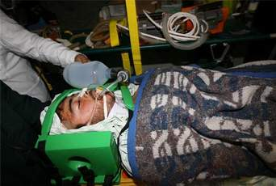

+++
title = "مع جرحى غزة في السعودية"
date = 2009-01-05
authors = ["ناصر القحطاني"]

[taxonomies]
authors = ["nasr-elkhtani"]
sections = ["ana-s3ody"]

[extra]
section_name = "أنا سعودي"
share_image = "/media/currentarticleassets/mari.jpg"
summary = "رهف عاطف الزاملي.. طفلة فلسطينية من غزة تبلغ من العمر ثمانية أعوام، تعرضت للإصابة أثناء خروجها من المدرسة وهي عبارة عن كسر في الجمجمة، نتيجة العدوان الإسرائيلي "
section_slug = "ana-s3ody"
section_colour = "#0E9C9A"
thumb = "/media/currentarticleassets/mari.jpg"
n_comments = 1
original_url = "http://20at.com/20at/ana-saudi/10883.html"
archived = "20100105234033"
date_source = "byline/meta"
aliases_20at = ["/20at/ana-saudi/10883.html"]

[extra.provenance]
original_url = "http://20at.com/20at/ana-saudi/10883.html"
capture_url = "https://web.archive.org/web/20100105234033/http://20at.com/20at/ana-saudi/10883.html"
capture_label = "٥ يناير ٢٠١٠، ٢٣:٤٠ UTC"
date_note = "من سطر التوقيع في المقال"
other_urls = []
comments = "١"
missing_images = ""
+++

<figure></figure>

رهف عاطف الزاملي.. طفلة فلسطينية من غزة تبلغ من العمر ثمانية أعوام، تعرضت للإصابة أثناء خروجها من المدرسة وهي عبارة عن كسر في الجمجمة، نتيجة العدوان الإسرائيلي على غزة..

اليوم وصلت رهف إلى السعودية ضمن دفعتين من جرحى غزة لتلقى العلاج، على متن طائرتين إغاثة سعودية قدمت من مطار العريش المصري ، تنفيذا لتوجيهات العاهل السعودي الملك عبد الله بن عبد العزيز.

الناطق الإعلامي لوزارة الصحة السعودية د. خالد مرغلاني، أوضح أن عدد الجرحى في أول دفعة عددهم 9 وسوف يتم توزيعهم على مستشفيات مدينة الرياض، التي تم تهيئتها لاستقبال الجرحى، وأفاد أن طائرة الإخلاء الطبي الثانية متواجدة الآن في مطار العريش بمصر تمهيدا لنقل الدفعة الثانية من المصابين الفلسطينيين إلى المملكة.

<h3>تخفيف الألم</h3>

جرحى الدفعة الأولى هم نهاد رباح أبو سيدو (23 عاما)، وفضل عيد أبو طير (27 عاما)، وحمزة عودة الخالدي ( 26 عاما)، ومحمود خليفة أبو سلطان (19 عاما)، ومحمود تيسير الزعانين (18 عاما)، ورهف عاطف الزاملي (8 أعوام)، ومعين علي طافش (24 عاما)، وعماد زهير الخالدي (20 عاما)، ومصطفى كمال بكير (21 عاما).

وفي لقاءات سريعة لـ (عشرينات) مع مرافقي بعض الحالات نظرا لصعوبة التحدث مع الجرحى أنفسهم لسوء حالتهم الصحية، قال سفيان الخالدي، من غزة، أنه مرافق لحالة قريب له وصل إلى الرياض، وأن قريبه أصيب بإصابة بالغة نتيجة العدوان الغاشم، ونقل شكره لحكومة المملكة العربية السعودية على هذه الوقفة الإنسانية.

أما تيسير الزعانين، وهو مرافق لشقيقه، قال أن ما يخفف من ألم الجرح في غزة هي مواساة الأشقاء في مثل هذه المساعدات الإنسانية، ونجدة أهلهم في غزة.

ومن بين المصابين كان يوجد من تعرض لشظايا صاروخ إسرائيلي أدى إلى إصابته بكسر في الذراع الأيمن والكتف، بينما أصيب أخر عندما كان يقوم بإسعاف المصابين في أحد مقار الأجهزة الأمنية في قطاع غزة جراء قصفه بصاروخ من طائرة أف 16 تم قصف المقر مرة أخرى وأصيب هو بهذا القصف ونتج عنه كسر في الرجل اليسرى وتمزق في الأمعاء إلى جانب قطع في وريد اليد اليمنى.

<h3>زيارة المصابين</h3>

على المستوى الشعبي أبدى الكثير من المواطنين السعوديين تعاطفا مع جرحى العدوان الغاشم على غزة، من بينهم ماجد سعد القحطاني، من الرياض، الذي أكد انه سيزور بعض المصابين متى سمحت الأجهزة الصحية بذلك حينما ستكون حالتهم أفضل.

أما الطفل خالد عائض، 11 سنة، فقد تأثر بما شاهده في قنوات الأخبار، فدفعه تضامنه مع أطفال غزة أن يطلب من والده أن يزور أحد المصابين في مدينة الملك فهد الطبية في الرياض، بينما أشار والده أنه سيلبي رغبة خالد فهو يستعد اليوم لشراء باقة من الورود لتقديمها إلى أحد المصابين.

فيما أكد على المنجومي، من الرياض، أنه تعاطف كثيرا لأن ما بث على الفضائيات الإخبارية من مشاهد الدمار والموت والقتل تجعل من كل من في قلبه رحمه يتعاطف معهم، ومن أجل ذلك فهو سيقوم بزيارة المصابين والجرحى بمستشفيات الرياض كأقل ما يمكن أن يقدمه.

من جانب آخر أوضح الأمير فيصل بن عبد الله بن عبد العزيز رئيس هيئة الهلال الأحمر السعودي أن الهلال الأحمر الفلسطيني تسلم عبر منفذ رفح الدفعة الثانية من المساعدات السعودية التي أمر بها خادم الحرمين الشريفين لتأمين المستلزمات الطبية والأدوية للأشقاء الفلسطينيين بحضور مندوب سفارة فلسطين والمنسق لدخول المواد الطبية والإغاثية إلى مصر محمد فايز عرفات.

