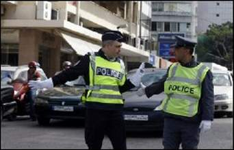

+++
title = "شرطة باريس تدرب سائقي بيروت!"
date = 2009-02-01
authors = ["ا ف ب"]

[taxonomies]
authors = ["a-f-b"]
sections = ["nashrat-9"]

[extra]
section_name = "نشرة 9"
share_image = "/media/currentarticleassets/pari.jpg"
summary = "في شوارع بيروت تم توزيع أعضاء من الشرطة الفرنسية خلال الأيام الأخيرة جاءوا من باريس يدربون زملاءهم اللبنانيين على طريقة ضبط السير والتعامل مع السائقين اللبنانيي"
section_slug = "nashrat-9"
section_colour = "#004B80"
thumb = "/media/currentarticleassets/pari.jpg"
n_comments = 0
original_url = "http://20at.com/20at/ana-saudi/11135.html"
archived = "20100105234308"
date_source = "byline/meta"
aliases_20at = ["/20at/ana-saudi/11135.html"]

[extra.provenance]
original_url = "http://20at.com/20at/ana-saudi/11135.html"
capture_url = "https://web.archive.org/web/20100105234308/http://20at.com/20at/ana-saudi/11135.html"
capture_label = "٥ يناير ٢٠١٠، ٢٣:٤٣ UTC"
date_note = "من سطر التوقيع في المقال"
other_urls = []
comments = ""
missing_images = ""
+++

<figure></figure>

في شوارع بيروت تم توزيع أعضاء من الشرطة الفرنسية خلال الأيام الأخيرة جاءوا من باريس يدربون زملاءهم اللبنانيين على طريقة ضبط السير والتعامل مع السائقين اللبنانيين المعروفين بعدم احترامهم لقوانين السير وبالقيادة المتهورة.

وعند تقاطع طرق قرب المتحف الوطني في وسط بيروت وقف "ادومينيك سزيمتشاك" الضابط في شرطة الدائرة الثامنة في باريس يوجه السائقين بيده.

وقال مبتسما "عناصر الشرطة في بيروت لديهم اشارات خاصة بهم: يؤشرون للسائقين وهم يقولون بصوت عال يلا يلا".

ويطلب من الشرطي اللبناني الوقوف في وسط التقاطع ويقول "يجب القيام بالإشارات المناسبة الموحدة" متفائلا بان "الأمور ستتحسن".

<h3>500 قتيل سنويا</h3>

وسزيمتشاك احد ستة ضباط يقومون بمهمة لمدة أسبوعين في بيروت في إطار مشروع تعاون بين وزارتي الداخلية الفرنسية واللبنانية لتحسين حركة السير في العاصمة اللبنانية.

ويبلغ عدد سكان لبنان أربعة ملايين تقريبا إلا أن عدد حوادث السير فيه نسبيا مرتفع جدا. ويقتل سنويا نحو 500 شخص في حوادث السير ويصاب أكثر من ستة آلاف بجروح بحسب الشرطة.

وقد أعلن وزير الداخلية الشاب زياد بارود الذي كان ناشطا سابقا في المجتمع الأهلي بعد تسلمه مهامه قبل أشهر حربا على مخالفي قوانين السير مطالبا بالتشدد في ملاحقة الذين لا يضعون أحزمة الأمان والذين يتجاوزون الضوء الأحمر أو يتحدثون عبر الهاتف المحمول أثناء القيادة.

وتسببت هذه الحملة بتحرير عدد أكبر من مخالفات السير ما أثار امتعاض شريحة واسعة من اللبنانيين.

وقال الرائد حنا اللحام احد المسئولين عن تنظيم السير في بيروت أن "اللبناني لا يحب أن يتلقى تعليمات أو توجيهات من احد".

أما الميجور "لوران بيرالدي" فيدهشه "حسن تدبير اللبنانيين" الذين يجدون دائما طريقة للهرب من زحمة السير إلا انه يقول أن "إيقاف السيارات على ثلاثة صفوف في شارع واحد والتوقف وسط الطريق خلال القيادة والانتقال من صف إلى آخر أمور كارثية".

ويقول بيرالدي "نشعر بان اللبنانيين لديهم حاجة حيوية إلى الأبواق يقومون بذلك طيلة الوقت لكن ليس في الأمر سوء نية".

ويضيف أن الشرطيين اللبنانيين "أكثر استرخاء واقل شعورا بالضغط من الشرطيين الباريسيين".إلا أن احد العناصر اللبنانيين يؤكد انه "من الآن فصاعدا سنكون أكثر تشددا"، ويطلب من سائق لبناني التراجع بعدما واصل سيره رغم إشارة التوقف ويعلق باسما "عليكم أن تتعلموا الالتزام بذلك".

ويقبل السائق على مضض. ويعلق سائق آخر "هنا يقود الناس كالمجانين وكل يفعل ما يريد. إن شاء الله مع الوقت سيصبح اللبنانيون أكثر نظاما".

غير أن سائقا آخر يرى "تحديا حقيقيا وبطولة" في تجاوز القانون.

