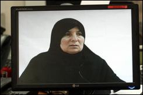

+++
title = "اعتقال (أم المؤمنين)العراقية"
date = 2009-02-04
authors = ["ا ف ب"]

[taxonomies]
authors = ["a-f-b"]
sections = ["nashrat-9"]

[extra]
section_name = "نشرة 9"
share_image = "/media/currentarticleassets/samira.jpg"
summary = "أعلن مسؤول أمني عراقي اعتقال امرأة لقبها \"أم المؤمنين\" تولت إعداد ما لا يقل عن ثمانين انتحارية نفذت 28 منهن عمليات أدت إلى سقوط المئات بين قتلى وجرحى."
section_slug = "nashrat-9"
section_colour = "#004B80"
thumb = "/media/currentarticleassets/samira.jpg"
n_comments = 0
original_url = "http://20at.com/20at/ana-saudi/11181.html"
archived = "20100105234021"
date_source = "byline/meta"
aliases_20at = ["/20at/ana-saudi/11181.html"]

[extra.provenance]
original_url = "http://20at.com/20at/ana-saudi/11181.html"
capture_url = "https://web.archive.org/web/20100105234021/http://20at.com/20at/ana-saudi/11181.html"
capture_label = "٥ يناير ٢٠١٠، ٢٣:٤٠ UTC"
date_note = "من سطر التوقيع في المقال"
other_urls = []
comments = ""
missing_images = ""
+++

<figure></figure>

أعلن مسؤول أمني عراقي اعتقال امرأة لقبها "أم المؤمنين" تولت إعداد ما لا يقل عن ثمانين انتحارية نفذت 28 منهن عمليات أدت إلى سقوط المئات بين قتلى وجرحى.

وقال اللواء قاسم عطا المتحدث باسم عمليات بغداد في مؤتمر صحفي أمس الثلاثاء "اعتقلنا المدعوة سميرة احمد جاسم الملقبة +أم المؤمنين+ ومهمتها إعداد الانتحاريات" مشيرا إلى"اعتقالها في 21 يناير الماضي في وكر إرهابي" لم يحدد موقعه.

وأكد "اعترافها بالمسؤولية عن 28 عملية انتحارية وإعداد ثمانين إرهابية".

<h3>ربة منزل عادية</h3>

وعرض خلال المؤتمر الصحفي شريطا قصيرا تحدثت خلاله سميرة (51 عاما) التي ترتدي حجابا اسود وبدت كأنها ربة منزل عادية تماما.

وقالت "تعرفت إلى شاكر حمود مالك من قرية حنبس (شمال شرق المقدادية في محافظة ديالى) وعرض علي العمل مع أنصار السنة وطلب مني مرافقته إلى بغداد لشراء معدات للتفجير عن بعد".

وأضافت "أول سيدة جندتها كانت أم هدى طلبوا مني نقلها إلى البساتين وكلمة السر هي +أم المؤمنين+ ثم عدت لاستلامها كنت أتحدث إليها دون أن تنطق وبدت كأنها تقرأ آيات ثم تركتها تفجر نفسها في مركز شرطة المقدادية 105 كم شمال شرق بغداد)".

وتابعت "أما الثانية فكانت سعدية خلف وهي عانس طاعنة في السن تحدثت إليها حتى أقنعتها (...) ثم تسلمها مني شاكر وأخذوها إلى البساتين ثم طلبوا مني نقلها إلى مرآب للنقل في المقدادية حيث فجرت نفسها".

أما الثالثة-بحسب سميرة- فكانت آمال وهي معلمة تعاني من مشاكل اجتماعية مع عائلتها وحالتها النفسية تعبة "ترددت إليها وأخذتها إلى البساتين (...) وقامت بتفجير نفسها عند مقر للجان الشعبية" في إشارة إلى قوات الصحوة.

وكانت قوات خاصة تابعة لوزارة الدفاع قبضت على ابتسام عدوان المشرفة على إعداد الانتحاريات بينما كانت في قرية حمادي شرق بعقوبة.

وقال مسؤولون أمنيون في حينها "عدوان ورطت الانتحارية رانيا" في إشارة إلى رانيا إبراهيم (15 عاما) التي قالت أن زوجها وامراة أخرى ارغموها على ارتداء حزام ناسف يزن عشرين كليوغراما لتفجير نفسها في حشد من الشرطة وسط بعقوبة الصيف الماضي.

لكن عناصر الشرطة اعتقلوها فور الاشتباه بها في 25 أغسطس الماضي.

<h3>أصغر انتحارية</h3>

وكانت رانيا اصغر انتحارية في العراق تعتقل مع حزامها الناسف.

ونفذت أكثر من ثلاثين عملية انتحارية من قبل نساء غالبيتها في ديالى أكثر مناطق البلاد توترا بسبب تركيبتها الديموغرافية المتشابكة ويعتبرها البعض عراقا مصغرا نظرا لتعدد القوميات والطوائف من عرب وأكراد وتركمان وشيعة وسنة ومسيحيين.

وفي كركوك (255 كم شمال بغداد) أعلن اللواء تورهان يوسف عبد الرحمن نائب مدير شرطة المحافظة "القبض على الإرهابي مثنى جاسم وفي سيارته حزام ناسف عصر اليوم أثناء ملاحقة جماعة إرهابية قادمة من خارج كركوك".

وأضاف "أوقف سيارته في وسط المدينة قرب سوق القلعة القريب من قيادة شرطة المحافظة وكان يحاول ارتداء الحزام عندما حاصرته قوة واعتقلته".

وقال أن "الإرهابي يسكن جنوب غرب كركوك" وتوقع أن يكون "مرتبطا بدولة العراق الإسلامية".

