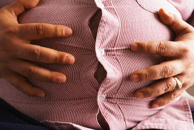

+++
title = "دّلك الكرش.. يكش"
date = 2009-02-12

[taxonomies]
authors = []
sections = ["nashrat-9"]

[extra]
section_name = "نشرة 9"
share_image = "/media/currentarticleassets/images/42-18026907potbelly.jpg"
summary = "تعاني الكثيرات من النساء من بروز منطقة البطن التي تؤثر بصورة سلبية على مظهر المرأة ورشاقتها، ويرى الخبراء انه يمكن استخدام العلاج بالتدليك للتخلص من هذا البروز "
section_slug = "nashrat-9"
section_colour = "#004B80"
thumb = "/media/currentarticleassets/images/42-18026907potbelly.jpg"
n_comments = 0
original_url = "http://20at.com/20at/ana-saudi/11276.html"
archived = "20100105233958"
date_source = "byline/meta"
aliases_20at = ["/20at/ana-saudi/11276.html"]

[extra.provenance]
original_url = "http://20at.com/20at/ana-saudi/11276.html"
capture_url = "https://web.archive.org/web/20100105233958/http://20at.com/20at/ana-saudi/11276.html"
capture_label = "٥ يناير ٢٠١٠، ٢٣:٣٩ UTC"
date_note = "من سطر التوقيع في المقال"
other_urls = []
comments = ""
missing_images = ""
+++

<figure></figure>

تعاني الكثيرات من النساء من بروز منطقة البطن التي تؤثر بصورة سلبية على مظهر المرأة ورشاقتها، ويرى الخبراء انه يمكن استخدام العلاج بالتدليك للتخلص من هذا البروز والتمتع بقوام ممشوق.

ويوضح الباحثون الامريكيون ان التدليك يساعد في تخفيف الارهاق والضغط وهو ما يؤدي بدوره الى ازالة الانتفاخ مشيرين الى ان آلام البطن والغازات ترتبط بالقلق والتوتر الذي يسبب بدوه اضطرابات هضمية .

وان تدليك منطقة البطن واماكن تجمع الزوائد يتم عبر حركات دائرية كبيرة وهادئة باتجاه عقارب الساعة .

كما ان التنفس بشكل صحيح والتحكم بالانفعالات التي قد تواجهها المرأة في حياتها اليومية يساعدها على التخلص من الزوائد المتناثرة في منطقة البطن بسهولة .

نقلا عن موقع البوابة

