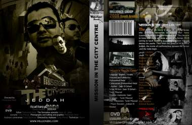

+++
title = "6 في مهمة بوسط المدينة"
date = 2009-02-22
authors = ["محمد جمال الدين"]

[taxonomies]
authors = ["mohamed-gamaleldin"]
sections = ["ana-s3ody"]

[extra]
section_name = "أنا سعودي"
share_image = "/media/currentarticleassets/n653729634_1437951_9760.jpg"
summary = "في أول تجربة لإنتاج أفلام الحركة (الأكشن) السعودية، عرض مساء الجمعة ضمن مهرجان الأفلام القصيرة بساقية عبد المنعم الصاوي الثقافية بالقاهرة فيلم \"مهمة في وسط المد"
section_slug = "ana-s3ody"
section_colour = "#0E9C9A"
thumb = "/media/currentarticleassets/n653729634_1437951_9760.jpg"
n_comments = 0
original_url = "http://20at.com/20at/ana-saudi/11373.html"
archived = "20100105234637"
date_source = "byline/meta"
aliases_20at = ["/20at/ana-saudi/11373.html"]

[extra.provenance]
original_url = "http://20at.com/20at/ana-saudi/11373.html"
capture_url = "https://web.archive.org/web/20100105234637/http://20at.com/20at/ana-saudi/11373.html"
capture_label = "٥ يناير ٢٠١٠، ٢٣:٤٦ UTC"
date_note = "من سطر التوقيع في المقال"
other_urls = []
comments = ""
missing_images = ""
+++

<figure></figure>

في أول تجربة لإنتاج أفلام الحركة (الأكشن) السعودية، عرض مساء الجمعة ضمن مهرجان الأفلام القصيرة بساقية عبد المنعم الصاوي الثقافية بالقاهرة فيلم "مهمة في وسط المدينة"، والذي قام بحصد جائزتين أفضل تصوير بعد مشاركته بمهرجان جدة الثالث للأفلام، ومهرجان الشرق الأوسط السينمائي.

الفيلم من بطولة عدد من الشباب السعودي، ومن إخراج وتصوير ومونتير محمد غازي هلال، وجميعهم لم يدرسوا الإخراج ولا التصوير، فكل ما يتسلحون به هي الموهبة فقط .

<h3>المنقذون الستة</h3>

تدور أحداث الفيلم الذي يمتد عرضه لـ 43 دقيقة في جدة، حيث تنوي عصابة من ضمن عصابات المافيا، القيام بأعمال من شأنها تخريب عقول الشباب السعودي، عن طريق شرائح تصدر موجات كهرومغناطيسية، تزرع في أماكن متعددة من المملكة وتستهدف أجزاء بعينها من المخ، بحيث تستطيع قوى غربية التحكم بالعقول المستهدفة، وذلك بعد تفعيل نشاط الشرائح.

ويتصدى لتلك المهمة التخريبية 6 شباب ترعرعوا جنباً إلى جنب منذ الصغر، وهم مشاري هلال في دور الميكانيكي، مازن باوازير في دور مهندس شبكات، إيهاب الأنصار في دور رجل أعمال، أحمد الطاسان في دور الفتوة ذو العضلات، جاسر الجهني في دور مصور فوتوغرافي، وعدنان الشودري في دور مهندس معماري، كما ضم الفيلم فتاتين هما آن سمان، وروز عطا الله، وقمن بالظهور في دور أخوات لمشارى ومازن.

<h3>أعمال سابقة</h3>

كانت المجموعة قد بدأت بعرض أعمالهم على شبكة الانترنت، وأنتجت أكثر من عمل قصير، كانت بمثابة الانطلاقة لهم، فقد كان هناك إعلان دعائي لفيلم " المليونير" وهو من نوعية أفلام الحركة، وفيلمي "بين الظلمات" و"الصديق المخلص".

وينتظر هؤلاء الشباب الدعم لإنتاج أعمال أكبر وأضخم، واستثمار مواهبهم في أعمال تليق باسم الشباب السعودي، ويتمنون حصد الجوائز في مهرجان الساقية بصفة خاصة، وذلك كونه مقام علي أرض الفن مصر.

وما يشجعهم هو استقبال الجمهور المصري للفيلم حيث لاقى اهتماما كبير من جانبهم، حيث وجد ردود أفعال ايجابية حوله سواء من ناحية التصوير أو الأداء والمؤثرات الصوتية، وأيضاً كونه انطلاقة جديدة للسينما السعودية على طريق التطور.

فتقول نيفين هاشم: "الفيلم ممتاز، وخاصة من جانب التصوير، ومع الأخذ في الحسبان أنهم مبتدئون وغير دارسون لذلك المجال، فإنه أكثر من رائع"

ويؤيدها كريم المهندس، قائلا: "الفيلم كان جميلا، ولكن هناك بعض المؤثرات الصوتية أعتقد كمشاهد أنها في غير موضعها الصحيح، وذلك أمر وارد في عمل أول لمجموعة من الشباب الطموح، وأعتقد أنها ستكون نقطة تحول لصناعة السينما في السعودية وسوف يتجه إلى ذلك النوع من الأفلام الكثير من الشباب السعودي".

أما صافيناز جاد، فتوضح: "من وجهة نظري الفيلم كان رائعا في التصوير، ولكن يعيبه الأكشن البطيء، أو التسلسل البطيء جداً في الأحداث، مما يجعلك تخرج من حالة الأكشن إلى حالة الركود، ولكنه ممتاز أولا وأخيراً، وأدعو لهم بالتوفيق ومزيد من التركيز".

