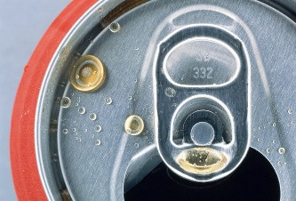

+++
title = "فينسيا.. برعاية كوكا كولا"
date = 2009-02-24

[taxonomies]
authors = []
sections = ["nashrat-9"]

[extra]
section_name = "نشرة 9"
share_image = "/media/currentarticleassets/images/coca2.jpg"
summary = "ثار اتفاق الرعاية بين مدينة فينيسيا الايطالية وشركة كوكاكولا للمياه الغازية عاصفة من الجدل في إيطاليا."
section_slug = "nashrat-9"
section_colour = "#004B80"
thumb = "/media/currentarticleassets/images/coca2.jpg"
n_comments = 0
original_url = "http://20at.com/20at/ana-saudi/11390.html"
archived = "20100105234624"
date_source = "byline/meta"
aliases_20at = ["/20at/ana-saudi/11390.html"]

[extra.provenance]
original_url = "http://20at.com/20at/ana-saudi/11390.html"
capture_url = "https://web.archive.org/web/20100105234624/http://20at.com/20at/ana-saudi/11390.html"
capture_label = "٥ يناير ٢٠١٠، ٢٣:٤٦ UTC"
date_note = "من سطر التوقيع في المقال"
other_urls = []
comments = ""
missing_images = ""
+++

<figure></figure>

ثار اتفاق الرعاية بين مدينة فينيسيا الايطالية وشركة كوكاكولا للمياه الغازية عاصفة من الجدل في إيطاليا.

ويقول ماسيمو كاسياري عمدة فينيسيا إن الاتفاق الذي تبلغ قيمته 2.7 مليون دولار يسمح بنشر آلات بيع المشروب في أنحاء المدينة مقابل الحصول على المال الذي سيستخدم في الحفاظ على التراث الفني للمدينة.

يذكر ان فينيسيا تفرض قواعد صارمة على بيع المواد الغذائية والمشروبات الغازية للسياح الذين بلغ عددهم في العام الماضي 20 مليون سائح.

وذكرت الصحف الايطالية ان فينيسا لن تغرق فقط في طوفان السياح أو مياه البحر الادرياتيكي وانما في المياه الغازية أيضا.

وبمقتضى الاتفاق بين مجلس بلدية المدينة وشركة كوكاكولا ستقوم الشركة بنشر 60 ماكينة تابعة لها في أنحاء المدينة لبيع المشروب الخاص بها.

وكان عمدة المدينة قد شكا علنا من ضعف مخصصات الدولة لمدينته والحاجة للمال للحفاظ على تراث فينيسيا من كنائس وغيرها.

ودافع كاسياري عن قراره قبول المال من شركة أمريكية قائلا إن الرعاية التجارية هي الاستراتيجية المالية الوحيدة لحماية تراث فينيسيا الحضاري.

وكانت حكومة سيلفيو برلسكوني قد قلصت ميزانية الثقافة والفنون إلى النصف هذا العام، فيما تستثمر الملايين في برنامج هندسي طموح للحيلولة دون غرق فينيسيا أمام المد الشتوي.

نقلا عن موقع الـ بي بي سي

