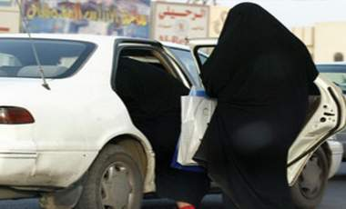

+++
title = "البحث عن كرامة (السعوديات)!"
date = 2009-03-01
authors = ["ناصر القحطاني"]

[taxonomies]
authors = ["nasr-elkhtani"]
sections = ["ana-s3ody"]

[extra]
section_name = "أنا سعودي"
share_image = "/media/currentarticleassets/saudi_woman_driver.jpg"
summary = "حملات عديدة في السعودية تتميز بطابع إنساني وحقوقي في آن واحد، تطلقها جمعيات شكلتها عدة نساء أكاديميات وإعلاميات ومثقفات، كلها تدعو إلى تحرير المرأة السعودية من "
section_slug = "ana-s3ody"
section_colour = "#0E9C9A"
thumb = "/media/currentarticleassets/saudi_woman_driver.jpg"
n_comments = 1
original_url = "http://20at.com/20at/ana-saudi/11445.html"
archived = "20100105234541"
date_source = "byline/meta"
aliases_20at = ["/20at/ana-saudi/11445.html"]

[extra.provenance]
original_url = "http://20at.com/20at/ana-saudi/11445.html"
capture_url = "https://web.archive.org/web/20100105234541/http://20at.com/20at/ana-saudi/11445.html"
capture_label = "٥ يناير ٢٠١٠، ٢٣:٤٥ UTC"
date_note = "من سطر التوقيع في المقال"
other_urls = []
comments = "١"
missing_images = ""
+++

<figure></figure>

حملات عديدة في السعودية تتميز بطابع إنساني وحقوقي في آن واحد، تطلقها جمعيات شكلتها عدة نساء أكاديميات وإعلاميات ومثقفات، كلها تدعو إلى تحرير المرأة السعودية من الكبت بحسب وصفهن بل وبمباركات ذكورية.

أخر تلك الحملات حملة تبنتها الإعلامية السعودية نوال اليوسف، رئيس تحرير صحيفة سعوديات نت، وشملت مضامين تلك الحملة ترك الفرصة للمرأة لتشارك في التنمية وأن تصل إلى مناصب عليا في الدولة وأن تشارك في مسيرات سلمية لتعبر عن مطالبها، وبرغم أن الفئات المستهدفة من تلك الحملة تشمل كافة فئات المجتمع إلا أنها تركزت على الدعوة للديمقراطية.

وأكدت اليوسف أن المرأة السعودية تحتاج الكثير من الدعم وتمنت من خلال حديثها لـ (عشرينات) أن يكون لوزير الإعلام الجديد عبد العزيز الخوجه نفس هِمة وجرأة وزير الإعلام السابق في تطوير الإعلام السعودي ومنح السعوديات الحق في العمل ومنحهن حقهن في التدريب.

ومضت تقول: "تعيين امرأة سعودية واحدة في منصب نائب وزير لا يكفي .. كما ليس المهم هو أن نعين نائبة للوزير في وزارة التربية والتعليم بل المهم هو أن نعين وزير ونائب له قادرين على إحداث حركة التغيير الفعلية في عقول الأشخاص الذين يديرون التعليم العام إلى الجامعي لأنه لا فائدة من تغيير المناهج من دون تغيير العقول الجامدة التي تدرس وتدير إدارات التعليم وتصادر حق المرأة في منح رأيها لأي وسيلة إعلامية".

كما طالبت بحق حرية التعبير لموظفات الوزارة من المعلمات في إبداء الرأي، وعدم إرغام التلميذات الصغيرات على ارتداء العباءة وغطاء الوجه منذ سن السادسة، وطالبت وزارة التربية والتعليم إلى تعيين أخصائيات اجتماعيات وأخصائيات نفسيات في كل مدارس المملكة من دون استثناء، إلى جانب تعيين الباحثات الاجتماعيات لدراسة أوضاع الطالبات المختلفة.

<h3>من يحمى الصغيرات ؟</h3>

من بين الحملات أيضا تبرز حملة سميت "جمعية الدفاع عن حقوق المرأة في السعودية - تحت التأسيس"، كان أخر أنشطتها إنتاج فيلم على موقع "يوتيوب" يسلط الضوء على قضية تزويج الصغيرات بالإكراه، ثم واصلت إصدار بيانات متلاحقة تدور حول تعرض المرأة السعودية للكثير من ظلم وقهر واستبداد.

عضو الجمعية سميرة البيطار، توضح أن أهم البيانات الصحفية التي أصدرتها الجمعية بيان المطالبة باحترام المرأة ومعاملتها بصورة لائقة، وأكدت أن البيان الذي صدر قبل أشهر بمناسبة اليوم العالمي للمرأة والذي سيصادف 18 من شهر مارس كل عام، طالب من كل المخلصين من جميع المسئولين في كل الشركات ومؤسسات المجتمع السعودي في كلا القطاعيين العام والخاص، أن ينتهزوا هذه الفرصة للاحتفاء بالنساء اللائي يبذلن أقصى جهودهن للمساهمة في بناء هذا الوطن العزيز، سواء كن يعملن داخل منازلهن أو خارجها.

وتمنى البيان من كل مؤسسة أو شركة أو مدرسة أو مركز أو معهد أن يختاروا نساء من كوادرهم أو نساء من المجتمع ممن تميزن هذا العام بجودة خدماتهن وتفانيهن في آدا أعمالهن لكي يتم تكريمهن، وفق ما تراه كل مؤسسة في مجال عملها.

<h3>جمعية للمطلقات</h3>

حملة ثالثة جذبت الأنظار إليها بعد أن نجحت المطالبات بتشكيل جمعية للدفاع عن حقوق المطلقات في السعودية في الحصول على ترخيص رسمي من وزارة الشئون الاجتماعية بعد أن نشطت عديد من النساء في هذا المجال تتقدمهم السيدة هيفاء الخالد، وأطلقت في هذا الجانب 37 توصية نسائية تطالب بتشكيل لجنة للدفاع عن المطلقة السعودية.

الكاتبة السعودية سحر خان، تقول: "ما بين شبح العنوسة وغول الطلاق تقف المرأة في المنتصف حائرة خائفة فهي لا تريد أن تكون عانسا تتلقى صنوف النقد من المجتمع ولا مطلقة يرافقها غول يثير مخاوف المجتمع منها فيصبح شغل الفتاة الشاغل هو الحصول على زوج بأي طريقة المهم أن تهرب من شبح العنوسة وتنتقل لبر الأمان، وقد تلجأ الفتاة للمشعوذين والنصابين والخاطبات المسترزقات وأيضا قد تفكر في طريقة الزواج الإلكتروني الفاشلة والوهمية، فكان لابد من التفكير في إنشاء مثل تلك الجمعيات التي تعيد لهن كرامتهن".

