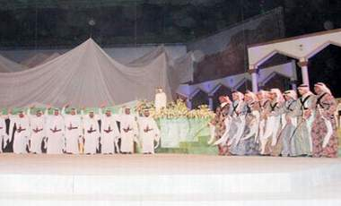

+++
title = "في (وطن الشموس).. لا للاختلاط"
date = 2009-03-03
authors = ["ناصر القحطاني"]

[taxonomies]
authors = ["nasr-elkhtani"]
sections = ["ana-s3ody"]

[extra]
section_name = "أنا سعودي"
share_image = "/media/currentarticleassets/operit.jpg"
summary = "(وطن الشموس) .. أوبريت فني وطني يتكرر كل عام في السعودية، ارتبط بحدث ثقافي هو مهرجان الجنادرية الثقافي، وبرغم أن احتفالية الأوبريت تثير كل عام المزيد من الجدل خ"
section_slug = "ana-s3ody"
section_colour = "#0E9C9A"
thumb = "/media/currentarticleassets/operit.jpg"
n_comments = 0
original_url = "http://20at.com/20at/ana-saudi/11470.html"
archived = "20100105234703"
date_source = "byline/meta"
aliases_20at = ["/20at/ana-saudi/11470.html"]

[extra.provenance]
original_url = "http://20at.com/20at/ana-saudi/11470.html"
capture_url = "https://web.archive.org/web/20100105234703/http://20at.com/20at/ana-saudi/11470.html"
capture_label = "٥ يناير ٢٠١٠، ٢٣:٤٧ UTC"
date_note = "من سطر التوقيع في المقال"
other_urls = []
comments = ""
missing_images = ""
+++

<figure></figure>

(وطن الشموس) .. أوبريت فني وطني يتكرر كل عام في السعودية، ارتبط بحدث ثقافي هو مهرجان الجنادرية الثقافي، وبرغم أن احتفالية الأوبريت تثير كل عام المزيد من الجدل خاصة فيما يتعلق بالاختلاط، إلا أنه بات صورة رمزية للاحتفاء بالوطن بعد أن تم تغيير مسماه من (شمس وشعب وملك) إلى (وطن الشموس).

مهرجان العام الحالي تحدثنا بشأنه مع رئيس هيئة الأمر بالمعروف والنهي عن المنكر الشيخ عبد العزيز الحمين، فأوضح أن هناك اجتماعات تمت بين الهيئة واللجنة المنظمة لحفل الجنادرية وتم التشاور خلالها والاتفاق على الالتزام بأوامر الله واجتناب ما نهى الله عنه ومنع أي مواضع للشبهة، وتابع أن اللجنة العليا المنظمة للمهرجان تحرص على التعاون مع الهيئة ومنع الاختلاط إن وجد.

ومن المنتظر أن يشهد العاهل السعودي - غدا الأربعاء 4 مارس- الأوبريت الذي كتب كلماته الأمير بدر بن عبد المحسن وقام بتلحينه د. عبد الرب إدريس ويؤديه مجموعة من الفنانين السعوديين أبرزهم الفنان محمد عبده، عبد المجيد عبد الله، راشد الماجد، عباس إبراهيم، بالإضافة إلى الفنان راشد الشمراني والفنان حسن عسيري.

<h3>نقلة وطنية فنية</h3>

الشباب السعودي ممن قابلنا أكدوا أنهم ينتظرون بلهفة الحدث السنوي.. فيقول أحمد عثمان: "أنا انتظر الجنادرية كل عام وبالذات الأوبريت، ولكن الذي يزيد من وهج المناسبة هذا العام هو عودة الأمير الشاعر بدر بن عبد المحسن لكتابته بعد أن صاغ كلمات 3 أوبريتات قدمت خلال سنوات مضت، فالأوبريت نقلة وطنية فنية تشهده الجنادرية كل موسم وهو الذي يزيد من رصيد الإقبال عليه ومتابعته".

أما مشاعل الأحمد، 24 عاما، من الرياض، فتطالب أن تخصص صالات للنساء ليتمكن من مشاهدة الأوبريت في مقر الحفل وإن كان ذلك موجودا فهو على حيز ضيق ولم يعلن عن ذلك بشكل رسمي، وتساءلت لماذا لا تتاح الفرصة للفتاة السعودية في الحضور ومتابعة الحفل في صالات نسائية مغلقة منعا للاختلاط وألا يقتصر الأمر على بضع مدعوات.

وتؤكد ندى السعيد، 20 عاما، أنها تنتظر الاحتفالية كل موسم وهي تستعد لمتابعة الحدث عبر شاشة التلفزيون فهي قد دخلت في رهان مع زميلاتها حول إن كان الأوبريت سيكون ناجحا أم لا، مشيرة إلى أن بعض زميلاتها يرفضن الحدث نظرا للاختلاط بين الرجال والنساء.

ويرى سعيد الزهراني، شاب من الرياض، أن (وطن الشموس) عمل وطني ضخم وتستخدم فيه التقنيات العالية حسبما شاهده العام الماضي في قناة MBC وقناة الجنادرية التي تخصصت في تغطية الحدث، وتمنى أن يستعرض الانجازات التنموية التي تشهدها السعودية وقال أن وجود أبرز الفنانين السعوديين في الحفل يزيده إشراقا.

<h3>لا اختلاط</h3>

من جانبه يؤكد الممثل راشد الشمراني، الذي يشارك ضمن طاقم الأوبريت، أن الأوبريت ومن عنوانه يهدف إلى معرفة الحضور بانجازات المملكة وهو لمحة فنية كبيرة تسلط الضوء على انجازات حققتها الدولة السعودية على مر العصور السابقة.

أما الدكتور عبد الرحمن بن سبيت، وكيل الحرس الوطني رئيس اللجنة التنفيذية للمهرجان الوطني للتراث والثقافة، فيؤكد انه لا صحة أن هناك اختلاط في حفل افتتاح مهرجان الجنادرية وأن سياسة اللجنة العليا المنظمة للمهرجان والمشرفة على حفل الافتتاح ومن ضمنه أوبريت وطن الشموس تمنع الاختلاط بين الرجال والنساء في مواقع الحضور وأن اللجنة تحترم عادات وتقاليد المجتمع الإسلامي وهو الشيء الذي يعرف عن السعودية، وأكد أن هناك تواجد لهيئة الأمر بالمعروف والنهي عن المنكر طيلة فعاليات المهرجان.

