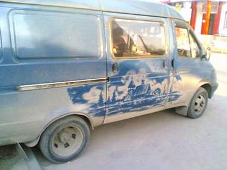

+++
title = "على السيارة .. الغبار يرسم أفضل!"
date = 2009-03-12
authors = ["ناصر القحطاني"]

[taxonomies]
authors = ["nasr-elkhtani"]
sections = ["ana-s3ody"]

[extra]
section_name = "أنا سعودي"
share_image = "/media/masr.20at.com/currentarticleassets/marwah/draw.jpg"
summary = "لكل موسم غبار فوائد.. ربما تنطبق هذه المقولة على بعض شباب السعودية الذين يستغلون موسم الغبار والعاصفة الرملية التي تتعرض لها مناطق المملكة في رسم أجمل اللوحات أ"
section_slug = "ana-s3ody"
section_colour = "#0E9C9A"
thumb = "/media/masr.20at.com/currentarticleassets/marwah/draw.jpg"
n_comments = 0
original_url = "http://20at.com/20at/ana-saudi/11558.html"
archived = "20100105234508"
date_source = "byline/meta"
aliases_20at = ["/20at/ana-saudi/11558.html"]

[extra.provenance]
original_url = "http://20at.com/20at/ana-saudi/11558.html"
capture_url = "https://web.archive.org/web/20100105234508/http://20at.com/20at/ana-saudi/11558.html"
capture_label = "٥ يناير ٢٠١٠، ٢٣:٤٥ UTC"
date_note = "من سطر التوقيع في المقال"
other_urls = []
comments = ""
missing_images = ""
+++

<figure></figure>

لكل موسم غبار فوائد.. ربما تنطبق هذه المقولة على بعض شباب السعودية الذين يستغلون موسم الغبار والعاصفة الرملية التي تتعرض لها مناطق المملكة في رسم أجمل اللوحات أو كتابة عبارات طريفة على سياراتهم وذلك بذرات التراب.. بل أن هناك بعض الشباب يتعمدون (تغبير) سيارتهم في غير موسم (الغبرة) على اعتبار أن تلك موضة جديدة ألفوها وقد تكون غريبة.

(عشرينات) عاشت تفاصيل مواهب الشباب بالرسم على السيارات بالرمال خلال الأيام الماضية.. عبد الله الهاجري، من المنطقة الشرقية، يوضح أنه استغل موسم الغبار في كتابه بعض العبارات على سيارته، لكن تلك الأبيات التي كتبها على زجاج سيارته لم تدم سوى لدقائق بعد أن مسحتها موجة أخرى من الأتربة.

<h3>لوحة وراء لوحة</h3>

أما كمران إقبال، فهو شاب باكستاني يقيم في الرياض، قال انتظرت حتى خفت حدة موجه الغبار وخرجت من منزلي حيث أسكن في حي العريجا واتجهت إلى سيارتي من نوع مايكروباص للخروج إلى متنزه بري بجوار العاصمة الرياض وقمت برسم لوحة على إحدى جانبي السيارة وظلت لليوم التالي قبل أن تأتي موجة أخرى من الأتربة فتمسحها، واكتشفت زوجتي أني فنان بارع.

مبارك ظافر، 20 عاما، من جدة، يقول أنه من عشاق الرسم والكتابة على زجاج السيارات، فاستغل الغبرى كي يكتب أبيات من قصائد مختارة ودخل في تحدى مع مجموعة من أصدقائه ليلتقي بهم في المساء فكانت العبارات التي كتبها أجمل ما كتبه ويتذكر عبارة (يا زين من عقبك حياتي شقية) وعبارة (خذني بقايا جروح)، ولكن عبارات مبارك لم تدم سوى يومين بعد أن قرر غسل سيارته ليستعد لموسما آخر ليقوم بوضع عبارات جديدة، ومضى يقول أنه أصر على أن تبقى عبارته على زجاج سيارته حتى تستطيع فتاة تسكن بجوار منزله أن تقرأها كنوع من الغزل ولكن غزل بذرات الغبار !.

ياسر الوادعي، من الرياض، يقول: "حينما هدأت العاصفة الرملية مساء الثلاثاء الماضي قررت أن أقوم برسم لوحة تعبر عن مقولة (الحب عذاب) فذهبت إلى متنزه الثمامة البري وأوقفت سيارتي تحت أحد أعمدة الإضاءة لرسم لوحة ولازالت على زجاج السيارة وإن بدأت تختفي معالمها شيئا فشيئا".

<h3>بودرة الأطفال</h3>

صالح الدوسري، اعتاد على (تغبير) سيارته ولكن بطريقة مختلفة، عنها يقول: "يلجأ البعض إلى وضع كميات من بودرة الأطفال (نونو) من ضمن مركبات التغبير، حيث يتم خلط بعض البودرة مع ملمع السيارات في علبة ثم ترج جيدا ويتم رشها على السيارة، وعادة ما يمارس الشباب هذه الهواية أو يتبعوا هذه الموضة في موسم الغبار".

محمد الأسمري، 26 عاما، عبرّ عن حبه لنادية الإتحاد بعبارات كتبها على سيارته، يقول: "هناك من أصدقائي من قام برسم عبارة أخرى بالرمال على زجاج سيارته وبطبيعة الحال اختفت مع هطول المطر الذي أتى بعد العاصفة".

<h3>مسابقات رسمية</h3>

الفنان التشكيلي السعودي سعيد سعييد الشهراني، من خميس مشيط، يعلق على عادة التغبير بقوله: "هي هواية جميلة ومتنفسا لطاقات الشباب، لكن تلك الإبداعات سرعان ما تزول لأنه لا يمكن تثبيتها، لذا أقترح على الرئاسة العامة لرعاية الشباب بأن تقيم مسابقة لأفضل رسم على زجاج السيارات بالرمال، وعلى أن تظل السيارات معروضة في صالات مغلقة لبعض أيام ويشارك في تحكيمها المتخصصين على غرار هواية (تحجير) السيارات".

خالد الشهري، موجه التربية الفنية بإدارة تعليم عسير جنوب السعودية، يوضح أن إدارته استغلت موسم الأجازة الصيفية الفائتة لإقامة برنامج الرسم بالرمال للأطفال الصغار ووجدت المسابقة إقبالا كبيرا لكنها لا تتعدى كونها مسابقة وقتية تمنى أن تنفذها وزارة التربية والتعليم على مستوى المناطق السعودية.

