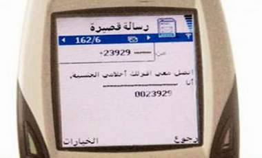

+++
title = "جديد الفضائيات: الجنس delivery"
date = 2009-03-18
authors = ["ناصر القحطاني"]
aliases = ["/articles/20at-ana-s3ody-11624/", "/articles/ana-s3ody-11624/"]

[taxonomies]
authors = ["nasr-elkhtani"]
sections = ["ana-s3ody"]

[extra]
section_name = "أنا سعودي"
share_image = "/media/masr.20at.com/currentarticleassets/marwah/massages.jpg"
summary = "(ارغب في ممارسة الجنس معك) نص رسالة من مئات الرسائل الإباحية تصل إلى شباب وفتيات ومواطنين ومقيمين في السعودية من جهات خارجية، تتعدد نصوص الرسائل وأحيانا تكون مر"
section_slug = "ana-s3ody"
section_colour = "#0E9C9A"
thumb = "/media/masr.20at.com/currentarticleassets/marwah/massages.jpg"
n_comments = 1
original_url = "http://www.20at.com:80/20at/ana-saudi/11624----delivery.html"
archived = "20100127081257"
date_source = "byline/meta"
aliases_20at = ["/ana-s3ody/11624.html", "/ana-s3ody/11624----delivery.html", "/20at/ana-s3ody/11624----delivery.html", "/20at/ana-saudi/11624----delivery.html", "/20at/ana-saudi/11624----delivery.html?layout=default&page=&print=1&tmpl=component"]

[extra.provenance]
original_url = "http://www.20at.com:80/20at/ana-saudi/11624----delivery.html"
capture_url = "https://web.archive.org/web/20100127081257/http://www.20at.com:80/20at/ana-saudi/11624----delivery.html"
capture_label = "٢٧ يناير ٢٠١٠، ٠٨:١٢ UTC"
date_note = "من سطر التوقيع في المقال"
other_urls = ["/ana-s3ody/11624.html", "/ana-s3ody/11624----delivery.html", "/20at/ana-s3ody/11624----delivery.html", "/20at/ana-saudi/11624----delivery.html?layout=default&page=&print=1&tmpl=component"]
comments = "١"
missing_images = ""
+++

<figure></figure>

(ارغب في ممارسة الجنس معك) نص رسالة من مئات الرسائل الإباحية تصل إلى شباب وفتيات ومواطنين ومقيمين في السعودية من جهات خارجية، تتعدد نصوص الرسائل وأحيانا تكون مرفقة بأفلام إباحية ومقاطع عبر رسائل الوسائط المتعددة ، وأحيانا تأتي من أرقام مجهولة المصدر.

على العمري واحد من اللذين وصلتهم رسائل على هذه الشاكلة يقول:"تلقيت أكثر من مرة رسائل تحمل نصوص من قبيل..

أرغب في ممارسة الجنس معك أنا في انتظارك.. يليها اسم المرسلة ثم الرقم في نفس الرسالة".

<h3>مشاكل زوجية</h3>

وتسببت هذه الرسائل في مشاكل زوجية بكثير من البيوت السعودية، وتسرد عبير (26 عاما) واحدة من هذه المشاكل قائلة:" كنت برفقة زوجي في نزهة فجاءت رسالة sms على جواله فتحتها لأجد رسالة إباحية من مصدر مجهول ، ويظهر الرقم انه من خارج المملكة وطبعا حدثت مشكلة كبيرة مع زوجي الذي أكد أن عشرات الرسائل تأتيه من خارج المملكة لفتيات يرغبن في أن يتم استقدامهن إلى السعودية للعمل مقابل ممارسة الجنس المجاني وأنه لا يهتم أبدا بها".

سيدة أخرى -رفضت ذكر اسمها- تعرضت لذات الموقف و تقول:" جاءت رسالة إباحية ففتحها زوجي وطبعا جعله ذلك يشك في أمري، وكادت المشكلة تصل إلي الطلاق لولا أنى حلفت له أنى لا اعرف مرسلها، وتوسط الأهل حتى تم الصلح، بعدها أجرى زوجي اتصالا بشركة الاتصالات وادخل الرقم في خدمة الحظر، وهي خدمة أتاحتها الاتصالات لمن يعانون من الأرقام المزعجة.

أما عن محتوى الرسالة فقالت أنها تتضمن دعوة صريحة لممارسة الجنس ومن ثم الدخول إلى جروب إباحي يدعوا إلى ارتكاب المعاصي.

<h3>قناة فضائية إباحية</h3>

وتلقى عامر الشهرانى عدة رسائل تدعوا إلى ممارسة الجنس ومصدرها قناة فضائية إباحية تقوم بالاتصال على أرقام عشوائية تدعوا إلى ممارسة الممنوع وتدعوا إلى الاتصال عبر الجوال أو الرسائل القصيرة بالقناة من أجل مشاهدة المزيد من المقاطع الإباحية.

( أنا فتاة تموت في الجنس أنا من لبنان ممكن نمارس الجنس معا أنا في انتظارك ) هكذا كان نص رسالة إباحية تلقاها الشاب بدر الحمود( 18 عاما) من الرياض، بدر كان ضعيفا أمام هذه الرسالة وبالفعل اتصل بالرقم الذي جاءه أسفل الرسالة.

وعن تجربته يقول:" اتصلت على أحدى تلك الأرقام ووجدت بالفعل فتاة ترد علي وحينما طلبت منها تنفيذ ما دعت إليه في رسالة الجوال لأكتشف حقيقة هذه الرسائل اختلقت الأعذار وطالبت أن اتصل على رقم قناة فضائية إباحية ليتحقق طلبي، وطبعا الهدف استغلال الشباب السعودي وإيقاعهم في تلك العلاقات المشبوهة بدافع الابتزاز فيما بعد".

<h3>كل أسبوع</h3>

وتؤكد تهاني (22 عاما) من جدة أنها تتلقى في الأسبوع مثل تلك الرسائل وأحيانا تشعر بالخجل لمحتواها وهى تصل إلى البنات وتحرجهن مع أهاليهن كما حدث لها أكثر من مرة مع أهلها بعد أن اكتشفوا تلك الرسائل وأن مصدرها دولي وخاصة مابين لبنان ومصر.

ويعرض لنا محمد البيشى نص إحدى تلك الرسائل:( حبيبي أنا بشوق لممارسة الجنس معك اتصل بهذا الهاتف) ورسالة أخرى تحمل النص التالي (أنا انتظرك يا حبيبي تبادل معي الحب على هذا الرقم).

وأضاف متسائلا :"لماذا تسمح شركة الاتصالات السعودية بتمرير الرسائل الدولية العشوائية إلى الأجهزة المحلية في المملكة ؟!!! هذه الرسائل لا يصعب مراقبتها ومع ذلك لا تقوم الشركة بحجبها على الرغم من أن الشركة لديها نظام Anty Spam للرسائل كلفها حوالي 150000 ريال -كما قراءنا في الصحف- لكنها لم تكلف نفسها بتشغيله !

انتقلنا إلي شركة الاتصالات السعودية للنقل إليها تساؤل محمد البيشى، وقال على العسيري واحد من موظفي الشركة:"لا يمكن التحكم في تلك الرسائل لكن يمكن للمشترك الاستفادة من خدمة حظر الأرقام التي تتيح حظر الأرقام والرسائل التي تصل للجوال عبر الشركات المشغلة لأجهزة الجوالات جوال وموبايلي أو زين".

<h3>قناة إسرائيلية</h3>

لم تكن تلك القناة الإباحية التي تحدث عنها الشباب فيما سبق إلا واحدة من ضمن قنوات إباحية تقف خلفها إسرائيل لغزو فكر الشباب العربي عامة، وتقوم بنشر أرقام جوالات لفتيات وشباب سعوديين حسبما أفاد به عدد من المشتركين بالجوال وحسب شباب آخرين أن الدخول إلى تلك القنوات يتم عن طريق بطاقات مشفرة تباع سريا في الأسواق !!

وفى هذا الإطار أعلنت إسرائيل أنها ستطلق خلال الفترة القادمة قناة إباحية جديدة تغطى المنطقة العربية ومنطقة الشرق الأوسط وذكرت مصادر صحافية إسرائيلية أن القناة ستعتمد على عرض أفلام ناطقة باللغة العربية وأنها اتفقت معه قناة بلاي بزى العالمية على إعادة بث أفلامها.

( افينوري ابراهام ) مدير القناة قال أنها ستعمل كوكيل لكبريات الشركات العالمية المتخصصة في المنتجات المرتبطة بالجنس كالمنشطات الجنسية ، لأن القناة ستفتح أسواقا جديدة لهذه الشركات.

ومؤخرا نشرت القناة إعلانا في الصحف الإسرائيلية تطلب فتيات للعمل كمذيعات واشترطت القناة في المذيعات القوام الممشوق والملابس المتحررة.

