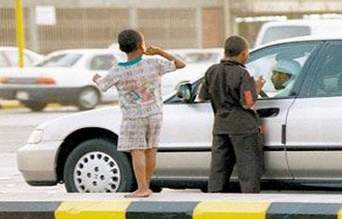

+++
title = "في حياتي.. متسول"
date = 2007-07-05
authors = ["أماني العبد الله"]

[taxonomies]
authors = ["amani-elabd-allah"]
sections = ["ana-s3ody"]

[extra]
section_name = "أنا سعودي"
share_image = "/media/admins.20at.com/aly/motasawel.jpg"
summary = "في أي وقت تخرج من منزلك حتما ستلقاهم يمدون أيديهم طلبا لكل شيء.. طعام ..مال.. حلوي وحتى الألعاب.. إنهم آلاف الأطفال المتسولين من كافة الجنسيات الذين أصبحوا يشكل"
section_slug = "ana-s3ody"
section_colour = "#0E9C9A"
thumb = "/media/admins.20at.com/aly/motasawel.jpg"
n_comments = 6
original_url = "http://20at.com/20at/ana-saudi/6350.html"
archived = "20100106001600"
date_source = "byline/meta"
aliases_20at = ["/20at/ana-saudi/6350.html"]

[extra.provenance]
original_url = "http://20at.com/20at/ana-saudi/6350.html"
capture_url = "https://web.archive.org/web/20100106001600/http://20at.com/20at/ana-saudi/6350.html"
capture_label = "٦ يناير ٢٠١٠، ٠٠:١٦ UTC"
date_note = "من سطر التوقيع في المقال"
other_urls = []
comments = "٦"
missing_images = ""
+++

<figure></figure>

في أي وقت تخرج من منزلك حتما ستلقاهم يمدون أيديهم طلبا لكل شيء.. طعام ..مال.. حلوي وحتى الألعاب.. إنهم آلاف الأطفال المتسولين من كافة الجنسيات الذين أصبحوا يشكلون ظاهرة سلبية في المجتمع السعودي على الرغم من وجود أكثر من 215 جمعية خيرية في السعودية تضم نحو 30 ألف عضو.

وأصبحت مظاهر التسول منتشرة في كافة مناحي الحياة بالمملكة فتجد المتسولين من الأطفال والعجزة عند إشارات المرور وأمام المحلات التجارية الصغيرة وفي الأسواق وعند بوابات المراكز التجارية الكبيرة (المولات) وأمام الدوائر الحكومية ينتظرون خروج الموظفين،كما يتواجد المتسولون بكثرة عند مطاعم الوجبات السريعة ويفترشون الأرض أمام المساجد بل يصل الأمر إلى طرق أبواب منازل المواطنين.

"عشرينات" تجولت في شوارع جدة والتقت بالعديد من هؤلاء الأطفال ومنهم سماح (طفلة من بلد عربي تبلغ من العمر 12 عاما) تخرج كما قالت لنا من الصباح الباكر لتتسول أو كما أفهمتها أمها لتطلب الرزق الحلال وقالت:" لا مال لدينا فأبي يسافر بالشهرين وأكثر وينفذ كل ما لدينا ،في هذا الوقت نخرج أنا وأخواتي إلي الشارع ".

وببراءة تحكي سماح قصتها مع التسول حيث تبدأ منذ الصباح الباكر رحلتها على المحال التجارية تطرق الأبواب مؤكدة لأصحاب هذه المتاجر أن الرزق الوفير سيعم عليهم إذا أعطوها المال أو الطعام.

وتعترف الطفلة بأنها تجمع الكثير من المال والطعام لتعود في منتصف النهار به لأسرتها قبل أن تخرج في دورة ثانية على الكورنيش وفي الملاهي و الحدائق العامة حيث يتواجد كثير من المواطنين "فزبائن النهار مختلفون عن زبائن الليل".

<h3>أريد أن ألعب</h3>

هدف أساسي يسيطر على الطفل "جابر" (14 عاماً)، فحينما يخرج إلي الشارع يتجه أولا إلي متاجر بيع الألعاب ويطلب من عملاء المحل أن يعطوه من الألعاب التي اشتروها لأبنائهم حتى استطاع تجميع ألعاب كثيرة له ولأخواته.

أما لماذا يركز على جمع الألعاب فقال " أجمع الألعاب و المال أيضا لأشترى حلوى لي ولأخواتي و أساعد أبي العاجز فانا أريد أن أعيش مثل غيري الذين يأكلون و يلعبون".

وجابر ليس الوحيد في العائلة الذي يمتهن التسول بل إن أخواته أيضا يسيرون علي الدرب ويتحدث الطفل عن مشاكل تواجهه يوميا أولها العبارات العنيفة من قبل المارة وأشدها مطاردات رجال الأمن.

<h3>نفر كثير يساعد أنا</h3>

الطفلة البنجالية "جميلة" وهي حقا جميلة لم تبلغ بعد العاشرة لكنها ماهرة في كسب تعاطف المواطنين بوجهها البريء، وبكلماتها الطفولية قالت لنا بعد أن حصلت على بعض المال :"هنا نفر كثير كويس يساعد أنا".

وبتعبيراتها البسيطة أوضحت بأنها تجمع الكثير من الأموال والتي لا تتمكن من معرفة كم قدرها ، بسبب أن والدتها تقوم بأخذها منها بشكل دوري حتى لا يضيع أو يسرق منها.

انتشار الأطفال المتسولين في كل مكان يزعج السعوديين ، فالشاب "صالح" يرى أن المواطنين هم السبب في هذه الظاهرة السلبية و أوضح لعشرينات قائلا:" لو لم يقدم أحداً من المارة المال لهؤلاء فإننا بالتأكيد لن نجد متسولين".

وطالب السعوديين بالكف عن التعاطف مع أطفال الشوارع،مشيراً إلى أن هناك الكثير من الجمعيات الخيرية التي تقدم مساعداتها للمحتاجين والفقراء ومن هم يستحقون هذه الأموال بشكل شرعي.

<h3>علمني الصيد</h3>

أما "عبد العزيز" فأنتقد كم الشباب الذين لديهم القدرة على العمل وكسب الرزق الحلال ولكنهم استسهلوا طلب المال من خلال مد اليد حقا أصبحنا نعيش في زمن لا نستطيع التفريق بين المحتاج من الفقراء وبين المتسول الذي يبحث عن المال فقط".

وذكر بالحديث الشريف "اليد العليا خير وأحب إلى الله من اليد السفلى" و كذلك بالحكمة القائلة: "بدلاً من أن تعطيني كل يوم سمكة، علمني كيف أصطاد".

<h3>تهريب</h3>

الدكتورة سهيلة زين العابدين حماد عضوة المجلس التنفيذي وعضوة لجنة الدراسات والاستشارات بالجمعية الوطنية لحقوق الإنسان في السعودية أوضحت بأن الجمعية بصدد تنفيذ عدد من الدراسات والإحصاءات حول ظاهرة الأطفال المشردين.

وبينت في حديثها لـ"عشرينات" بأن هناك عوامل كثيرة ساهمت في هذه الظاهرة حيث بينت بأن هناك الكثير من حالات تهريب الأطفال من الدول المجاورة لممارسة التسول لاسيما من دولة اليمن، مشيرةً إلى أن نسبة التسول من الجالية اليمنية قلت بشكل واضح بعد إبرام عدد من الاتفاقيات بين الدولتين.

الأخصائية الاجتماعية "أميرة حسين" بيت بأن "التسول ظاهرة انتشرت في أغلب المجتمعات العربية مؤخراً"، مشيرةً إلى أن "الجميع يمارس التسول كباراً وصغاراً أصحاء ومرضى معافين وأصحاب عاهات ولكل منهم طريقته الخاصة وأسلوبه المميز في التسول".

وأوضحت بأن لهذه الظاهرة مخاطرها المتفاقمة لاسيما على الأطفال، "فهذه الفئة معرضة لمخاطر صحية ونفسية واجتماعية منها الحقد على المجتمع والعصبية والحرمان من أبسط الحقوق مثل اللعب والشعور بالأمان ومن الناحية الجسدية قد يتعرضون إلى حادث سيارة أو لأمراض صدرية أو لتحرشات جنسية".

<h3>في القفص</h3>

ولمواجهة هذا الخطر تباشر عدد من الجهات في السعودية من أهمها إدارات الشرطة والجوازات القبض على المستولين، كما تم إنشاء أقسماً متخصصة لهذا الغرض مزود بالإمكانات والتجهيزات اللازمة.. حيث تتولى أجهزة الأمن الميدانية ضبط المتسولين والمتسولات وإحالتهم لهذا القسم الذي يباشر إجراءاتهم الأولية.. ثم يحيلهم لجهات الاختصاص، وبالنسبة إلى الوافدين تتم إحالتهم لإدارة متابعة الوافدين بالجوازات.. أما السعوديون فتتم إحالتهم لوزارة الشؤون الاجتماعية لدراسة حالتهم وبحثها ومدى حاجتهم لتقديم المساعدة.

وللحد من تنامي ظاهرة تسول الأطفال أعلن وكيل وزارة الشؤون الاجتماعية الدكتور عوض الردادي عن إنشاء ثلاثة دور إيوائية للأطفال في كل من مكة المكرمة والمدينة المنورة وجدة.

وبحسب تقديرات اقتصادية سعودية فيوجد في المملكة نحو 150 ألف متسول ، الغالبية العظمى منهم يوجدون في مكة المكرمة وجدة والمدينة المنورة، فيما تتوزع النسبة المتبقية في المدن السعودية الأخرى مثل الرياض والمنطقة الشرقية.

ويقدر مراقبون أن حجم الإنفاق على التسول في السعودية يقارب 700 مليون ريال سنوياً (186 مليون دولار)، حيث يكثر المحسنون في شهر رمضان والعيد وموسم الحج من إعطاء الصدقات و بالنسبةلك هل تضع الصدقة في المكان الصحيح؟.

