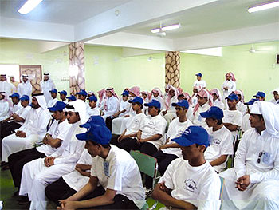

+++
title = "الميول الجامعية.. محل استغلال بالسعودية"
date = 2007-07-05

[taxonomies]
authors = []
sections = ["ana-s3ody"]

[extra]
section_name = "أنا سعودي"
share_image = "/media/admins.20at.com/aly/toulabl.368298.jpg"
summary = "تبث بعض المواقع الإلكترونية التابعة لأشخاص مجهولين رسائل قصيرة عبر الجوال مرفقة بأرقام جوالات لأشخاص غير معروفين خلال أيام الامتحانات ومع قرب إعلان النتائج، تدع"
section_slug = "ana-s3ody"
section_colour = "#0E9C9A"
thumb = "/media/admins.20at.com/aly/toulabl.368298.jpg"
n_comments = 0
original_url = "http://20at.com/20at/ana-saudi/6356.html"
archived = "20100106001331"
date_source = "byline/meta"
aliases_20at = ["/20at/ana-saudi/6356.html"]

[extra.provenance]
original_url = "http://20at.com/20at/ana-saudi/6356.html"
capture_url = "https://web.archive.org/web/20100106001331/http://20at.com/20at/ana-saudi/6356.html"
capture_label = "٦ يناير ٢٠١٠، ٠٠:١٣ UTC"
date_note = "من سطر التوقيع في المقال"
other_urls = []
comments = ""
missing_images = ""
+++

<figure></figure>

تبث بعض المواقع الإلكترونية التابعة لأشخاص مجهولين رسائل قصيرة عبر الجوال مرفقة بأرقام جوالات لأشخاص غير معروفين خلال أيام الامتحانات ومع قرب إعلان النتائج، تدعو طلاب الثانوية العامة للاشتراك في برامج بزعم مساعدتهم على تحديد ميولهم وتخصصاتهم الجامعية للاشتراك في برامج علمية مقابل مبلغ يتفاوت بين 300 و500 ريال سعودي.

وللحد من استغلال احتياج طلاب الثانوية في هذا الجانب، تقترح فايزة علي العمودي مشرفة اجتماعية "ضرورة إيجاد برامج متخصصة معتمدة من وزارة التربية والتعليم العالي لتحديد توجهات الطلاب والطالبات للتخصصات قبل أن ينتهي الطالب من المرحلة الثانوية".

وقالت لصحيفة "الاقتصادية "السعودية-:" تفعيل هذه البرامج يحد من استغلال الجهات غير المتخصصة والأشخاص المجهولين الذين يحرصون فقط على جمع الأموال مستغلين احتياج الطلاب إلى النصيحة"، وأكدت أن أغلب الطلاب لا يمتلكون القدرة الكافية لتحقيق التخصص المناسب دون وجود برامج تعمل على دعمهم تربويا ونفسيا.

وعن الهدف من هذه البرامج تضيف: إن أهمية هذا البرنامج تتمثل في الإسهام في النمو النفسي السليم للطلاب أثناء المرحلة الثانوية من أجل حياة مستقبلية أفضل تساعدهم على اختيار التخصص بعد التخرج وتسهم في تحقيق الحياة المهنية المستقبلية التي تتناسب مع إمكاناتهم، وذلك من خلال تسليط الضوء على العوامل التي تقيم عملية النمو النفسي للطلبة والتي تعد عاملا لسوء اختيار الطلبة للتخصص الدراسي الذي يحدد مهنة الإنسان مدى الحياة.

وشددت على ضرورة تضامن الجهود بين وزارتي التعليم العام والعالي لتفعيلها لأنهما ـ حسب قولها ـ الجهتان المعنيتان بإنشاء مثل هذه البرامج، وقالت: إن عدم تحديد الرغبة والميول للطالب منذ بداية الطريق الأكاديمي ينعكس سلبا على الحياة العملية والمهنية لمستقبل الطالب كما أنه يولد شعورا بعدم الإحساس بالمتعة في العمل أثناء حصوله عليه بعد التخرج لعدم توافق ميوله معه.

<h3>زيارات إلي المدارس</h3>

ودعت فايزة العمودي الوزارتين إلى تنظيم زيارات ميدانية بين المدارس وبين الجامعات منذ أن يبدأ الطالب في المرحلة الثانوية، وقالت: إذا تعذر تنظيم هذه الزيارات نظرا لارتفاع عدد الطلاب والطالبات لابد أن توضع حلول بديلة كإرسال عدد من الأكاديميين والأكاديميات من الأقسام الجامعية المختلفة إلى المدارس، بحيث تعمل المدرسة على تنظيم اجتماع بين الطلاب والأكاديميين ليتم شرح الأهداف الجامعية المختلفة بشقيها العلمي والأدبي.

وعن مدى تفاعل طلبة وطالبات الثانوية العامة مع هذه الرسائل، استطلعت الصحفية آراء بعض الطلاب والطالبات، يقول عبد الرحمن السلمي: من السهل أن أتفاعل مع هؤلاء الأشخاص الذين يرسلون هذه الرسائل خاصة أن رقم الجوال مرفق بتلك الرسائل، فأنا إلى الآن لم أحدد التخصص الذي أريد الالتحاق به".

<h3>وهم</h3>

وترى الطالبة سارة خالد أن هذه الرسائل توهم الكثير من الطالبات بأهميتها فالجهل الذي يقع فيه الكثير من زميلات الدراسة من عدم مقدرتهن على تحديد التخصص الذي يردنه يسمح لهؤلاء الأشخاص بعمل مشاريع استثمارية بسهولة.

لكن ماجد محمد يتوقع أن تأثير الرسائل لا يمتد إلى مدى تصديقها فهو ـ على حد قوله ـ يعلم بأنها مجرد خدع، معللا ذلك بأن الميول لا يحدد نتيجة أوراق أو استمارات تتم تعبئتها ولكنه متعلق بالدراسة الأكاديمية التي تستمر سنوات عديدة.

