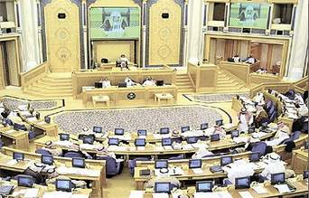

+++
title = "«هيئة الأمر بالمعروف» لن تضم نساء"
date = 2007-07-05

[taxonomies]
authors = []
sections = ["ana-s3ody"]

[extra]
section_name = "أنا سعودي"
share_image = "/media/admins.20at.com/aly/shoura.jpg"
summary = "حسم صوت رئيس مجلس الشورى الدكتور صالح بن حميد الموقف من توصية إضافية، تقدم بها أحد أعضاء المجلس خلال الجلسة السادسة والعشرين أمس الاثنين ، طالب فيها بالانتهاء م"
section_slug = "ana-s3ody"
section_colour = "#0E9C9A"
thumb = "/media/admins.20at.com/aly/shoura.jpg"
n_comments = 0
original_url = "http://20at.com/20at/ana-saudi/6357.html"
archived = "20100106001719"
date_source = "byline/meta"
aliases_20at = ["/20at/ana-saudi/6357.html"]

[extra.provenance]
original_url = "http://20at.com/20at/ana-saudi/6357.html"
capture_url = "https://web.archive.org/web/20100106001719/http://20at.com/20at/ana-saudi/6357.html"
capture_label = "٦ يناير ٢٠١٠، ٠٠:١٧ UTC"
date_note = "من سطر التوقيع في المقال"
other_urls = []
comments = ""
missing_images = ""
+++

<figure></figure>

حسم صوت رئيس مجلس الشورى الدكتور صالح بن حميد الموقف من توصية إضافية، تقدم بها أحد أعضاء المجلس خلال الجلسة السادسة والعشرين أمس الاثنين ، طالب فيها بالانتهاء من درس إمكانية توظيف نساء مؤهلات للعمل في هيئة الأمر بالمعروف والنهي عن المنكر.

وصوت بن حميد (الذي يعادل صوته صوتين) ضد التوصية بعدما تعادلت أصوات أعضاء المجلس المؤيدة والمعارضة في هذا الشأن، بواقع 59 صوتاً لكل طرف.

وأوضح عضو المجلس الدكتور طلال بكري خلال مناقشة وجهة نظر لجنة الشؤون الإسلامية والقضائية وحقوق الإنسان بشأن ملاحظات الأعضاء تجاه التقرير السنوي لهيئة الأمر بالمعروف والنهي عن المنكر، أن مبررات توصيته الداعية لإشراك النساء في عمل «الهيئة» تعود إلى أن الأمر بالمعروف والنهي عن المنكر ليس قاصراً على الرجال.

وأضاف–نقلاً عن صحيفة "الحياة"- أن من المبررات أيضاً وجود أماكن خاصة للنساء، ولإبعاد شبهة تدخل رجال الهيئة في الأمور النسائية، ولتفهم النساء لبعضهن بعضاً في أمور التحقيق، إلى جانب إيجاد فرص عمل جديدة للنساء.

كما رفض مجلس الشورى القبول بتوصية إضافية أخرى تدعو إلى توحيد زي رجال الهيئة.

