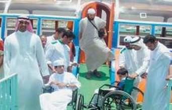

+++
title = "معاق في البحر الأحمر"
date = 2007-07-05
authors = ["علي الفقيه"]

[taxonomies]
authors = ["ali-elfakih"]
sections = ["ana-s3ody"]

[extra]
section_name = "أنا سعودي"
share_image = "/media/admins.20at.com/aly/ghous.jpg"
summary = "على عمق 25 مترا تحت الماء شارك أكثر من 15 معاقاً سعوديا في رحلة بحرية غوصاً في البحر الأحمر، تحدوا إعاقتهم وأبهرتهم الشعاب المرجانية والكائنات البحرية المختلفة "
section_slug = "ana-s3ody"
section_colour = "#0E9C9A"
thumb = "/media/admins.20at.com/aly/ghous.jpg"
n_comments = 2
original_url = "http://20at.com/20at/ana-saudi/6381.html"
archived = "20100106001538"
date_source = "byline/meta"
aliases_20at = ["/20at/ana-saudi/6381.html"]

[extra.provenance]
original_url = "http://20at.com/20at/ana-saudi/6381.html"
capture_url = "https://web.archive.org/web/20100106001538/http://20at.com/20at/ana-saudi/6381.html"
capture_label = "٦ يناير ٢٠١٠، ٠٠:١٥ UTC"
date_note = "من سطر التوقيع في المقال"
other_urls = []
comments = "٢"
missing_images = ""
+++

<figure></figure>

على عمق 25 مترا تحت الماء شارك أكثر من 15 معاقاً سعوديا في رحلة بحرية غوصاً في البحر الأحمر، تحدوا إعاقتهم وأبهرتهم الشعاب المرجانية والكائنات البحرية المختلفة .

وجاءت هذه الخطوة بعد مبادرة من مؤسسة خالد حسن ثابت للنزهة البحرية بالتنسيق مع مركز التأهيل الشامل بينبع (غرب السعودية).

"عشرينات" استطلعت الآراء حول هذه الخطوة التي مكنت المعاقين من شيء كانوا يحلمون به، الشاب المعاق "أحمد" قال لنا "الرحلة كانت جميلة، تفاجئنا فعلا عندما تلقينا خبر المشاركة لم أكن أتوقع أن أنزل يوما تحت الماء وأشاهد تلك المناظر البديعة التي ظلت حكراً على الغواصين".

"أبو أحمد" والد أحد المعاقين أكد أن الرحلة تركت أثراً كبيراً في نفسية ابنه، مطالباً بتفعيل مثل هذه البرامج لهذه الفئة الموجودة في المجتمع والتي تحرم من العديد من الأنشطة والبرامج الترفيهية والثقافية.

<h3>خوف ورهبة ومتعة</h3>

"عامر" أحد المعاقين أوضح بأنه شعر بالخوف والرهبة مع بداية دخول المجموعة إلى البحر وقال " كنا نشعر بالرعب خاصة أن كراسينا المتحركة وملابسنا ابتلت مع بداية دخولنا إلي البحر وتخيلت ماذا سأفعل لو انقلب المركب لولا حالة الاطمئنان التي أشاعها المرافقين والمنظمين و الذين بذلوا كل ما في وسعهم لضمان نجاح الرحلة".

وأوضح بأن جميع المعاقين غاصوا سوياً داخل مركب ضخم من طابقين محاط بالزجاج ساعدهم على رؤية ما في البحر من إبداع ومن مخلوقات استمتعوا بالنظر إليها لمدة ساعتين تقريباً.

ولم يكن "عامر" يحلم بأن ينزل للبحر أبدا لكن أخيرا تحقق أمله كما يقول،و بحسب الإحصائيات يوجد في السعودية نحو 720 ألف معاق ما يشكل 4% من السعوديين.

<h3>مفاجأة سارة</h3>

الشاب المعاق "حسن" قال أنه استعد مبكراً لهذه الرحلة التي وصفها بأنها كانت "مفاجأة" سارة بالنسبة له، وقد رافقه فيها أخوه الأكبر ليساعده على تحريك الكرسي.

وبين بأن ما شاهده من شعاب مرجانية وأسماك تحت الأعماق كان مختلفاً جداً عن ما يشاهده في التلفزيون والصور،مشيرا إلي أنه ظل يسبح الله كثيرا علي جمال خلقه.

في البداية أكد مدير المؤسسة بأن هذا البرنامج يأتي من خلال أحساس المؤسسة بمسؤوليتها تجاه المعاقين وأنها يجب أن تخدمهم.

وبين بأن هذه الرحلة أسعدت المشاركين كثيراً لاسيما أنهم حققوا شيئاً كانوا يتمنون تحقيقه بل يحلمون به لأن إعاقاتهم تمنعهم من مزاولة ذلك بل تعيقهم من مزاولة العديد من الأنشطة والبرامج مقابل نسيان أو تجاهل أغلب أفراد المجتمع لواجبهم نحو هذه الفئة.

<h3>"عيب علينا نحن الأصحاء"</h3>

وحول أراء الشباب الأصحاء في هذه الخطوة قال "بديع": لم أفكر من قبل في الغوص فأنا أجهل أساسياته بل أصلا لا أجيد السباحة ".

أما "علي" فأفصح عن رغبته أن يغوص قائلاً: "عيب علينا نحن الأصحاء لم نغوص ونحن نتمتع بالصحة والعافية وهؤلاء معاقين أكرمهم الله بأن شاهدوا جمال الأعماق"، مؤكداً عزمه على الالتحاق بأحد الأندية الرياضية لتعلم السباحة والغوص.

لكنه عاد وأكد أنه بذلك لا يحسد المعاقين على هذه الخطوة ولكنه يغبطهم، راجياً من الله أن يعافي كل مريض.

<h3>فعاليات صيفية للمعاقين</h3>

يشار إلى أن السعودية تشهد العديد من الفعاليات الصيفية الخاصة بالمعاقين من خلال التنسيق مع الجهات والمؤسسات المعنية بهم ومن أخر تلك الأنشطة مشاركة 400 معاقة من ذوات الإعاقات السمعية والبصرية في مركز صيفي، تنظمه إدارة التربية الخاصة، التابعة للإدارة العامة للتربية والتعليم (بنات) في المنطقة الشرقية.

وتتضمن فعاليات المركز الذي يُقام في مجمع الأمير محمد بن فهد في الدمام، أنشطة تعليمية وترفيهية، منها دورات في الحاسب الآلي وكيفية استخدامه، والتعرف على البرامج التي تناسب مستوى إعاقتهن التي تتراوح بين البسيطة والمتوسطة، لتهيئتهن للعام الدراسي الجديد، إضافة إلى عقد دورات في اللغة الإنجليزية.

