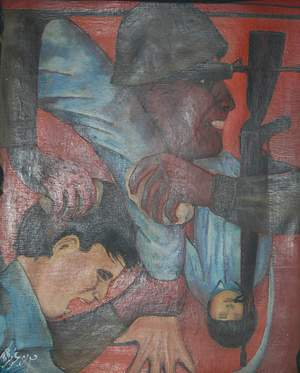

+++
title = "(إيقاعات وطن).. فلسطين بالريشة والألوان"
date = 2008-11-19
authors = ["رنا خموس"]

[taxonomies]
authors = ["rana-khmos"]
sections = ["fonoon"]

[extra]
section_name = "فنون"
share_image = "/media/masr.20at.com/currentarticleassets/marwah/atfal-7egara.jpg"
summary = "60 عاما مرت على نكبة الشعب الفلسطيني .. شهدت تاريخ ومواقف وأحداث وعقبات وزلات وانتفاضة .. مراحل بسنوات خطها الفنان الفلسطيني \"مرشد غريب\" بمعرضه الفني \"إيقاعات و"
section_slug = "fonoon"
section_colour = "#7B2CBF"
thumb = "/media/masr.20at.com/currentarticleassets/marwah/atfal-7egara.jpg"
n_comments = 0
original_url = "http://20at.com/20at/arts/10552.html"
archived = "20100106004247"
date_source = "byline/meta"
aliases_20at = ["/20at/arts/10552.html"]

[extra.provenance]
original_url = "http://20at.com/20at/arts/10552.html"
capture_url = "https://web.archive.org/web/20100106004247/http://20at.com/20at/arts/10552.html"
capture_label = "٦ يناير ٢٠١٠، ٠٠:٤٢ UTC"
date_note = "من سطر التوقيع في المقال"
other_urls = []
comments = ""
missing_images = ""
+++

<figure></figure>

60 عاما مرت على نكبة الشعب الفلسطيني .. شهدت تاريخ ومواقف وأحداث وعقبات وزلات وانتفاضة .. مراحل بسنوات خطها الفنان الفلسطيني "مرشد غريب" بمعرضه الفني "إيقاعات وطن"، الذي أقيم في جامعة النجاح الوطنية في نابلس، ليسجل تاريخا جديدا للشعب الفلسطيني والعربي بالريشة والألوان..

صاحب الإيقاعات فنان فلسطيني من مواليد قرية ميثلون في جنين عام 1948م، وعمل كمدرس تربية فنية في المدارس السعودية والمملكة الأردنية الهاشمية، وعاد إلى مسقط رأسه في عام 2005، ولا يقتصر فنه على الرسم بل يمتد للتصوير، النحت، التشكيل والبناء، الموسيقى..

<h3>توظيف الفن</h3>

يقول غريب لـ (عشرينات): "الهدف من المعرض هو تسجيل الأحداث التي عصفت وما زالت تعصف بالشعب الفلسطيني من مراحل الثورة وانطلاقتها وإعلان الاستقلال إلى عمليات التفاوض التي حدثت والانتكاسات التي ألمت بهذا الشعب، والتهجير والانتفاضة والمقاومة والشهداء وانسحاب غزة وما وصلنا إليه من انقسام داخلي أليم ومطالبة بالوحدة، كل هذا عبرت به عن طريق لوحاتي من خلال تسلسل منطقي للإحداث".

يضيف: "الرسالة التي أريد إيصالها هي إثارة الوعي وروح القومية لدى الشباب وإحياء ذلك التاريخ العتيد عند الشباب بالذات الذين لم يعاصروا تلك الأحداث، والتعبير عن أحلام وآمال وتطلعات الشعب، وتوظيف الفن باستثارة الهمم والنفوس لدى الشباب وليس إحباطها واستخدام الفن الغربي للحديث عن همومنا وقضيانا".

تضمن المعرض لوحات تناقش المراحل التاريخية مثل مرحلة الانطلاق والثورة وإعلان منظمة التحرير الفلسطينية، ومرحلة القومية العربية في فترة السبعينيات والثمانينات، وبداية الانتفاضة الأولى، وفي التسعينيات مرحلة التفاوض والسلام، وتجسيد إطلاق سراح الأسرى والانسحاب من غزة بالألفية، والانقسام والمطالبة بالوحدة حاليا.

<h3>لوحات تسجل الواقع</h3>

حظي المعرض بإقبال جمهور كبير من الطلبة والطالبات بالذات.. فيعبر الطالب أسامة مناصرة، من كلية الاقتصاد، عن إعجابه الكبير بالمعرض وطريقة مزج الألوان وشدة التعبير من خلال الوجوه، التي كما قال تبين مدى ملامح الألم والمعاناة الفلسطينية.

تحرير رجب، من كلية الآداب، تشير إلى أن اللوحات المعروضة "تسجل الواقع الذي لم نعايش أحداثه ولكننا ما زلنا نعايش نتائجه كجيل شباب، واللوحات تبين تاريخ الشعب الفلسطيني والقضية الفلسطينية بمحيطها العربي وله بعد وطني وقومي، وهو البعد الذي نحن إليه ونفتقده".

وأضافت: "للأسف الشديد أن الظروف التي نعيشها جعلتنا نمل من كثرة الأحداث وملاحقة ما حصل لقضيتنا، والمعرض يأتي تعبيرا عما نحلم به خاصة في ظل الانقسام الحاصل، ومطالبنا بالوحدة، لقد أحيا فينا المعرض كل هذه المشاعر واستنهض هممنا من جديد".fsgشاهد جاليرى معرض فلسطين

