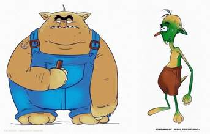

+++
title = "مواطن يعشق الشيكولاتة"
date = 2008-11-26
authors = ["إسماعيل دبارة"]

[taxonomies]
authors = ["ismail-dabara"]
sections = ["fonoon"]

[extra]
section_name = "فنون"
share_image = "/media/currentarticleassets/lakhdar2.jpg"
summary = "مخلوقان عجيبان، الأول أخضر اللون بأسنان بارزة زادت مظهره غرابة، غير قادر على نطق حرف السين، وينطق بدلا عنه حرف الثاء.. أما الشخص الثاني فضخم الجثة مفتول العضلات"
section_slug = "fonoon"
section_colour = "#7B2CBF"
thumb = "/media/currentarticleassets/lakhdar2.jpg"
n_comments = 5
original_url = "http://20at.com/20at/arts/10607-2009-08-13-13-11-17.html"
archived = "20100106005157"
date_source = "byline/meta"
aliases_20at = ["/20at/arts/10607-2009-08-13-13-11-17.html"]

[extra.provenance]
original_url = "http://20at.com/20at/arts/10607-2009-08-13-13-11-17.html"
capture_url = "https://web.archive.org/web/20100106005157/http://20at.com/20at/arts/10607-2009-08-13-13-11-17.html"
capture_label = "٦ يناير ٢٠١٠، ٠٠:٥١ UTC"
date_note = "من سطر التوقيع في المقال"
other_urls = []
comments = "٥"
missing_images = ""
+++

<figure></figure>

مخلوقان عجيبان، الأول أخضر اللون بأسنان بارزة زادت مظهره غرابة، غير قادر على نطق حرف السين، وينطق بدلا عنه حرف الثاء.. أما الشخص الثاني فضخم الجثة مفتول العضلات.. يتوجه الأول "الأخضر" إلى الثاني طالبا منه قسمة عادلة لقطعة الشيكولاتة التي يحملها، لكنّ "الضخم" يرفض ذلك مستندا إلى قوته البدنية ويقوم أحيانا بضرب "لخضر" الذي يستعطفه تارة ويستشيط غضبا مرة أخرى.. ليقَسم لخضر "اقثم برأس أمك" ويرد الثاني بـ "مااهاا" - وتعني لا باللهجة العامية التونسية.

كان ذلك محتوى الإعلان الكوميدي "اقسم يا لخضر" التي انطلقت في شهر رمضان الماضي، والمتعلّقة بالإشهار عن قطعة شيكولاتة، التي لاقت اهتماما شبابيّا كبيرا وشغفا متزايدا حولها بشكل وصل أحيانا إلى حدّ الهذيان وإنشاء حلقات النقاش الصاخبة.

فظاهرة "لخضر" انتشرت بسرعة بين الشباب التونسي، بعضهم اختار الاهتمام بقضية هذا "المغضوب عليه" أو "المحروم" من قطعة الشيوكلاتة عبر وضع صوره على خلفية هاتفه المحمول، وبعضهم اختار النغمة المرافقة للإشهار لجعلها رنينا مميزا لهاتفه الخلويّ.

في حين توجه البعض الآخر لمناقشة حكايته المستعصية مع أقرانه ضمن "حلقات نقاش" في المقاهي أو الجامعات، بل انتقلت إلى مستعملي منتديات النت وأعضاء موقع "فيس بوك"، الذين سارعوا إلى استخراج بطاقة هوية للكائن الافتراضي "لخضر" ليحصل بذلك على حقوقه كاملة.

<h3>تضامن عبر الفايس بوك</h3>

فعلى الـ "فيس بوك" تكونت أكثر من مجموعة، لمساندة "لخضر" منها "معا من أجل أن يقسم لخضر قبل العيد"، و"يا لخضر"، و"أم لخضر".. حيث ضمّت المجموعات أكثر من 11 ألف مشترك يزداد عددهم يوما بعد يوم!.

إحدى المشاركات وعدت هذا "الأخضر" بمعمل كامل من هذه المادّة (الشيكولاتة) حتى يكف عن إراقة ماء وجهه ("التلحليح" كما سمته)، في حين أقسمت مشاركة أخرى بأنّها تحدّثت مع مبتكر هذه الشخصية الذي وعدها بأن يحصل الأخضر على قسمته في الومضة القادمة، وهو ما اعتبرته بشرى لأحباء هذا الكائن الضعيف.

يقول فؤاد حمروني، 22 سنة: "انضممت للمجموعة التي تساند لخضر في قسمته إيمانا منّي بأنه يستحقّ ذلك، وفي العمق أنا أشجع أولا صاحب الومضة المؤثرة وثانيا أثمن مشاعر التآزر بين البشر، بعد أن افتقدتها الكائنات الافتراضية".

الشاب ريان زيدي، 25 سنة، يقول: "هذا أقلّ ما يمكن فعله للتعبير عن وقوفنا إلى جانب لخضر، أشكر كثيرا أصحاب هذه المبادرة الطيبة فبواسطتها أضحى لخضر مواطنا تونسيا مثلنا".

<h3>وقت ضائع</h3>

جلاء ستهم، 25 سنة، معلمة، تقول: "الجميع في الفصل ذكورا وإناثا يتحدثون عن الأخضر وكأن الموضوعات غابت نهائيا، في الحقيقة أنا لم أشاهد الومضة إلا بعد أن أصبحت حديث الأطفال المحبّب، أنا مندهشة للأثر الذي خلفه هذا الإشهار على أبنائنا وإن كنت أعتبره شخصيا غير مؤثر بالشكل الكافي كونه يأتي في قالب كوميدي".

أما نوري نظيف، 27 سنة، فهاجم الإشهار ومن يقف خلفه ومن يتعاطف معه بالقول: "هؤلاء الذين يضيعون الوقت عبر الفايس بووك بأحاديث لا معنى لها عن كائن افتراضي لا وجود حقيق له ، هم سبب تخلف الشباب التونسي.. لو انخرطوا في حملة تضامنية مع معتقل أو سجين حقيقي أو ساهموا في إحدى الحملات التوعوية لكان خيرا لهم وأسلم".

وأنت.. هل تعاطفت مع لخضر؟

