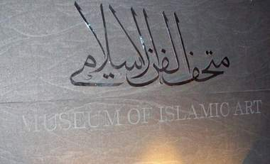

+++
title = "شاهد .. المتحف الإسلامي في قطر"
date = 2008-12-17
authors = ["مصري يوسف"]

[taxonomies]
authors = ["masri-youssef"]
sections = ["fonoon"]

[extra]
section_name = "فنون"
share_image = "/media/masr.20at.com/currentarticleassets/marwah/100_0243.jpg"
summary = "تبدأ جولة الزائر للمتحف الإسلامي بقطر بركوب عربة الجولف لتنقله من مواقف السيارات إلى أسفل المتحف، حيث يستقل المصعد بمقدار طابق واحد ليصبح أمام الباب الرئيسي للم"
section_slug = "fonoon"
section_colour = "#7B2CBF"
thumb = "/media/masr.20at.com/currentarticleassets/marwah/100_0243.jpg"
n_comments = 2
original_url = "http://20at.com/20at/arts/10745.html"
archived = "20100106005329"
date_source = "byline/meta"
aliases_20at = ["/20at/arts/10745.html"]

[extra.provenance]
original_url = "http://20at.com/20at/arts/10745.html"
capture_url = "https://web.archive.org/web/20100106005329/http://20at.com/20at/arts/10745.html"
capture_label = "٦ يناير ٢٠١٠، ٠٠:٥٣ UTC"
date_note = "من سطر التوقيع في المقال"
other_urls = []
comments = "٢"
missing_images = ""
+++

<figure></figure>

تبدأ جولة الزائر للمتحف الإسلامي بقطر بركوب عربة الجولف لتنقله من مواقف السيارات إلى أسفل المتحف، حيث يستقل المصعد بمقدار طابق واحد ليصبح أمام الباب الرئيسي للمتحف، ليجد النخيل على الجانبين ونافورة ضخمة تتوسط تلك المساحة، ونصب نقشت عليه كلمة اسم المتحف بالخط العربي .

يأخذك الباب الرئيسي إلى ساحة المتحف الداخلية حيث تجد تصميم داخلي عصري يفوح منه عبق الطابع الإسلامي، وهناك في نهاية الطابق الأول تجد واجهة زجاجية لن ترى منها سوى مياه الخليج وشاطئ الدوحة المقوس وقد وضعت بها عدد من المقاعد لمن يرغب في جولة روحانية مع أمواج الخليج.

وعند التجول بين طوابقه الخمسة تجد القطع التراثية موزعة طبقا للحقب التاريخية والأمكنة وروح القطعة نفسها، ويجمعها كلها ترتيب وعرض يليق بقيمتها..<a href="https://web.archive.org/web/20100106005329/http://20at.com/ http://www.20at.com/galleries/17Dec08/mathaf.htm"> شاهد .. المتحف الإسلامي في قطر</a>

