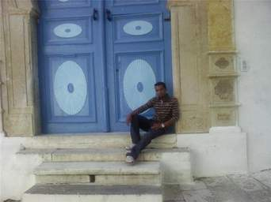

+++
title = "سيدي بوسعيد التونسية.. جمال ورومانسية"
date = 2008-12-22
authors = ["إسماعيل دبارة"]

[taxonomies]
authors = ["ismail-dabara"]
sections = ["fonoon"]

[extra]
section_name = "فنون"
share_image = "/media/currentarticleassets/tunes_1_.jpg"
summary = "لا يمكنك أن تذهب إلى تونس ولا تعرّج على \"عروس المتوسط\" كما يسميها التوانسة، أو مدينة سيدي أبي سعيد."
section_slug = "fonoon"
section_colour = "#7B2CBF"
thumb = "/media/currentarticleassets/tunes_1_.jpg"
n_comments = 1
original_url = "http://20at.com/20at/arts/10771.html"
archived = "20100106004906"
date_source = "byline/meta"
aliases_20at = ["/20at/arts/10771.html"]

[extra.provenance]
original_url = "http://20at.com/20at/arts/10771.html"
capture_url = "https://web.archive.org/web/20100106004906/http://20at.com/20at/arts/10771.html"
capture_label = "٦ يناير ٢٠١٠، ٠٠:٤٩ UTC"
date_note = "من سطر التوقيع في المقال"
other_urls = []
comments = "١"
missing_images = ""
+++

<figure></figure>

لا يمكنك أن تذهب إلى تونس ولا تعرّج على "عروس المتوسط" كما يسميها التوانسة، أو مدينة سيدي أبي سعيد.

تبعد البلدة عن تونس العاصمة 20 كيلومترا لها من الخصوصية ما يجعلها قبلة لزوار تونس الأجانب وملاذا لشبابها الباحث عن القليل من الرومانسية التي قد تنسي عذابات الضغط النفسي للعاصمة ومشاكلها الجمة.

<h3>"عين تاساط"</h3>

كسحابة معلقة بين السماء والأرض، تتربع بلدة سيدي أبي سعيد على تلّة صخرية صلبة تغازل قمتها الغيوم وتنبع من أسفلها عين يسميها أهالي المنطقة عين "تاساط" وهي عين ماء عذب ماؤها مفيد وصحيّ للغاية في تفتيت "حصى" مرضى الكلى .

البعض من التونسيين يتبركون بهذه العين، فلا يشربون إلا من ينابيعها خصوصا خلال شهر رمضان الكريم، ومن علو يقارب 330 مترا عن سطح البحر تشرف "العروس" سيدي أبي سعيد الحالمة على أغلب مناطق الضاحية الشمالية للعاصمة من المرسى شمالا إلى قرطاج جنوبا.

ومن خلال بحيرة تونس تطل القرية على أغلب أجزاء العاصمة التونسية من "أريانة" إلى ضاحية "حمام الأنف".

تتميز المدينة الجذابة بلونين معروفين يجمعان بين زرقة البحر وبياض اللبن، وبمنحدراتها المتعرجة، لتشكل لوحة فنية أبدع الخالق، حيث يمتزج فيها جمال الطبيعة وروعة المعمار المغاربي- الأندلسي ذي النكهة "الإفريقية".

تقول السائحة الهولندية تيفاني جرند، 20 سنة: "مكان جذاب بالفعل، تغلب عليه الرومانسية والحضور الشبابي المكثف، الجميع منشغل بهمسات المحبة والغرام إلى درجة أنهم يتناسون بعضهم البعض، سمعت كثيرا عن هذه المنطقة في بلادي لكنني لم أتصورها بهذا الجمال".

<h3>أولياء صالحون</h3>

يعود تأسيس سيدي أبي سعيد إلى نحو 500 عام، ويربط بعض المؤرخين بين نشأة المدينة واستيطانها من قبل الولي الصالح الذي تحمل اسمه وهو أبو سعيد الباجي الراقد في قلب المرتفع الذي توجد عليه المدينة.

وحسب بعض الروايات فإن سيدي أبي سعيد ومجموعة من الأولياء الصالحين الآخرين مثل سيدي عبد العزيز المدفون بجهة المرسى، وسيدي بالحسن الشاذلي وغيرهما اتخذوا من المرتفعات المحيطة بالعاصمة التونسية والمطلة على البحر الأبيض المتوسط خلوات لهم رابطو بها (ومن هنا جاءت تسميتها بالرباطات) خلال غزوات "الفرنجة" ليتفرغوا للعبادة من جهة، وحتى يتمكنوا من رصد العدو القادم إليهم عبر البحر من جهة ثانية.

وظلت المنطقة منذ بداية القرن الماضي، وخلال كامل الحقبة الاستعمارية الفرنسية، والى الآن، ملجأ هادئاً لعدد كبير من الفنانين البارزين ورجالات الفكر والكتاب والفنانين والشعراء، مثل البارون دارلونجاي الذي ما زال بيته موجودا إلى الآن، ووقع تحويله في العشرية الماضية إلى ناد دولي للموسيقى المتوسطية، ورسام تونس الأول الهادي التريكي.

يقول الشاب وسيم جمور، 25 سنة: "لا أعلم كثيرا ولا أهتمّ بسيرة الأولياء الصالحين الذين انشئوا هذه المدينة، كلّ ما يهمني أنها جميلة وجذابة ومريحة، ويمكنني فيها الركون بسلام جنبا إلى جنب مع حبيبتي دون إزعاج".

<h3>هدايا تذكارية</h3>

تتميز المنطقة بمعمارها المتوسطي مع لمسات إسلامية وإفريقية واضحة تتجلى خاصة من خلال القباب والأقواس والنقوش التي تزين الأبواب المتأثرة في أغلبها بالطابع المميز لأبواب المساجد والجوامع الكبرى بتونس.

أما طرقاتها فهي ضيقة ومتعرجة وكلها مبلطة ببلاط حجري على شاكلة الشوارع الرومانية القديمة، تزيدها فوانيس الإضاءة الصفراء وانعكاسات أضوائها على الأزهار والنباتات المتدلية من حدائق منازل القرية روعة وجمالا.

وتصطف دكاكين بيع السجّاد التقليدي وغيرها من منتوجات الصناعات والحرف التقليدية على امتداد الطريق الرئيسية المتعرجة نحو الأعلى، ويقبل السائحون على شرائها كهدايا تذكارية.

<h3>المقهى العالية</h3>

حكاية المقهى العالية في سيدي أبي سعيد هي حكاية الشباب والغرام، فعند نهاية المرتفع تقع "المقهى العالية" بزينتها المميزة وتاريخها الذي يعود إلى مئات السنين حين كانت حكرا على أعيان البلاد فقط، وهي مقهى ذات درج عال وتتوفر على طابع عربي أندلسي غاية في الروعة والجمال و تعتبر أشهر مقهى في القرية بل في البلاد التونسية بأكملها.

يكافئ لطفي عمدوني، 22 سنة، صديقته آلاء بزيارة إلى سيدي بوسعيد، لأنها حصلت على علامة جيّدة خلال الامتحانات الأخيرة، يقول: "أحفزها بزيارة إلى هذه البلدة الرائعة، اجتهدنا في الدراسة ويحقّ لنا اليوم القيام بزيارة لن ننساها ما حيينا في هذا المكان الجميل".

وعلى الطريق ينتشر باعة الفلّ والياسمين بلباسهم التقليدي الأحمر الجميل وملامحهم العربية المتوسطية يوزعون على المارة الابتسامات وعقود الفل وأطواق والياسمين.

