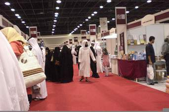

+++
title = "معرض قطر للكتاب .. جنس ونكت للمساطيل!"
date = 2009-01-01
authors = ["أحمد يوسف"]

[taxonomies]
authors = ["ahmed-youssef"]
sections = ["fonoon"]

[extra]
section_name = "فنون"
share_image = "/media/currentarticleassets/2100963671_b3c87d5910.jpg"
summary = "رغم أن معرض الدوحة للكتاب في دورته الـ 19 قد أوشك على الانتهاء بعد يومين، إلا أنه لم يسجل ما كان عليه في العام الماضي، فالحضور ليس كبيرا وهو ما تعكسه حالة الأجن"
section_slug = "fonoon"
section_colour = "#7B2CBF"
thumb = "/media/currentarticleassets/2100963671_b3c87d5910.jpg"
n_comments = 0
original_url = "http://20at.com/20at/arts/10859.html"
archived = "20100106004927"
date_source = "byline/meta"
aliases_20at = ["/20at/arts/10859.html"]

[extra.provenance]
original_url = "http://20at.com/20at/arts/10859.html"
capture_url = "https://web.archive.org/web/20100106004927/http://20at.com/20at/arts/10859.html"
capture_label = "٦ يناير ٢٠١٠، ٠٠:٤٩ UTC"
date_note = "من سطر التوقيع في المقال"
other_urls = []
comments = ""
missing_images = ""
+++

<figure></figure>

رغم أن معرض الدوحة للكتاب في دورته الـ 19 قد أوشك على الانتهاء بعد يومين، إلا أنه لم يسجل ما كان عليه في العام الماضي، فالحضور ليس كبيرا وهو ما تعكسه حالة الأجنحة الخالية من الزوار، أما على الأرفف فلن يجد الزائر للمعرض عناءً كبيرا في ملاحظة العديد من الكتب التجارية ذات الهدف البيعي لا أكثر، فهنا كتاب بعنوان "نكت المساطيل" وهناك آخر "رسائل الحب والغرام" وبينهما "غرف النوم وما يحدث فيها " وكثير غيرها من العناوين التي تسير على نفس الدرب.

وتأتي هذه الحالة رغم أن الدورة الحالية تشهد مشاركة 440 دار نشر من 21 دولة عربية وأجنبية، ويعرض خلالها أكثر من 23 ألف عنوان باللغة العربية وأكثر من 5000 باللغات الأخرى، كما يستضيف معرض الدوحة لأول مرة الولايات المتحدة لتكون ضيفة شرف للمهرجان.

<h3>أجنحة خالية</h3>

حول الكتب المعروضة يقول صالح أحمد، أحد المتجولين في المعرض : "أرى أن المعرض لم يكن بنفس ما كان عليه العام الماضي، فالإقبال عليه ضعيف جدا هذا العام وأكثر من ذلك فإن الكثير من الأجنحة الموجودة بالمعرض إما أنها خالية من الكتب وإما أنها تحمل كتب ليست ذات أهمية، بل أتوقع أنه أكثر من نصف المعروض يهتم بكتب الأطفال وهو حجم مبالغ فيه ويعتمد على القوة الشرائية للأطفال".

وأضاف: "جناح الكتب الإسلامية فهو الأروع وقد شهد العديد من الكتب القيمة، والمصاحف ذات الطبعات الجيدة، أما الكتب ذات المستوى الثقافي فلن تجد سوى النذر القليل جدا لدور نشر قليلة ".

أما محمد نور، فقد ألقى باللائمة على الأزمة الاقتصادية العالمية قائلا: "الإقبال ضعيف جدا وقد يكون هذا الأمر نتيجة للأزمة العالمية فالقوة الشرائية ضعيفة للغاية، وقد يكون هذا السبب أصلا في عدم إقبال دور النشر على المعرض وعدم الاهتمام بدرجة كبيرة لأنهم بالتأكيد يدركون قوة السوق في هذه الفترة وبالتأكيد لديهم أرقام تتوقع حجم مبيعاتهم".

<h3>ارتفاع أسعار</h3>

وفي محاولة لتفسير قلة الإقبال على المعرض عزى أيمن يوسف الأمر إلى عدم اهتمام الجمهور هذه الأيام بالقراءة، فشراء كتاب آخر ما يمكن أن يهتم به الفرد الآن، وأضاف: "الاهتمامات جميعها منصبة على ضغوط الحياة فقد افتقدت الناس حسها وحبها للقراءة بل وافتقدت الوقت لهذه القراءة، وأصبح كل فرد يلهث خلف لقمة عيشه طوال ليله ونهاره، وإن وجد بعض الوقت ليلا فلن تتركه القنوات الفضائية للقراءة لحظة واحدة".

من جانبها قالت منى علي: "المعرض هذا العام به العديد من الكتب ليست ذات النفع، إضافة إلى ارتفاع أسعار الكتب بشكل كبير، فالكتب تتراوح أسعارها من 20 ريالا فما فوق، وهناك بعض المجلدات تصل أسعارها إلى آلاف الريالات وهي أسعار خيالية جدا.. فقد أردت أن اشتري بعض المجلدات الروائية ولكنني عجزت لأن سعرها يتخطى 1500 ريال قطري .. يبدو أن قطار ارتفاع الأسعار قد نال من الكتب أيضا".

<h3>لا كتب ممنوعة</h3>

كان وزير الثقافة والفنون والتراث القطري حمد بن عبد العزيز الكواري - وهي الوزارة الأحدث في الحكومة القطرية والتي لم تكمل عامها الأول- قد أعلن أن المهرجان هذا العام لم يشهد منع أي كتاب من العرض.

ورغم ارتفاع عدد دور النشر المشاركة بالمعرض عن العام الماضي إلا أن حجم الكتب لم يسجل نصف كتب العام الماضي حيث وصل عدد دور النشر المشاركة في العام الماضي إلى 437 دار وتعرض لنحو 97 ألف كتاب عربي وأجنبي، في حين يستمد معرض هذا العام قوته من استعدادات الدوحة لتكون عاصمة للثقافة العربية لعام 2010 .

