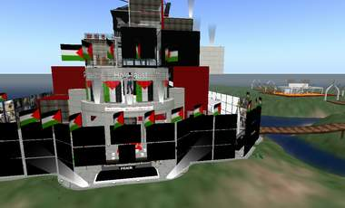

+++
title = "(هولوكوست غزة) ..على  second life"
date = 2009-01-08
authors = ["رضوه حسن"]

[taxonomies]
authors = ["radoh-hassan"]
sections = ["fonoon"]

[extra]
section_name = "فنون"
share_image = "/media/currentarticleassets/holocost.jpg"
summary = "كما يحدث تماما على أرض الواقع؛ يشهد العالم الافتراضي على شبكة الإنترنت المعروف باسم سكند لايف second life رفضا للعدوان الإسرائيلي الحالي على قطاع غزة، وتضامنا م"
section_slug = "fonoon"
section_colour = "#7B2CBF"
thumb = "/media/currentarticleassets/holocost.jpg"
n_comments = 1
original_url = "http://20at.com/20at/arts/10910.html"
archived = "20100106004854"
date_source = "byline/meta"
aliases_20at = ["/20at/arts/10910.html"]

[extra.provenance]
original_url = "http://20at.com/20at/arts/10910.html"
capture_url = "https://web.archive.org/web/20100106004854/http://20at.com/20at/arts/10910.html"
capture_label = "٦ يناير ٢٠١٠، ٠٠:٤٨ UTC"
date_note = "من سطر التوقيع في المقال"
other_urls = []
comments = "١"
missing_images = ""
+++

<figure></figure>

كما يحدث تماما على أرض الواقع؛ يشهد العالم الافتراضي على شبكة الإنترنت المعروف باسم سكند لايف second life رفضا للعدوان الإسرائيلي الحالي على قطاع غزة، وتضامنا مع الفلسطينيين..

ويأخذ هذا التضامن أشكالا مختلفة من بينها رفع لافتات التضامن والتنديد بجرائم إسرائيل بالإنجليزية، منها: "لا لجرائم الحرب في غزة"، "لا لعدوان الإسرائيلي الوحشي"، "افتحوا المعابر لإنقاذ أهالينا".

أما متحف "هولوكوست فلسطين" – الذي دشنه موقع "إسلام أون لاين" في أبريل الماضي في عالم سكندلايف لتوثيق الجرائم الإسرائيلية المتواصلة ضد الشعب الفلسطيني- فقد أصبح ملتقى يومي للرافضين للعدوان الإسرائيلي على غزة، ومكانا لإقامة الفعاليات الاحتجاجية المختلفة ضد إسرائيل.

<h3>تجسيد حي للعدوان</h3>

أحمد فتحي، مسؤول سكندلايف بالموقع، يقول: "التقنيات العديدة التي يتيحها هذا العالم ومن بينها التجسيد الحي ثلاثي الأبعاد والتفاعلية والمباشرة، يمكننا من عمل تجسيد حي لآثار الغارات الإسرائيلية على الأسر الفلسطينية".

موضحا أن فكرة المتحف جاءت بعد أن توعد نائب وزير الدفاع الإسرائيلي الفلسطينيين بمحرقة ردا على إطلاق صواريخ القسام، فكان التفكير في بناء متحف افتراضي يحمل اسم الهولوكست ويوثق لجرائمهم المتواصلة على الشعب الفلسطيني".

وحول أهداف المتحف الافتراضي، يضيف: "متحف هولوكوست فلسطين يسعى إلى توثيق الجرائم الإسرائيلية في فلسطين، وفتح آفاق جديدة للتعريف بالقضية وبناء ذاكرة يحفظها التاريخ لفضح الانتهاكات الإسرائيلية أمام سكان سكندلايف الذي يسكنه حاليا نحو 14 مليون مستخدم، بزيادة شهرية تقدر بنحو 400 ألف مستخدم".

كما أتاح المتظاهرون صندوقا للتبرعات لصالح الهلال الأحمر الفلسطيني لمساندة غزة بلغ نحو 5000 ألف ليندين دولار أي ما يعادل (2500 دولار) ، حيث أن 250 ليندين = 1 دولار أمريكي.

<h3>غضب إسرائيلي</h3>

كانت وسائل إعلام إسرائيلية قد قامت بتغطية أنباء هذا المتحف وهذه الفعاليات الاحتجاجية التي تتم يوميا، حيث ذكر موقع "واي نت" الإخباري الإسرائيلي على الإنترنت أن موقع "إسلام أون لاين.نت" أنشأ متحفا باسم "هولوكوست فلسطين"، لحشد الدعم من جميع أنحاء العالم تجاه الأراضي الفلسطينية المحتلة، التي تواجه مجازر إسرائيلية متوالية.

وأشار الموقع الإخباري الإسرائيلي أن "هولوكوست فلسطين" يسلط الضوء على عناصر محرقة غزة، من مواقع وأسلحة ونتائج، وسيتضمن روايات شهود من الناجين، وذكر الموقع الإسرائيلي أن أكثر من 6700 شخص زاروا "هولوكوست فلسطين" منذ إطلاقه.

تجول في متحف الهولوكوست

