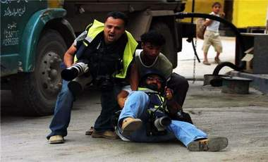

+++
title = "الصحافة بغزة= استشهاد واصابات ومقاومة"
date = 2009-01-10
authors = ["رنا خموس"]

[taxonomies]
authors = ["rana-khmos"]
sections = ["fonoon"]

[extra]
section_name = "فنون"
share_image = "/media/masr.20at.com/currentarticleassets/sahafi.jpg"
summary = "\"القلم والعدسة نوع من أنواع المقاومة\"..هكذا يواجه الصحفيون الفلسطينيون العدوان الأخير على غزة، مهنتهم أصبحت مهنة الموت ففي كل لحظة يكون بانتظارهم، لا قذائف ولا "
section_slug = "fonoon"
section_colour = "#7B2CBF"
thumb = "/media/masr.20at.com/currentarticleassets/sahafi.jpg"
n_comments = 0
original_url = "http://20at.com/20at/arts/10917.html"
archived = "20100106004759"
date_source = "byline/meta"
aliases_20at = ["/20at/arts/10917.html"]

[extra.provenance]
original_url = "http://20at.com/20at/arts/10917.html"
capture_url = "https://web.archive.org/web/20100106004759/http://20at.com/20at/arts/10917.html"
capture_label = "٦ يناير ٢٠١٠، ٠٠:٤٧ UTC"
date_note = "من سطر التوقيع في المقال"
other_urls = []
comments = ""
missing_images = ""
+++

<figure></figure>

"القلم والعدسة نوع من أنواع المقاومة"..هكذا يواجه الصحفيون الفلسطينيون العدوان الأخير على غزة، مهنتهم أصبحت مهنة الموت ففي كل لحظة يكون بانتظارهم، لا قذائف ولا رصاص بحوزتهم، جل ما يحملوه هو قلمهم وعدستهم، وشعار يحاولون به الاحتماء بينما تستبيح الطائرات الإسرائيلية غزة وأجسادهم المرابطة من أجل الحقيقة.

<h3>شهيدان و10 مصابين</h3>

سلامة عطا الله مراسل قناة القدس الفضائية تحدث إلي "عشرينات" على عجل، وفي كل مرة يتلفظ بجمل وينقطع الاتصال، قال واصفا الظروف التي يعيشها الصحفي الفلسطيني حاليا:" أن شعور الصحفي في هذه الأحداث مختلط أمام واجبه المهني والإنساني ففي كثير من المرات نبكي من شدة وهول المناظر التي نراها، فلا نستطيع تمالك أنفسنا، وذلك بخلاف تعرض الطواقم الصحفية لإصابات عدة بلغ عددها العشرة وقد استشهد صحفيان ، رغم ارتدائنا ما يؤكد أننا صحفيون".

ومن ضمن الصعوبات التي تواجه الصحافة أيضا أوضح عطا الله " انقطاع وسائل الاتصال والتي تعد عقبة كبيرة أمامنا في تغطية الأحداث، ومع انقطاع التيار الكهربائي أصبح الأمر أكثر تعقيدا، فاضطررنا إلى استخدام مولدات الكهرباء، الحصول على الحقائق والمعلومة أمر معقد جدا، وبسبب صعوبة الحصول على المعلومة أصبح مشهد تأثير الصورة أقل ومنخفض، فبسبب كثرة الأحداث والغارات المتواصلة أصبحنا نتابع الحدث ولا نتابع القصص الإنسانية التي تنقل الوضع الحقيقي والتي يكون لها تأثير أكبر".

وبين عطا الله، أن هناك ضغط كبير يعمل به الصحفي في القطاع، فمن جهة واجبه ومن جهة أخرى إنسانيته وأخرى عائلته، التي يفكر بها كل دقيقة وما حل بها أثناء عمليات القصف، فهو يبقى مرابط لنقل الحدث ولكن عائلته تتعرض لما يتعرض له أيضا المواطنون، فأنا على سبيل المثال عندما أعود إلى منزلي بالليل ارجع مشيا على الإقدام ومن طرق غير مكشوفة لطائرات الاحتلال ويكون الجميع بانتظاري وهم يضعون أياديهم على قلوبهم، فعائلة الصحفي تعيش في خوف دائم وقلق.

<h3>موت محتم</h3>

أما المصور الصحفي يعقوب أبو غلوة الذي يعمل لحساب وكالة الاسشويتيد برس فقد عاود الاتصال بـ"عشرينات" أكثر من أربع مرات أثناء إجراء المقابلة معه، ليس فقط بسبب انقطاع الاتصال ولكن أيضا بسبب توارد الإنباء عن غارات جديدة.

وقال أبو غلوة " بعد العدوان الإسرائيلي البري لا يستطيع احد التحرك أو تغطية الأحداث مهما كانت سخونتها وقوتها بعد أن يسدل الليل ظلمته على القطاع، فتبقى الشوارع خالية إلا من صوت القذائف ولون لهب القذائف والرصاص، بالسابق كنا نخرج ليلا للتغطية ولكن بعد البدء بالعمليات البرية لا يستطيع احد التجرؤ على الخروج لأنه يعرض حياته لموت حتمي".

وتابع أبو غلوة شهادته " نواجه صعوبات كبيرة بسبب انقطاع الكهرباء فكثير منا يبيت في المستشفيات لتوفر مولدات الكهرباء أو في مكتبه من اجل نقل الحدث، فهناك صعوبة كبيرة في الاتصال وهناك أحداث كبيرة جدا لا نستطيع تغطيتها، حتى أن هناك صحفيين اضطروا لاستخدام بطاريات سياراتهم من أجل شحن حواسيبهم، حتى أثناء تغطيتنا الحدث نتعرض لهجوم، فقد حصل مرة أننا كنا نقوم بتغطية قصف لأحد المنازل بين خان يونس ورفح وتوجهنا هناك".

وتابع :"كنا نقوم بتصوير بعض الشهداء وفوجئنا بصواريخ متوجه علينا وتم قصف المنزل رغم أننا نرتدي الدروع وسياراتنا عليها أسماء الوكالات وإشارات الصحافة ولكننا قصفنا، وفي تلك اللحظة كانت الأنباء تتوارد عن سقوط شهداء صحفيين واستهدافهم، ولكن حمدا لله نجونا بأعجوبة".

وطالب أبو غلوة المؤسسات الحقوقية الفعالية سواء داخليا أو العالم للتوجه بطلب رسمي لحماية الصحفيين حماية كاملة، في كل مرة يتم قتل الصحفي والصورة كما هي فكل يوم يتوافد إصابات من جانبا ولا هناك من يدافع عنا، ونطالب بتوفير حماية ومكان أمن لنا وأيضا توفير سبل الاتصال، فالوضع لا يجوز السكوت عنه.

14 شهيدا

وقد استشهد مؤخرا مصور القناة الجزائرية باسل فرج في غزة أثناء تغطيته للأحداث، ويبلغ من العمر(22 عاما)، والشهيد الصحفي تخرج هذا العام من الجامعة وهو من مواليد 28 مارس 1987وهو الابن البكر من عائلة مكونة من ثمانية أفراد خمس أولاد وفتاة، وكان يتدرب مع الوكالة الألمانية، ويصور الملتقيات كأي صحفي فلسطيني.

وعن عمله مع التلفزيون الجزائري اختير مؤخرا لتميزه في تغطية الأحداث، وهو شاب محبوب وخلوق ومتميز في عمله ودراسته.

كما استشهد الصحفي علاء مرتجى الذي يعمل لحساب اذاعة الوان المحلية امس الجمعة بعد تعرض منزله لقذيفة صاروخية اطلقها الجيش الاسرائيلي في حي الزيتون جنوب غزة.

وقالت المصادر ان مرتجى كان عائدا الى منزله من عمله ولدى دخوله المنزل فوجئ بالقذيفة مما ادى الى اصابته بجراح ادت الى مقتله في وقت لاحق.

وبذلك يرتفع عدد الشهداء الصحفيين خلال سنوات انتفاضة الأقصى إلى 14 صحفيا، عدا عن العشرات من المصابين في صفوف الإعلاميين.

