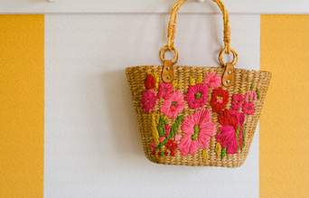

+++
title = "شنط بنات فلسطين.. فيها إيه؟"
date = 2009-01-29
authors = ["رنا خموس"]

[taxonomies]
authors = ["rana-khmos"]
sections = ["fonoon"]

[extra]
section_name = "فنون"
share_image = "/media/currentarticleassets/shnta.jpg"
summary = "قلم روج.. مسكرة.. كريم أساس..مرآة.. هي محتويات حقيبة يد كل فتاة عربية، فهل تختلف عنها محتويات حقيبة الفتاة الفلسطينية؟"
section_slug = "fonoon"
section_colour = "#7B2CBF"
thumb = "/media/currentarticleassets/shnta.jpg"
n_comments = 1
original_url = "http://20at.com/20at/arts/11128.html"
archived = "20100106005830"
date_source = "byline/meta"
aliases_20at = ["/20at/arts/11128.html"]

[extra.provenance]
original_url = "http://20at.com/20at/arts/11128.html"
capture_url = "https://web.archive.org/web/20100106005830/http://20at.com/20at/arts/11128.html"
capture_label = "٦ يناير ٢٠١٠، ٠٠:٥٨ UTC"
date_note = "من سطر التوقيع في المقال"
other_urls = []
comments = "١"
missing_images = ""
+++

<figure></figure>

قلم روج.. مسكرة.. كريم أساس..مرآة.. هي محتويات حقيبة يد كل فتاة عربية، فهل تختلف عنها محتويات حقيبة الفتاة الفلسطينية؟

سمية صالح، من جنين، تقول: "أنا دائمة التنقل على الحواجز لهذا أحمل في حقيبة يدي دائما زجاجة مياه خوفا من أي تأخير يطرأ وتجنبا للعطش أو عند الجري إذا تعرضنا لأي ملاحقة من قبل جنود الاحتلال، كما أحمل معي مصحفا صغيرا لردع المخاطر".

أما حنان أيوب، فتقول: "بسبب رحلة العذاب على الحواجز فأنا أحمل دائما مالا إضافيا، وأتفقد دوما بطاقة التعريف الشخصية، وطبعا هاتفي النقال ودفتر الطوارئ كما تطلق عليه والدتي التي سجلت فيه أسماء أهم الأقارب خاصة في المدينة التي أدرس فيها إن حصل أي طارئ، وأرقام سائقين إن تأخرت على الحاجز، ولا بد أن احتاط بما يسليني على الحاجز كقطعة حلوى أو بسكويت".

أما سارة عبد الله، فأشارت أنها تتجنب حمل أي شعار أو أي شيء تنشره الفصائل الطلابية في الجامعة أثناء عودتها إلى منزلها، "ولابد أن تكون في حقيبتي عدة التزيين أو المكياج، فهو أمر طبيعي ولا بد منه".

<h3>أحجام وأحمال</h3>

حجم الحقيبة يختلف من فتاة وأخرى، فسمية عليان، طالبة في كلية الاقتصاد، تعيش داخل مدينة نابلس لهذا تجد حقائبها ما بين صغيرة ومتوسطة الحجم، ولا تضطر إلى حمل حقائب كبيرة لوضع كتبها فيها لأنها لا تتنقل على الحواجز، وفيها تضع هاتفها النقال ومفتاح السيارة وما يكفيها لتناول فطور الصباح مع رفيقاتها في المطعم، وما يضمن إصلاح زينتها.

وبدورها، قالت فاطمة مصطفى: "لازم أحمل معي بالشنطة دبابيس لزوم الحجاب، وأكيد فرشاة الأسنان لأني أضع تقويم لأسناني، ولا أنسى العلكة على طعم النعناع لتعطير رائحة الفم، ومحارم ورقية لزوم العطس لأننا بفصل الشتاء، هاي أشياء لازم تكون معي أينما توجهت".

أما راما إبراهيم، أوضحت لنا الفرق بين حاجيات حقيبتها حسب المناسبة والمكان الذي تتوجه له مبينة وابتسامة عريضة رسمت على وجهها: "عند توجهي إلى الجامعة أحمل بطاقة الجامعة ومصروفي ونظارتي الطبية وهاتفي النقال وقلمين واحد أحمر والتاني أزرق، أما لزوم مشاوير الصديقات، فأحمل مرآة ومكياجي ولا أجلب معي هاتفي حتى لا تتصل أمي كل لحظة وتذكرني أني تأخرت عن البيت".

فيما تقول مي عماد، أنها لا تحب حمل حقيبة في يدها خاصة أثناء ممارستها رياضة المشي، وما تحمله فقط هاتفها النقال في جيب سترتها، وتجد أن حمل الحقائب أمر ممل جدا ومتعب، لهذا تفضل ألا تكون مقيدة حركة اليدين، لأنها تشعر بنفسها دون حقيبة حرة وأكثر نشاطا وخفيفة أثناء سيرها.

<h3>جيبي حقيبتي</h3>

أما بالنسبة للشاب في فلسطين، فبعضهم أيضا يحمل حقيبة خاصة طلاب الجامعة، فسامح يحمل حقيبة على كتفه مشيرا لنا أنه يفضل حمل حقيبة في الجامعة لأنه يدرس في كلية الإعلام، وكتبها كثيرة بخلاف عدة التصوير والفلاشة.

"حقيبتي تقتصر على جيبي"، هذا ما قاله أسامة مرعي، طالب في السنة الأولى في جامعة القدس المفتوحة، مضيفا: "لأنني أتنقل على الحواجز كل يوم فأنا أتجنب حمل كل شيء يرن عليه جهاز التفتيش على الحاجز، خاصة الحزام، فأتجنب لبس الحزام، وما أحمله طبعا هويتي التي لا بد منها حتى أستطيع التنقل عبر الحواجز، وهاتفي وأضعه في جيبي وما يكفيني من نقود".

بالنسبة لمحمد عبد الرحيم، فيقول: "أنا ارتدي دائما الجينز لأن فيه جيوب كثيرة وأفضل ارتداء السترات التي فيها جيوب داخلية، حتى أستطيع حمل محفظتي التي فيها بطاقات وأوراق وصورة للخطيبة التي اشتريت المحفظة من أجل صورتها".

