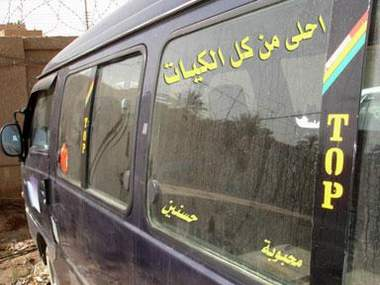

+++
title = "سيارات بغداد.. راجعه بالسلامة!"
date = 2009-02-04
authors = ["فؤاد فليح حسن"]

[taxonomies]
authors = ["fouad-falih-hassan"]
sections = ["fonoon"]

[extra]
section_name = "فنون"
share_image = "/media/currentarticleassets/mekrobas1.jpg"
summary = "الكثير من سائقي السيارات في بغداد يتوجهون هذه الأيام إلى محلات الإكسسوارات أو الخطاط الإلكتروني من أجل الحصول على الملصقات التي يضعونها على سياراتهم، حيث تحمل ه"
section_slug = "fonoon"
section_colour = "#7B2CBF"
thumb = "/media/currentarticleassets/mekrobas1.jpg"
n_comments = 2
original_url = "http://20at.com/20at/arts/11192.html"
archived = "20100106005753"
date_source = "byline/meta"
aliases_20at = ["/20at/arts/11192.html"]

[extra.provenance]
original_url = "http://20at.com/20at/arts/11192.html"
capture_url = "https://web.archive.org/web/20100106005753/http://20at.com/20at/arts/11192.html"
capture_label = "٦ يناير ٢٠١٠، ٠٠:٥٧ UTC"
date_note = "من سطر التوقيع في المقال"
other_urls = []
comments = "٢"
missing_images = ""
+++

<figure></figure>

الكثير من سائقي السيارات في بغداد يتوجهون هذه الأيام إلى محلات الإكسسوارات أو الخطاط الإلكتروني من أجل الحصول على الملصقات التي يضعونها على سياراتهم، حيث تحمل هذه الملصقات كلمات أو جمل لعبارات مضحكة أو لبيت من الشعر أو غيرها.. "راجعه بالسلامة"، "محروسة من عين البشر"، "الباب اللي يجيلك منه الريح سده واستريح"، "امشي شهر ولا تعبر نهر"، " امشي ورا اللي بيحبك ولا تمشي ورا اللي يضحكلك".

يرى البعض أن هذه الظاهرة المنتشرة سببها عدم تطبيق رجال المرور أنظمة وقوانين المرور العراقية، حيث يقول حبيب سعدون،31 عاما، أن هذه الظاهرة تسيء إلى الذوق العام وأن سبب انتشارها بهذه الحالة هو أن رجال المرور لا يحاسبون أصحاب المركبات الذين يلصقون أو يكتبون على سياراتهم بالرغم من وجود مادة قانونية تمنع هذه الظاهرة.

من جانبه يقول أبو محمد، 30 عاما، صاحب شاحنة كبيرة: "نحن نخاف الحسد فكتبت على مؤخرة الشاحنة ( اللهم أعطهم مثل ما يتمنون لنا )، أنا لم أكتب هذه العبارة من أجل التسلية أو لفت الانتباه بل فعلا نحن نخاف الحسد وقد تضررت كثيرا منه".

تعتمد نوعية الكلام المكتوب على المركبة على ثقافة وعمر السائق حيث أن أغلب الشباب بدءوا يكتبون عبارات باللغة الانكليزية مثل أسماء ممثلين أو لاعبي كرة قدم أو غيرهم من المشاهير.

فالشاب جبار الموسوي، 22 عاما، صاحب مركبة صالون نوع (أوبل)، يضع على زجاج سيارته اسمين للاعبين في نادي برشلونة الأسباني، موضحا: "هما مفضلين لدي.. أعتقد أني لم أرتكب إثما أو جريمة".

منى أحمد، 21 عاما، طالبة في كلية الرافدين، تقول: "أعتقد أن ظاهرة الكتابة على السيارات سيئة ودخيلة على مجتمعنا مهما كانت تلك العبارات، وأعتقد أن السائق لو اهتم بتكملة نواقص سيارته أفضل مما ينفق الأموال على الخطاطين وتضييع الأوقات في كتابة أو لصق العبارات".

<h3>مع الخطاط</h3>

يتراوح السعر الذي يتقاضاه الخطاط نظير كتابة لوحة بين 10 دولارات إلى 15 دولارا للعبارة الواحدة.. الخطاط محمود علي، 33 عاما، يرى أن هذا الموضوع فيه تصرفا يدل على حرية صاحب السيارة مع الأخذ بنظر الاعتبار عدم التعرض للقيم والثوابت والإساءة للذوق العام، ولا أجد فيه أي أذى للآخرين.

ويؤيد قاسم ناجي، 27 عاما، بعض العبارات ويرفض بعضها، قائلا: "أعتقد أنها ظاهرة جيدة إن كانت العبارة تحمل معنى أو آية قرآنية أو أدعية دينية أو نصائح أو حكم، أما إن كانت عبارات غير بناءة وهادفة فأكيد تصبح ظاهرة سيئة وغير مقبولة".

من أكثر العبارات التي يكتبها الخطاطين "الحسود في عينه عود"، "لا تسرع فنحن بانتظارك"، إلى جانب جمل كثيرة تتعلق بالحب والغرام، وأخرى تتغنى بحب الوطن.

<h3>على مزاج السائق</h3>

ويشير أبو جمال الهليجي، صاحب محل لبيع السيارات في بغداد، إلى أن أجمل ما في صاحب السيارة ذوقه الرفيع الذي يأتي من نظافة سيارته وتعطيرها بعطر جميل أفضل من كتابة عبارات مزعجة وملئها بالصور، "لا بد أن يضع السائق في حساباته أذواق الناس الذين يستقلون سيارته وبالتالي يبتعد عن الانتقادات والكلام الجارح".

وتقول ليلى الجابري، أن العبارات في السابق كانت لا تتعدى العبارات التحذيرية، في حين أن عبارات اليوم هي تعبير حقيقي عن مزاج سائق السيارة الذي يعمل على إفراغ مكنونات نفسه وهواجسه ليترجمها إلى عبارات وشعارات يزين بها سيارته.

أحد ضباط المرور يرى أن هذه الظاهرة أخذت في الانتشار بشكل غير طبيعي بالرغم من أن هناك قانوناً يقضي بمنع مثل هذه الكتابات أياً كان شكلها ومعناها، مشيراً إلى أن سبب منعها هو أن الكتابة على السيارة سوف تشغل السائق الآخر وربما يحصل حادث مروري بسبب تلك العبارات، فضلاً عن أنها ظاهرة غير حضارية ولا تليق بالمجتمع العراقي.

