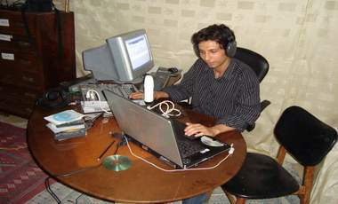

+++
title = "(كلمة تونس) ..باي باي"
date = 2009-02-07
authors = ["إسماعيل دبارة"]

[taxonomies]
authors = ["ismail-dabara"]
sections = ["fonoon"]

[extra]
section_name = "فنون"
share_image = "/media/currentarticleassets/zafer.jpg"
summary = "لم يكن الصحفيون الشباب العاملون في إذاعة (كلمة) الالكترونيّة في تونس يتصورون أن الإعلان عن تحوّلها من راديو عبر الانترنت إلى البث عبر الأقمار الصناعيّة سينتهي ب"
section_slug = "fonoon"
section_colour = "#7B2CBF"
thumb = "/media/currentarticleassets/zafer.jpg"
n_comments = 0
original_url = "http://www.20at.com:80/20at/arts/11210.html"
archived = "20100201072957"
date_source = "byline/meta"
aliases_20at = ["/20at/arts/11210.html"]

[extra.provenance]
original_url = "http://www.20at.com:80/20at/arts/11210.html"
capture_url = "https://web.archive.org/web/20100201072957/http://www.20at.com:80/20at/arts/11210.html"
capture_label = "١ فبراير ٢٠١٠، ٠٧:٢٩ UTC"
date_note = "من سطر التوقيع في المقال"
other_urls = []
comments = ""
missing_images = ""
+++

<figure></figure>

لم يكن الصحفيون الشباب العاملون في إذاعة (كلمة) الالكترونيّة في تونس يتصورون أن الإعلان عن تحوّلها من راديو عبر الانترنت إلى البث عبر الأقمار الصناعيّة سينتهي بذلك الشكل.

حيث صادرت السلطات التونسية صباح يوم 30 يناير الماضي معدات وتجهيزات راديو "كلمة" مع فتح تحقيق قضائي ضد الناشطة الحقوقية سهام بن سدرين رئيسة تحرير الراديو بحجة عدم حصولها على ترخيص قانوني.

تقول سهام رئيسة تحرير راديو كلمة في تصريحات لـ"عشرينات":"طرقنا أبواب القانون منذ العام 1999 وقدمنا مطلبا للحصول على ترخيص لإذاعة تبثّ عبر الأثير، و توجهنا إلى وزير الداخلية بطلب رخصة بثّ بعد أن استوفينا كلّ الإجراءات القانونيّة اللازمة . لكنّ السيد الوزير رفض منحنا الترخيص الذي يمكننا من الحصول على رقم في سجلات المحكمة التجاريّة مما يحفظ وجودنا بشكل قانونيّ".

وتؤكد سهام أنّ رفض السلطات منحها الترخيص دفع بها إلى اللجوء إلى الفضاء الافتراضيّ لإيصال هذا الصوت للتونسيين، فأنشأت موقعا الكترونيا خاصا بها في العام 2007 و بدأت البثّ عبره.

<h3>إذاعة مستقلّة</h3>

وتعرّف إذاعة كلمة نفسها بـ"إذاعة تونسية مستقلة عن السلطة والأحزاب السياسية، ممنوعة من الذبذبة التي جعلتها السلطة التونسية حكرا على المقربين منها ، لجأ فريقها من تونس إلى شبكة الانترنت والقمر الصناعي بحثا عن التواصل مع أهل بلدنا وأصدقائنا في العالم. وهي أول إذاعة تونسية مستقلة تبث عبر القمر الصناعي. خيارنا الكلمة الحرة وصوت مجتمعنا".

العاملون في راديو كلمة ارجعوا سبب إغلاق السلطات للإذاعة إلى عاملين اثنين ، أولهما إعلانها التحوّل من البثّ الالكترونيّ إلى البثّ عبر الأقمار الاصطناعية مما يعني جمهورا أوسع وأكثر، و ثانيهما تجاوزها في عدد من برامجها المسكوت عنه سياسيّا و اجتماعيا.

ويقول الصحفي ظافر عطي (27 سنة) وهو احد العاملين في "كلمة:"نقدّم مادة جديدة جريئة وبعيدة عن المألوف الأمر الذي ضاق به صدر الجهات المعنيّة فاستغلت إعلاننا البثّ عبر الأقمار الاصطناعية لمصادرة التجهيزات والتعلّل بأننا نخالف القانون.

<h3>سنواصل العمل</h3>

ظافر الذي احتجز لعدّة ساعات من قبل أعوان الأمن وتعرّض للتهديد والترهيب ، قال إنه شعر بالحزن لإغلاق الراديو، لكن ذلك لم يمنعه من الاصرار على مواصلة العمل مهما كلفه الأمر.

ويمكن للزائر لموقع راديو كلمة تونس أن يلاحظ أنّ الملفات الصوتيّة والمكتوبة لم تتوقف عن النشر منذ إغلاقه.

ويبدي فريق "كلمة" التقنيّ والصحفي عزما وإصرارا كبيرين للالتفاف على ما يعتبرونها "عراقيل من قبل الحكومة لإخراس صوتهم الحرّ والمستقلّ".

أما الصحفيّة فاتن حمدي (25 سنة) فتقول إنها تعرضّت إلى حصار كبير من قبل أعوان الأمن بالإضافة إلى تهديدات بالاعتداءات الجسدي نتيجة لعملها في إذاعة كلمة.

وتضيف فاتن لعشرينات:" الانتهاكات طالت والدي الذي نقل من محل سكناه بالفحص إلى أحد مخافر الشرطة وتم تهديده ، وطلبوا منه استقدامي إلى محل سكن العائلة في محافظة زغوان ومنعي من العودة إلى العاصمة لمواصلة عملي بالراديو، لكن هيهات فأنا متشبثة بشغلي و لن أخضع لأيّ تهديد".

<h3>نحلم بالعودة</h3>

طلبة "معهد الصحافة وعلوم الإخبار" أبدوا استيائهم الشديد من "إخراس راديو كلمة" كما عبّرت عن ذلك بالقول الطالبة جيهان ( 22 سنة) وتضيف:"سياسة تكميم الأفواه لن تجدي نفعا ونحن في العام 2009 ، الانترنت تستغلّ من الجميع وتستهدف الجميع لذلك فإن الحجز والمصادرة لا معنى لهما اليوم".

أما عفيف (23 سنة) طالب سنة رابعة اتصال فيقول إنّ "كلمة" ليست مستقلّة و إنما هي لسان حال المعارضة الراديكالية التي لا تريد الخير لتونس, ويتابع:" أحسنت السلطات صنعا بالقضاء على هذا الصوت النشاز الذي ينشر الافتراءات والأكاذيب عن بلادنا بشكل يوميّ".

