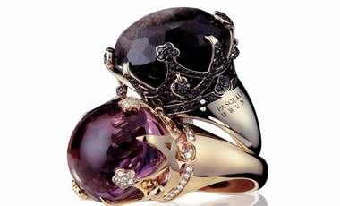

+++
title = "الدخول للمليونيرات فقط!"
date = 2009-02-24
authors = ["مصري يوسف"]

[taxonomies]
authors = ["masri-youssef"]
sections = ["fonoon"]

[extra]
section_name = "فنون"
share_image = "/media/currentarticleassets/juju.jpg"
summary = "لم يكن الشاب \"منصور\" يعلم أنه سوف يصاب بصدمة عندما يتجول بين أروقة معرض \"الدوحة للمجوهرات والساعات السادس\"، فقد ذهب للمعرض الذي تستضيفه قطر هذه الأيام، ممنيا نف"
section_slug = "fonoon"
section_colour = "#7B2CBF"
thumb = "/media/currentarticleassets/juju.jpg"
n_comments = 0
original_url = "http://20at.com/20at/arts/11400.html"
archived = "20100106005513"
date_source = "byline/meta"
aliases_20at = ["/20at/arts/11400.html"]

[extra.provenance]
original_url = "http://20at.com/20at/arts/11400.html"
capture_url = "https://web.archive.org/web/20100106005513/http://20at.com/20at/arts/11400.html"
capture_label = "٦ يناير ٢٠١٠، ٠٠:٥٥ UTC"
date_note = "من سطر التوقيع في المقال"
other_urls = []
comments = ""
missing_images = ""
+++

<figure></figure>

لم يكن الشاب "منصور" يعلم أنه سوف يصاب بصدمة عندما يتجول بين أروقة معرض "الدوحة للمجوهرات والساعات السادس"، فقد ذهب للمعرض الذي تستضيفه قطر هذه الأيام، ممنيا نفسه باقتناء ساعة تناسبه، ووضع ميزانية لهذه الساعة تقدر بألف ريال قطري (ما يعادل 275 دولار) ولكنه وجد نفسه أمام كم هائل من الساعات السويسرية باهظة الثمن والتي يصل بعضها إلى مليون ونصف المليون ريال (420 ألف دولار) بعضها مُعد للغوص في أعماق البحار والبعض الآخر مرصع بالألماس!.

ولم تكن تلك هي الفاجعة الوحيدة لمنصور، فالمعرض ليس صالحا أيضا لشراء شبكة متوسطة لعروسه، يعلق منصور: "بدلا من أن يُسمى معرض المجوهرات كان يجب أن يكون الاسم معرض المليونيرات، لذا فالإقبال ضعيف على المعرض بل يكاد معدوم إلا ما رحم ربي وكان من أهل الملايين".

أما صالح، أحد المتفرجين على المجوهرات بالمعرض، tيقول: "أنا لست من أصحاب الملايين ولكنني جئت اليوم لكي أقوم بجولة أتعرف فيها فقط على ما هو موجود، بالنسبة لي المعرض أشبه بمعرض فني تشكيلي يحتوي على العديد من اللوحات الفنية، وإذا سألتني لماذا أتيت فسأقول لك لماذا يذهب البعض إلى معرض تشكيلي أو معرض للصور الفوتوغرافية؟ .. فالأمر بالنسبة لي ليس أكثر من ذلك، فلا تتوقع أبدا أنني أمتلك مليونا لكي أشتري مثلا ساعة من الألماس ثمنها يفوق المائة ألف دولار".

أما مصطفى، فلم يرهق نفسه بالذهاب إلى المعرض معللا ذلك بقوله: "فضلت البقاء بعيدا عن هذا المعرض فهو يصيبني بالاكتئاب، لما أراه من أسعار وقطع مجوهرات بين دهاليزه، لذا فضلت البقاء بعيدا طالما أنني لن أستطع الشراء".

وأضاف ساخرا: "رغم أن زوجتي ألحت علي للذهاب أكثر من مرة ولكن هي تلح بغريزتها كامرأة تحب الذهب والمجوهرات، ولكني أرفض بغريزة الرجل الذي يرفض الشراء وإسراف المال فضلا عن عدم قدرتي أصلا على شراء مثل هذه القطع الثمينة".

<h3>لؤلؤ وأمراء</h3>

من بين القطع الأكثر غلاء في المعرض هو عقد من اللؤلؤ التاريخي والذي يعود للأسرة الحاكمة الهندية وتقدر قيمة العقد بما يفوق 20 مليون ريال، وعقد آخر من الألماس الخالص والذي تصل قيمته إلى نحو 25 مليون دولار، في حين تعرض أحد بيوت المجوهرات خاتما يحتوي على أكبر قطعة من الألماس الأزرق في العالم والذي تقدر قيمته بأكثر من 30 مليون ريال (8.3 مليون دولار تقريبا) ، ويعود لإحدى أميرات أسرة نابليون بونابرت.

وعلى حجم هذه المعروضات كان حجم الافتتاح، فرئيس الوزراء القطري حمد بن جاسم حضر بنفسه ليقص الشريط بل ويقوم بجولة داخل أروقة المعرض، أما اليوم الثاني من المعرض فقد شهد حضور غير رسمي لكل من أمير دولة قطر الشيخ حمد بن خليفة آل ثاني وحرمه الشيخ موزة بنت ناصر المسند وابنتهما مديرة مكتب الأمير الشيخة هند، أما الشيخ حمد بن جاسم ففضل المجيء اليوم الثاني في زيارة غير رسمية للمعرض ليقتني ما يشاء حيث يقال عنه أنه مولع باقتناء المجوهرات الفخمة .

وبالطبع إذا تجولت بين أورقة المعرض فحتما لن تنهي جولتك أن ترى واحد أو اثنين من العائلة الحاكمة، فمن بين الزوار أيضا الشيخة جواهر حرم ولي العهد ووالدها الشيخ سحيم بن حمد وهو الرجل الأكثر ثراء وقوة في قطر، ليستحق المعرض أن يكون "معرض المليونيرات".

