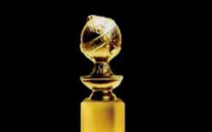

+++
title = "جولدن جلوب...لمن ذهبت الكرات؟"
date = 2007-01-17
authors = ["دعاء الشامي"]

[taxonomies]
authors = ["doaa-elshamy"]
sections = ["klam-rosas"]

[extra]
section_name = "قلم رصاص"
share_image = "/media/admins.20at.com/do3a2/golde__n-globe.jpg"
summary = "أحدث الموضات وأهم اللقطات التي أقتنصها المصورين لتحتل الصفحات الأولى من أغلفة المجلات الفنية، يتم الجري وراءها في مثل هذه الأمسيات الفنية الكبرى.."
section_slug = "klam-rosas"
section_colour = "#333333"
thumb = "/media/admins.20at.com/do3a2/golde__n-globe.jpg"
n_comments = 0
original_url = "http://20at.com/20at/arts/3061.html"
archived = "20100106012808"
date_source = "byline/meta"
aliases_20at = ["/20at/arts/3061.html"]

[extra.provenance]
original_url = "http://20at.com/20at/arts/3061.html"
capture_url = "https://web.archive.org/web/20100106012808/http://20at.com/20at/arts/3061.html"
capture_label = "٦ يناير ٢٠١٠، ٠١:٢٨ UTC"
date_note = "من سطر التوقيع في المقال"
other_urls = []
comments = ""
missing_images = ""
+++

<figure></figure>

أحدث الموضات وأهم اللقطات التي أقتنصها المصورين لتحتل الصفحات الأولى من أغلفة المجلات الفنية، يتم الجري وراءها في مثل هذه الأمسيات الفنية الكبرى..

ففي فندق هليلتون بيفرلي هيلز، احتفل نجوم هوليود بحصادهم الفني بعد عام من العمل الشاق، في حفل توزيع جوائز " الجولدن جلوب لتمتزج فرحة النجوم بالجوائز وفرحة الجمهور بصور الفائزين بالجوائز، والموعودين بالأوسكار قبل نهاية مارس القادم...!

جولدن جلوب جاءت هذا العام بترشيحات قوية للكثير من الأفلام التي عرضت أواخر العام المنقضي، لتتشابه في ذلك مع رأي الجمهور الذي اختار هذه الأفلام من خلال الإيرادات وتذاكر الشباك، ليبقى الجميع في انتظار الخبر اليقين والفوز المبين بجوائز الأوسكار.

<h3>"بابل" و"الراحلون" في الجون</h3>

وكعادة الأوساط الفنية منذ بداية هذا العام، كان السؤال الذي يشغل المجلات والصحف التي تهتم بالأخبار الفنية حول كرة جولدن جلوب الذهبية ولمن ستذهب، ومن هو سعيد الحظ الذي سيرفع الجائزة هذا العام ليس مرة واحدة ولكن مرتين لأنه مرشح بلا محالة للأوسكار أيضا.

وكان أمس الاثنين هو يوم الحسم..فشهد إعلان الجوائز وحصل على الكرة الذهبية الأولى المخرج الأمريكي "مارتن سكورسيزي" بجائزة الكرة الذهبية (جولدن جلوب) لأفضل مخرج عن فيلم(الراحلون)، الذي يدور عن عالم الجريمة فيما يعتبره كثيرين خطوة على طريق فوز المخرج الشهير بجائزة الأوسكار لأول مرة في حياته.

وفاز فيلم (بابل) للمخرج المكسيكي "اليخاندرو جونزاليس" بجائزة أفضل دراما سينمائية، والفيلم الذي يصور عالم اليوم بما فيه من ألم ومعاناة ويستكشف التفاوتات الثقافية بين الشعوب تدور أحداثه في أربع دول، ويؤدي الأدوار فيه ممثلون يتحدثون خمس لغات.

كما فاز الممثل البريطاني "ساشا بارون كوهين" بجائزة الكرة الذهبية لأفضل ممثل عن أدائه المتميز عن الفيلم الكوميدي الموسيقي (بورات)، والذي يدور حول صحفي من قازاخستان يبحث عن "المتعة الجنسية" خلال زيارة إلى الولايات المتحدة.

<h3>إليزابيث وش السعد على "ميرين"</h3>

فيما فازت الممثلة الأمريكية "ميريل ستريب" بجائزة الكرة الذهبية لأفضل ممثلة، عن الفيلم الكوميدي (الشيطان ترتدي برادا) حيث جسدت دور رئيسة تحرير شريرة لمجلة أزياء، وسبق وأن فازت الممثلة المخضرمة بخمس جوائز للكرة الذهبية عن أدوار سينمائية وتلفزيونية.

أما جائزة الكرة الذهبية لأفضل ممثل في فيلم درامي فكانت من نصيب الممثل "فورست ويتيكر" عن تجسيده لشخصية الدكتاتور الأوغندي عيدي أمين في فيلم (آخر ملوك اسكتلندا).

أما الممثلة البريطانية "هيلين ميرين" فكان لها نصيب الأسد هذا العام، لفوزها بجائزة الكرة الذهبية لأحسن ممثلة في الفيلم الدرامي (الملكة)، حيث جسدت شخصية الملكة إليزابيث الثانية، حيث أشاد النقاد بأداء هيلين لشخصية الملكة خاصة المشاهد التي تواجه فيها أزمة ثقة بعد وفاة الأميرة ديانا في حادث سيارة.

كما فازت ميرين بجائزة الكرة الذهبية لأحسن ممثلة في مسلسل تلفزيوني قصير جسدت فيه دور ملكة أخرى هي "إليزابيث الأولى"، وفيما يبدو أن الملكات "وش السعد" على "ميرين" التي بلغت عامها الـ 61 هذا العام.

كما فازت "جنيفر هدسون" بجائزة جولدن جلوبز لأحسن ممثلة مساعدة عن أداءها القوي في فيلم "أحلام الفتيات"، وفي واحدة من الجوائز المبكرة التي أعلنت أيضا فازت أغنية "القلب" من فيلم الرسوم المتحركة "الأقدام السعيدة" بجائزة "أفضل أغنية أصلية".

أما الممثل الكوميدي الأمريكي "أيدي ميرفي" ففاز بجائزة جولدن جلوبز لأحسن ممثل مساعد عن دوره في فيلم "أحلام الفتيات"، وفي الفيلم أدى ميرفي دور مطرب لموسيقى الراب تنحسر عنه الأضواء.

هكذا وزعت كرات الجولدن جلوب..فماذا لو امتلكت توزيع هذه الكرات..فمن ستختار؟

