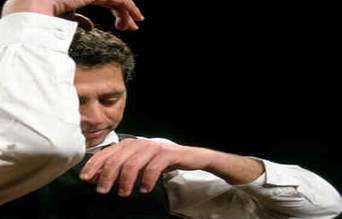

+++
title = "المسرح بيتكلم عبرى"
date = 2007-01-17
authors = ["منى سليم"]

[taxonomies]
authors = ["mona-selim"]
sections = ["klam-rosas"]

[extra]
section_name = "قلم رصاص"
share_image = "/media/admins.20at.com/aly/acca.jpg"
summary = "طفل في مدينة، قالوا له: اسمك الحقيقي \"صاحب الأرض\"، لكن لا تخبر أحد هنا..فـأنت تحمل جنسية أخرى عليك الرضوخ لقوانين دولتها..واسمها الذي ستحمله في أوراقك هو إسرائي"
section_slug = "klam-rosas"
section_colour = "#333333"
thumb = "/media/admins.20at.com/aly/acca.jpg"
n_comments = 5
original_url = "http://20at.com/20at/arts/3062.html"
archived = "20100106013304"
date_source = "byline/meta"
aliases_20at = ["/20at/arts/3062.html"]

[extra.provenance]
original_url = "http://20at.com/20at/arts/3062.html"
capture_url = "https://web.archive.org/web/20100106013304/http://20at.com/20at/arts/3062.html"
capture_label = "٦ يناير ٢٠١٠، ٠١:٣٣ UTC"
date_note = "من سطر التوقيع في المقال"
other_urls = []
comments = "٥"
missing_images = ""
+++

<figure></figure>

طفل في مدينة، قالوا له: اسمك الحقيقي "صاحب الأرض"، لكن لا تخبر أحد هنا..فـأنت تحمل جنسية أخرى عليك الرضوخ لقوانين دولتها..واسمها الذي ستحمله في أوراقك هو إسرائيل..هى عدونا وقاهرنا..أما هذه الأرض التي نحدثك عنها والتي عليك أن تتنسم شذى غيابها فاسمها "فلسطين"، واسم أهلك

 عرب48

أعتقد أن هذه هي الخلفية التي وقف بها هذا الشاب على مسرح مهرجان "تياترونيتو" التابع للكيان الصهيونى، ليقدم لجمهوره من الإسرائيليين والعرب عرض "مدى البصقة" باللغة العبرية و..يحثل المركز الأول.

<h3>ميلودراما..الركب</h3>

اسمه "خليفة ناطور" واسم العرض الركب بالعربية أو مدى البصقة بالعبرية، العرض من بطولته وقصة زميل له هو "طاهر نجيب"، أما الإخراج فكان لـ..إسرائيلية تدعى "أوفيرا هوينك".

يكون من الإجحاف لو اختصرنا الموقف لنقول أن اسم المخرجة هو جواز عبور العرض للمسرح ـ وان كان هذا لا يمنع انه موجود ـ ولكن اقترب أكثر..لتعرف أن على خشبة هذا المسرح تتداخل العديد من الخطوط التي عليك أن تختلط بها جيدا قبل أن تأخذ انطباعك وتقول لو كنت مكانهم ..

خليفة ناطور ـ كما كتب عنه ـ هو شاب محب للمسرح من بلدة قلنسوة في منطقة المثلث، تخرج خليفة من معهد الفنون المسرحية "بيت تسفي" عام 1991، ومنذ أن كان طالباً، كان من أكثر الطلاب موهبة، وكانت تسند إليه العديد من ادوار البطولة، رغم أنه العربي الوحيد في صفه.

وبعد أن تخرج شارك في العديد من الأعمال المسرحية كممثل ومخرج ومعد، وعمل باللغتين العربية والعبرية في مسرح "هبيما" وهو من أكبر المسارح الإسرائيلية.

<h3>قصة معاشة</h3>

القصة لطاهر نجيب، واهم ما نقوله انه لم يكتبها ولكنه عاشها ويحكى من خلالها حيرته هو وكل من يشبهه، أما مكان الأحداث فممتد بين رام الله، باريس، تل أبيب.. يتنقل بينها خلال مشوار حياته مع التمثيل.

يسافر من باريس إلى تل أبيب في الذكرى السنوية الأولى لتفجيرات سبتمبر، ولاحظ القلق والتوتر بين موظفي المطار في "شارل دي جول".

وتتعجب حبيبته الباريسية لماذا منعوه من السفر عشية اليوم، وسمحوا له في اليوم الثانى وكأن الساعات قد توقف خططه الإرهابية إذا كان هناك واحدة !!.

وصل تل أبيب ليستقبله الأمن الإسرائيلي بخلع الملابس والأحذية وأحزمة السراويل كما هو معتاد دائما مع أبناء عرب 48.

ينتقل بعد ذلك إلى رام الله حيث قرر أن يعمل في أحد مسارحها، رغم منع التجول والحرب وعزوف الناس عن الخروج من بيوتهم وملاجئهم.

يروي طاهر على لسان خليفة لهفته لمعرفة سرّ وقوف الشبان في رام الله على جانبي شارع "رُكب" والبصق من دون توقف، ويرد على نفسه قائلاً يحدث هذا لأنها أفواه هجرتها القبلات وهجرها الكلام الجميل وهجرها الأمل.

<h3>الطفو على الماء</h3>

شاهد عرضهم الناقد "علاء حليحل" من عرب 48، وكتب التيمة الرئيسية للعرض.. فهي نزعة الفلسطيني المُعذّب التائه، المُتفركِش أبدًا بالواقع والمُتفركِش الواقعُ به، لأن يكون طبيعيًا، لأن يكون إنسانًا عاديًا، من دون قضية، من دون آلام في العينين وفي الرأس وفي المفاصل الجوفية، من دون آلام في الألم.. ببساطة: أن يكون إنسانًا عاديًا.

ويظهر هذا جلياً في حركة "شدّ الشراع" أو "التجديف" التي يقوم بها ناطور مرارا في المسرحية، وهي حركة تعبيرية رمزية تُحيل الفلسطيني كإنسان على وشك الغرق (أو النجاة)، يُعارك قوىً تشدّه نحو ما لا يرغب، فيقاومها بأضعف وسائل المقاومة..الطفو على الماء.

<h3>خلف الجدار .. يقفوا</h3>

خليفة وطاهر ليس وحدهما في هذه الحالة المشتبكة بالفن والقضية، فهناك أجيال متعاقبة أخرجتها هذه المدن المنبوذة صهيونياً المتحرش بها عربياً من خلال نظرة تستنكر ولا تقدم بديل.

وبرغم هذا يلفت نظرك محاولاتهم المستمرة للوصول والتواصل العربي، ونتوقف مع مبادرة أخيرة جاءت مفعمة بروح هذه المدن الحبيسة، من خلال العرض المسرحي "الجدارية" الذي تم انجازه منذ فترة وعرض على مسارح عالمية في سويسرا والدنمارك، وكانت دمشق هي العاصمة العربية الأولى التي استضافت عرضهم العربي الأول خلال الشهر الماضي على مسرح دار الأسد.

و..الجدارية هي قصيدة شهيرة لابن حيفا الشاعر "محمود درويش" كتبها من سرير المرض وقال أنها تميمة ضد موت الهوية والمعنى.

وقال انه تفاجأ عندما طلب منه "مكرم خوري" رئيس فرقة المسرح الوطني الفلسطيني موافقته، وتفاجأ أكثر عندما رأى الأداء الذي كان من نصيب نزار أمير زعبي في الإخراج، ومساعدتة ثريا طه، وخليفة ناطور في الإعداد، وتمثيل مكرم خوري، خليفة ناطور، ريم تلحمي، ربى بلال، جميل خوري، ريمون حداد، رانية طحان، وموسيقى حبيب شحادة، وإضاءة فيليب دي، وتصميم ملابس حمادة عطا الله، وتصميم أقنعة عبد السلام عبدو.

كل هؤلاء من أبناء عرب 48، فهل تفكر معنا في مناقشتهم ومشاهدة فنهم وإن كان بالعبري.. ننتظر رأيك..

