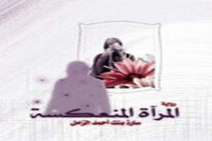

+++
title = "بنات الرياض أمام المرآة المنعكسة"
date = 2007-01-19
authors = ["أحمد العمودي"]

[taxonomies]
authors = ["ahmed-elamoudi"]
sections = ["fonoon"]

[extra]
section_name = "فنون"
share_image = "/media/admins.20at.com/aly/story.jpg"
summary = "بعد أن أطلت علينا رواية \"بنات الرياض\" التي أثارت الكثير من الهجوم وردود الأفعال المتباينة داخل السعودية، يظهر بين أيدينا اليوم رواية سعودية جديدة مضادة للأولى، "
section_slug = "fonoon"
section_colour = "#7B2CBF"
thumb = "/media/admins.20at.com/aly/story.jpg"
n_comments = 11
original_url = "http://www.20at.com:80/20at/arts/3074.html"
archived = "20100301230441"
date_source = "byline/meta"
aliases_20at = ["/20at/arts/3074.html"]

[extra.provenance]
original_url = "http://www.20at.com:80/20at/arts/3074.html"
capture_url = "https://web.archive.org/web/20100301230441/http://www.20at.com:80/20at/arts/3074.html"
capture_label = "١ مارس ٢٠١٠، ٢٣:٠٤ UTC"
date_note = "من سطر التوقيع في المقال"
other_urls = []
comments = "١١"
missing_images = ""
+++

<figure></figure>

بعد أن أطلت علينا رواية "بنات الرياض" التي أثارت الكثير من الهجوم وردود الأفعال المتباينة داخل السعودية، يظهر بين أيدينا اليوم رواية سعودية جديدة مضادة للأولى، تثير أيضا الجدل والنقاش..هي رواية

"المرآة المنعكسة" لمؤلفتها الشابة "سارة أحمد الزامل" (20 عاما) الطالبة بكلية الشريعة جامعة الإمام محمد بن سعود الإسلامية.

حيث برزت العديد من الردود المختلفة تجاهها، لكن على عكس الرواية الأولي كانت الآراء في أغلبها تميل للترحيب بالرواية الجديدة، واصفة إياها بأنها "صد للأقلام التي تحاول تشويه صورة المجتمع السعودي"، وقد ظهرت تلك الآراء لاسيما عبر المنتديات الحوارية وساحات الإنترنت.

<h3>تحسين الصورة</h3>

إحدى الفتيات من رواد منتدى (طالبات جامعة الإمام محمد بن سعود الإسلامية)، شكرت الكاتبة على هذا الجهد قائلة: "أشكرك على غيرتك علينا نحن بنات الرياض، وأوافقك في تحسين الصورة التي لطختها بعض الأيدي الطائشة العابثة، التي فقدت المصداقية وابتليت بداء التعميم الجائر المجرد من الواقعية..نحن في انتظار المزيد من الصور المشرقة لنا نحن بنات الرياض".

فيما قالت إحداهن وسمت نفسها بـ"بنت الرياض": "يعلم كل من قرأ رواية (بنات الرياض) الفكرة السيئة عن مجتمع لم نراه لا أنا ولا غيري، ولم اسمع عنه إلا في مجتمعات بعيده كل البعد عن مجتمعنا الذي قام على العقيدة الصحيحة، وحتى لو وجد ما ذكرته فانه منبوذ لدينا ومحارب ونقيم عليه شرع الله إذا علمناه".

<h3>عكست جزء من الواقع</h3>

"موني"، وصفت رواية سارة بأنها "عكست جزء من الواقع"..تقول: "الواقع كبير ولا يمكن حصره برواية، عندما قرأت الرواية أحسست أني بمجتمع سعودي تطرقت سارة لمشاكلنا.

تضيف: "رواية سارة أخذ عنها الجميع فكرة بأنها رواية أفلاطونية تصف مجتمع مثالياً، ربما داهمهم هذا الشعور عندما قرأوا عن الجلسة الأخوية التي أقامتها قاعة مها في بداية الرواية، لا يعلمون أننا في قسم الشريعة في محاضرات الفراغ التي تحصل نادراً تقام جلسات أخوية وأحياناً تقام بين العشر دقائق بين المحاضرتين".

أما "قمر 15" في منتديات آسية، فشكرت من خلال تعليقها الكاتبة، قائلة: "سارة إنسانه غيورة على بنات وطنها، غيرها كتب روايته على حساب سمعة بنات الرياض، وكان كلامهم كله يخالف الواقع، وبصراحة إنا انقهرت أن فيه ناس أيدوا مثل تلك الروايات ".

<h3>لم نخلق كاملين</h3>

مقابل ذلك ظهرت العديد من ردود الفعل التي لم ترحب بالرواية، حيث تقول أحد المشاركات في (منتديات نسيج) منتقدة سارة: "أنتي منزهه بنات كليتك عن الأخطاء, الله لم خلقنا كاملين، وأنتي تتحدثين عن شخصيات ولا في الخيال".

<h3>انعكاس للصورة الإيجابية</h3>

الكاتبة "سارة الزامل" في تعليقها على الرواية أكدت لـ"عشرينات" بأن رواية "المرآة المنعكسة" هي "انعكاس لصورة المجتمع السعودي الإيجابية، التي حاول البعض تشويهها والنيل منها".

وقالت: "كتبت روايتي في محرم عام 1427هـ، وتم صدورها في شهر ذو الحجة من نفس السنة، جلست أكتب أحداثها فيما يقرب سبعة أشهر، ثم شهرين آخرين أقوم بتعديل بعض أجزائها وتنظيمها أكثر، وفي الطبعة الثانية قد تكون منقحة أكثر لبعض الأخطاء المطبعية الواردة".

وأضافت: "هذه الرواية ليست أول عمل أدبي لي، ولكن هي أول عمل أنشره، وكان لنشرها أهداف عدة، إذ لم أود أن يكون عملي أجوفاً لا حقيقة له، وإنما حاولت أن أطوع هذا العمل لتصوير أقرب صورة أراها حولي.. أذكر أن إحدى الصديقات لما أنهت قراءة روايتي، قالت لي أنها أثناء قراءتها للأحداث تقوم بتركيب الشخصيات على طالبات الجامعة!، وتقصد بذلك أن هذا العمل يحكي عن واقع فعلا حقيقي وليس مزيف أو مبالغ فيه، لذا سأنبّه.. أن الرواية عموما من نسج الخيال لكن الأحداث التي تكلمت عنها قد تقع للكثيرين".

وأوضحت سارة أن الرواية تحكي عن قصة "هيفاء" ومعاناتها مع العادة التي تمسك بها أبوها وهي ما لم ينزل الله بها من سلطان، وعن "منار" ومشكلتها الصعبة مع خالد السكير، و"مها" وأخلاقها وحب الخير، ودهاء "ريم" واستغلالها لطاقاتها، وحلم "ندى" وتعلقها بذكرى أختها، و"عبير" ذو الاهتمامات الساذجة، و"محمد" العائد من أفغانستان".

مؤكدة أن هذه الرواية "انعكاس للصورة الحقيقية للمجتمع" الذي تعيشه، مبينةً بأن الدافع الذي جعلها تتحمس لكتابتها هو عدم حبها أن يوصف هذا المجتمع بسوء زوراً، متسائلة: "أليس السكوت عن هذا الوصف كالرضا بوجوده !".

<h3>سلوكيات موجودة</h3>

وأضافت: "لم أطلق على روايتي ببنات الرياض، ولم أذكر أنها تمثّل منطقة معينة من المملكة، بل كنتُ أصور فكراً يتمثل في كثيرين ممن هم حولي، سواء كانوا في الرياض أو الدمام أو مكة أو المدينة أو القصيم أو جدة، فأحببت أن أنقل صورة وإن كانت شخصياتها لم تعش بأسمائها بيننا لكننها تعيش بسلوكها وتمثّل الواقع كما نراه جميعاً".

وأوضحت بأن دعم الرواية كان جدا رائع، وذلك أقوى دلاله على أن المجتمع يحب إشاعة الخير والتحدث عنه، ويكفي إطلالة واحدة على ساحات الانترنت لترى الفرح العارم بصدورها، وجعلهم هذه الرواية إنجاز لهم وخطوة كانوا ينتظرونها من قريب، والكثيرون ممن كان يتابع الأجزاء عبر صفحات المنتديات لم يتوقع إصراري بجعلها منشوره، ومازالت الفرحة بهذا العمل مشاعة بين الناس وإن كنت أنا أسعدهم، وردود الفعل السيئة نادرة جدا أمام صخب الفرح الذي أظهره القراء لروايتي.

مشيرة في نهاية حديثها بأنها تعتبر هذه الرواية إنجاز بسيط لحلم كانت تود تحقيقه.. مشيرةً إلى أن حلمها كان مشاركة الأقلام ذات النهج الخاضع لحدود الشريعة لصد عفن الأقلام المخالفة.

<h3>* نص الرواية موجود في</h3>

<a href="https://web.archive.org/web/20100301230441/http://www.saraalzamil.jeeran.com">مدونة سارة الزامل</a>

