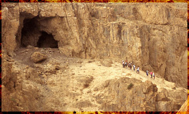

+++
title = "الإعلام : ميلادي آه هجري لا"
date = 2007-01-20
authors = ["محمد فاروق عجم"]

[taxonomies]
authors = ["mohamed-farouk-agam"]
sections = ["klam-rosas"]

[extra]
section_name = "قلم رصاص"
share_image = "/media/admins.20at.com/aly/hijra.jpg"
summary = "بالأمس القريب احتفلت جميع القنوات الفضائية والأرضية بليلة رأس السنة الميلادية الجديدة 2007، وها نحن اليوم على رأس سنة هجرية جديدة 1428.. فكيف تم الاحتفال بهما إ"
section_slug = "klam-rosas"
section_colour = "#333333"
thumb = "/media/admins.20at.com/aly/hijra.jpg"
n_comments = 3
original_url = "http://20at.com/20at/arts/3083.html"
archived = "20100106013438"
date_source = "byline/meta"
aliases_20at = ["/20at/arts/3083.html"]

[extra.provenance]
original_url = "http://20at.com/20at/arts/3083.html"
capture_url = "https://web.archive.org/web/20100106013438/http://20at.com/20at/arts/3083.html"
capture_label = "٦ يناير ٢٠١٠، ٠١:٣٤ UTC"
date_note = "من سطر التوقيع في المقال"
other_urls = []
comments = "٣"
missing_images = ""
+++

<figure></figure>

بالأمس القريب احتفلت جميع القنوات الفضائية والأرضية بليلة رأس السنة الميلادية الجديدة 2007، وها نحن اليوم على رأس سنة هجرية جديدة 1428.. فكيف تم الاحتفال بهما إعلاميا؟

إذا حاولنا تتبع مسار القنوات الفضائية في الاحتفال بالمناسبتين، سنجد أن هذه القنوات جميعها، والتي تخطت عددها حاجز الـ 250 قناة، اشتركت شاشاتها في العديد من الملامح..

<h3>على كل لون</h3>

فقبل دخول العام الميلادي الجديد بأيام حاولت كل قناة جذب المشاهدين، فرفعت شعارات من قبيل تابعوا معنا حفل ليلة رأس السنة الساهر على قناة (....)، أجمل الفقرات فقط على قناة (....)..

لكن هذه الفقرات تشابهت فيما بينها.. فمن كل أنحاء الدنيا نشاهد ونسمع أصوات الألعاب النارية والمفرقعات والأضواء تطفأ وُتشعل احتفاء بالعام الميلادي الجديد..

والفنانين هم ضيوف ونجوم ليلة الكريسماس بلا منافس.. هذه جاءت بالنيولوك الجديد، وهذا متحدثا عن أعمال وضعته على طريق النجومية..

مصممي ومصممات الأزياء يعرضون أحدث تصميماتهم..

وخبراء وخبيرات التجميل يقدمون أحدث المكياجات وقصات الشعر..

مشاهد تقارع كؤوس الخمر "في صحة" العام الميلادي الجديد..

عشرات الفيديو كليب تعرض لأول مرة..

أفلام ومسلسلات بكل اللغات، ترفع شعار "حصرية العرض" لكي يستمتع المشاهدين..

تنبؤات، توقعات، أبراج، تحليلات، حصاد..

<h3>احتفال على استحياء</h3>

لكن كل هذه البهجة والفرحة التليفزيونية تضيع إذا كانت المناسبة رأس السنة الهجرية!!

وإذا تذكرت إحدى القنوات أن هناك عاما هجريا جديدا يهل، فالاحتفال يظهر على استحياء..

عرض أفلام دينية "حفظ المشاهد العربي أحداثها عن ظهر قلب"..

أغنيات دينية لا تمت للدين بأي صلة..

الحلقات الأخيرة من مسلسلات رمضان الدينية التي سجلت أثناء عرضها "لم يشاهد أحد"!!

.....، لا أجد ما أكتبه لأنه لا يوجد أكثر من ذلك!!

أما المنفذ الوحيد الذي يروي ظمأ المشاهدين في هذه المناسبة الدينية، يكون من خلال القنوات الدينية المتخصصة، التي تحاول جاهدة أن تقديم ما يليق بالمناسبة، من خلال عرض الأمسيات الدينية واستضافة المشايخ وعلماء الدين من خلال ندوات تتحدث عن فضل الهجرة..

لكن هل يتناسب ذلك مع أهمية هذه المناسبة؟

وكيف لنا أن نوظف الإعلام في خدمة أعيادنا الدينية؟

<h3>تقصير الفضائيات</h3>

تجيب عن هذه الأسئلة الدكتورة (ثريا البدوي)، الأستاذة بكلية الإعلام جامعة القاهرة، بقولها: بالفعل هناك تقصير شديد من الفضائيات في حق رأس السنة الهجرية، بل أن ثقافة المجتمع حاليا لا تحبذ هذا الاحتفال، فالاحتفالات لدينا ترتبط بالأنظمة السياسية، وانتقل ذلك حاليا إلى محيط الأسرة فنجد احتفالات تتم داخل المنازل احتفالا بالعام الميلادي الجديد!

وإذا قمنا بسؤال أي فرد داخل هذه الأسر في أي عام هجري نحن؟ لا يعرف، بل هناك من لا يعرف أسماء الشهور الهجرية نفسها.

عمل على ذلك توجه الفضائيات، فهي تقتصر في رأس السنة الهجرية بعرض "برومو" يحمل تاريخ السنة الجديدة، وكلمة كل عام وأنتم بخير مثلا، وهناك من يعرض أفلام تحمل الصفة الدينية أنتجت منذ عشرات السنين، لكن على العكس نرى اهتماما متزايدا بقدوم السنة الميلادية، مما أدى إلى تغيير في العادات والتقاليد التي نشأت عليها الأسر العربية، ومن ثم التغير في التوجهات الثقافية في المجتمعات العربية.

وعن كيفية توظف الإعلام في خدمة أعيادنا الدينية قالت: الإعلام لا يستطيع أن يغير اتجاهات أصبحت تتحكم في المواطن، ولكن ما يستطيع أن يقدمه هو محاولة التوعية الصحيحة، من خلال عرض النماذج الإيجابية والبعد عن السلبيات.

وليس هناك احتفالا لائقا يجب أن نقره بكل مناسبة دينية، فهي ليست قاعدة يجب أن تسير عليها الفضائيات، بل ما يمكن قوله أن تعمل الاحتفالات المقدمة على جعل الإنسان المسلم يتمسك بدينه ويحكم ضميره، في عصر ضاعت فيه القيم والمبادئ.

<h3>تقليد للغرب</h3>

عمل تزايد القنوات الفضائية على اعتناق أساليب واتجاهات مستحدثة، وتقليد الاتجاهات الغربية دون مراعاة خصوصية المجتمعات والأخلاقيات العربية والإسلامية..كان ذلك ما توصلت إليه دراسة للدكتورة ( عزة كريم )، أستاذ علم الاجتماع، فالفضائيات تعتمد على أفكار مستوردة تركز علي الرغبات المفجرة للغرائز والأحاسيس، مما أدي إلى تعرض المشاهد العربي إلى مواجهات إعلامية مختلفة ومتنوعة ومتعارضة، تشتمل على ما هو منحرف ومتحرر وجنسي، وبين ما هو ملتزم وأخلاقي وديني، مما أدى إلى حدوث بلبلة فكرية، وأصبح الجمهور يتأرجح بين التناقضات التي تبثها الفضائيات مما عمل على ضياع المعايير أمام هذه الأفكار المستوردة والواردة إلينا.

وأنت.. ما رأيك فيما يقدم..وكيف ترى الاحتفال المناسب بأعيادنا الدينية ؟

