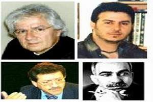

+++
title = "الرقابة والحرية.. قضية العرب الأبدية"
date = 2007-01-21
authors = ["كامل الشيرازي"]

[taxonomies]
authors = ["kaml-elshirazi"]
sections = ["klam-rosas"]

[extra]
section_name = "قلم رصاص"
share_image = "/media/admins.20at.com/aly/clip_imag.jpg"
summary = "تبدو مسألة \"حرية التعبير والفكر، والرقابة في الوطن العربي\" متشعبة وغير قابل للإنتهاء، وغير قابلة للصمت، غير قابلة للسكوت عنها.."
section_slug = "klam-rosas"
section_colour = "#333333"
thumb = "/media/admins.20at.com/aly/clip_imag.jpg"
n_comments = 0
original_url = "http://20at.com/20at/arts/3088.html"
archived = "20100106013041"
date_source = "byline/meta"
aliases_20at = ["/20at/arts/3088.html"]

[extra.provenance]
original_url = "http://20at.com/20at/arts/3088.html"
capture_url = "https://web.archive.org/web/20100106013041/http://20at.com/20at/arts/3088.html"
capture_label = "٦ يناير ٢٠١٠، ٠١:٣٠ UTC"
date_note = "من سطر التوقيع في المقال"
other_urls = []
comments = ""
missing_images = ""
+++

<figure></figure>

تبدو مسألة "حرية التعبير والفكر، والرقابة في الوطن العربي" متشعبة وغير قابل للإنتهاء، وغير قابلة للصمت، غير قابلة للسكوت عنها..

لذا دائما يثار السؤال.. هل حقا هناك مساحة كافية من هذه الحرية على مدى خريطة وطننا العربي؟، أم هي مجرد هامش صغير مسموح بها في حدود ما يمكن أن تسمح به السيدة "رقابة" التي تفرضها وترعاها الأنظمة العربية "العتيدة"؟

"عشرينات" اغتنمت فرصة تواجد كوكبة من الأدباء العرب في الجزائر هذه الأيام بمناسبة "المهرجان الثقافي العربي"، وطرحت عليهم القضية الأبدية..

<h3>خارج الحدود</h3>

يقول المترجم الأردني ) قاسم طلاع)، المقيم في النمسا: الكاتب العربي لا يتمكن في الغالب من ممارسة حرية الكتابة إلا خارج وطنه، ويعتقد أنّ المجتمعات العربية لازالت تحت رحمة الاستبداد الفكري الأحادي الجانب، والرغبة المتجذرة لدى النظم السياسية القمعية في محاولة دحر المبدع ليس فكريا فقط، وإنما إلغائه كإنسان أيضا، كما أنّ وسائل الإعلام من صحف ومجلات وإذاعة وتلفزيون، والتي غالبا ما تكون ملكا للسلطة، تنتهج خطابا مغايرا لما هو كائن، فهي تسوّق لـ" مجتمع قائم على التسامح الاجتماعي واحترام الآراء المغايرة وصيانة حقوق الإنسان وحقوق الأقليات الأخرى"، إلا أنّ الميدان يكشف زيف ادعاءاتها.

ويجزم طلاع إنّ الحرية المسموح بممارستها، هي تلك التي تتوافق مع مزاج المشروع السلطوي، لذا فالكاتب والشاعر والمفكر والمثقف، لا يتمكن من ممارسة حرية الكتابة إلا خارج حدود الوطن العربي، أي أن ما ينتجونه من إبداع يكون دائما في بلد الغربة.

<h3>مفهوم مشوّش</h3>

أما المفكر العراقي المقيم في هولندا (صلاح حسن)، يرى إنّ مفهوم الرقابة مشوش في عالمنا العربي لارتباطه بمفهوم (العقاب)، ويتصور صلاح إنّ الرقابة تحددها ثقافة المجتمع نفسه، وهي ليست نتاجا بالضرورة لمختلف عمليات الإبداع.

ويقارن محدثنا بين الرقابة في المجتمع الفرنسي ونظيرتها العربية، فيلاحظ أنّ المفهوم نفسه سيتغير ويتخذ أسماء شتى، لأن الثقافة الفرنسية تختلف تماما عن الثقافة العربية، تبعا لكون المجتمع الفرنسي مجتمع غربي يتمتع بالتعددية الثقافية التي تسمح بتعدد الأديان واللغات والعادات والتقاليد ويكون الفرد فيه ذا خصوصية شديدة، أما المجتمع العربي فيناقض ذلك رأسا، فالدين واحد واللغة واحدة، في فرنسا يستطيع الفرد هناك أن يغير دينه من المسيحية إلى الإسلام مثلا دون أن يفكر بنوع معين من الرقابة أو العقاب، لكن ماذا سيحدث لو أن مواطنا عربيا يعيش في الخليج العربي أو مصر قرر أن يصبح مسيحيا؟، في هذه الحالة ستظهر رقابات متعددة، دينية، إجتماعية، أخلاقية، قانونية، ثقافية، ويترتب عليها أنواع متعددة من العقوبات، لذا فمفهوم الرقابة عندنا ينطلق من مبدأ ( التحريم ) بينما في الغرب ينطلق من مبدأ (الحماية).

وينتقد صلاح الناس الذين يعتقدون أن الغرب يعيش بدون رقابة، وأن الشرور التي تنهال عليهم من هذا الغرب سببها هذا التسيب الرقابي، مشددا إنّ هذه الفكرة ليست صحيحة، ومتأتية من الجهل بالثقافة الغربية التي تفرض رقابة صارمة، لكنها تفرق بين الرقابة والحرية، بين الرقابة والقانون.

كما يستنج أنّ تشوّه مفهوم الرقابة في المجتمعات العربية، أفرز ثقافة سلوكية عاطلة مثل تخلف النظم السياسية وهيمنة الحزب الواحد والطبقة والعشيرة، بجانب تخلّف التعليم وانتشار الأمية، وكذا التخلف الاقتصادي وانتشار الفقر، وهو ما حوّل الفرد إلى رقيب من نوع آخر هو الرقيب السلبي أو الرقيب المعاق نفسيا، وبالتالي فإن كل نشاط مهما كان نوعه ومهما كان تقليديا سيتحول إلى عبء وينبغي أن يمر بمراجعات كثيرة قبل الشروع به أو إنجازه، بطبيعة الحال تسهم الدولة أو الطبقة الحاكمة ذات النزعة المهيمنة بتغذية هذه الرقابات وجعلها عنصرا من عناصر الضغط على المجتمع والفرد على السواء من أجل ديمومتها وديمومة سياساتها .

<h3>تحريم ذاتي</h3>

من جهته، يتوسم الكاتب الجزائري (فائق جوزي)، إنّ الرقابة لدى العرب تحولت إلى نمط ثقافي وخيار اجتماعي وطريقة في التربية سواء في البيت أو المدرسة أو الشارع، وبالتالي نشأ نمط من الرقابة الذاتية القسرية المحرّمة التي تحد من انطلاق المواهب والخبرات الشخصية ذات الطبيعة الإبتكارية لأن الفرد لا يجرؤ على التجريب أو المغامرة خارج محيطه الاجتماعي المغلق .

ويعارض جوزي اعتقاد بعض الناس من أنّ ثورة الاتصالات ستلغي بشكل تلقائي عملية الرقابة، مستندا إلى إخضاع أي دولة في العالم وسائل الاتصال إلى رقابة صارمة تمكّنها من مراقبة البريد الإلكتروني لأي شخص بوسائلها الخاصة إذا شعرت أنّ هذا الشخص يشكل خطرا على أمنها القومي، وبالتالي فلا معنى.

أما اختفاء الرقابة، فهي توظف في غير مقاماتها الحقيقية، كما هو حال المواقع الإباحية التي يوفرها الأنترنت، فلا تخيف الدولة بقدر ما توفر لها منفذا تستطيع أن تتحكم من خلاله برصد حركة المجتمع ونزعاته.

<h3>تابوهات الرقابة</h3>

يربط الشاعر التونسي (منجي العلوني)، الرقابة بما يعرف بـ"التابوهات"، في صورة الجسد الذي أريد له ان يمثّل في ثقافتنا العربية مشكلة معقدة لا يود أي شخص الخوض فيها بإعتبارها منطقة محرمة على أصعدة كثيرة، ابتداء من التسمية وانتهاء بالمعرفة التي نمتلكها عنه، لذا يجب مراقبة الجسد فهو (عورة) في اللغة و(شيء كريه) ينبغي أن يختفي خلف حجب كثيرة، وهو خطر قد يصيب المجتمع بالجنون، لذلك ينبغي أن يتوارى عن الأنظار وتحجب أي معرفة تتناوله حتى في المدارس، ما يحوّل هذا الجسد لدى الطالب المراهق إلى خطر مبهم ومشكلة عسيرة على الفهم بفعل التراكم.

