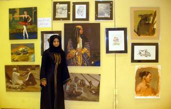

+++
title = "منى.. الأصل كالصورة!"
date = 2008-12-10
authors = ["دعاء الشامي"]

[taxonomies]
authors = ["doaa-elshamy"]
sections = ["fonoon"]

[extra]
section_name = "فنون"
share_image = "/media/currentarticleassets/images/marwah/p1050996.jpg"
summary = "فتاة بملامح سمراء، ترتدي جلبابا مميزا في ألوانه وتقاسيمه وزركشته، ترتدي الكثير من المجوهرات والحلي، تنظر نظرة أقرب إلى الحزن منها إلى الفرح.."
section_slug = "fonoon"
section_colour = "#7B2CBF"
thumb = "/media/currentarticleassets/images/marwah/p1050996.jpg"
n_comments = 1
original_url = "http://20at.com/20at/arts/7969.html"
archived = "20100106005209"
date_source = "byline/meta"
aliases_20at = ["/20at/arts/7969.html"]

[extra.provenance]
original_url = "http://20at.com/20at/arts/7969.html"
capture_url = "https://web.archive.org/web/20100106005209/http://20at.com/20at/arts/7969.html"
capture_label = "٦ يناير ٢٠١٠، ٠٠:٥٢ UTC"
date_note = "من سطر التوقيع في المقال"
other_urls = []
comments = "١"
missing_images = "٢"
+++

<figure></figure>

فتاة بملامح سمراء، ترتدي جلبابا مميزا في ألوانه وتقاسيمه وزركشته، ترتدي الكثير من المجوهرات والحلي، تنظر نظرة أقرب إلى الحزن منها إلى الفرح..

الفتاة القطرية، التي وصفناها في السطور السابقة هي بطلة لوحة زيتية رسمت خطوطها فتاة قطرية أيضا، تشبه بطلتها إلى حد كبير، فيما عدا أن الأولى نظرتها حزينة لا ترتدي غطاء للرأس وتستبدله بزينة جذابة، في حين ترتدي الثانية عباءة سوداء وحجابا ومبتسمة طوال الوقت..

منى بوجسوم، فتاة قطرية، عمرها واحد وعشرون عاما، هي "كوكتيل" غريب فقد درست في الجامعة علوم الكمبيوتر وتعمل في موظفة في مؤسسة البترول الذي تحتكر بلادها نسبة لا بأس بها منه عالميا، أما هوايتها فهي الرسم.

<h3>تفاحة منى</h3>

بدأت حكايتها بالرصاص ولكنه رصاص خلاق غير قاتل، حيث خطت به أولى لوحاتها وهي تفاحة جملية لازالت تحتفظ بها حتى الآن، اختارت الرصاص برغم أنها بدأت تهتم بموهبتها الفنية بعد أن تخطت سن العشرين أي بعد مرحلة الطفولة بسنوات طويلة.

عن اهتمامها بالفن، تقول منى: "لم يكن الرسم في اهتماماتي، فقد كنت مجرد طالبة عادية أدرسه في حصص التربية الفنية فقط، ولكن زاد اهتمامي بالرسم بعد تخرجي من الجامعة خصوصا مع زيادة وقت الفراغ".

بدأت محاولاتها بالقلم الرصاص والفحم، ثم تطورت فرسمت بالباستيل والزيت وألوان المياه وغيرها من المواد، وبرغم أنها بدأت قبل عام واحد في هوايتها إلا أنها أبدعت أكثر من 25 لوحة، واشتركت في معرضين في نشاط الصيف، كما أقامت معرضا في جامعة قطر وتستعد الآن لمعرضها الشخصي الأول في يناير الحالي.

<h3>محترفة رسم</h3>

مع رسوماتها تشعر أنها ولدت فنانة، فلوحاتها مختلفة ومميزة وتشعرك بحس مختلف، فهنا تستطيع أن ترى الباليرينة الجميلة وهي ترقص، وهناك تجد الفتاة القطرية بزيها الشعبي المسمى بالنشل، وقربهما بقليل تجد لوحة للحلاق وهو يمارس مهامه في الحارة.

ورغم ذلك فهي لا تنوي احتراف الرسم ولكنها مقتنعة أنه هواية جميلة لا مانع من تطويرها والسير قدما نحو تحقيق نجاحات بها ولكنها لا تصلح كمهنة.

أما عن رأي أسرتها فيما تفعله، فتقول: "أهلي شجعوني كثيرا على مواصلة الرسم خصوصا قبل أن التحق بعملي الحالي، وبعد أن أرسم لوحة من لوحاتي لابد أن أعرضها أولا في بيتنا الصغير وبعدها على العائلة الكبيرة لإبداء الرأي فيها، وأعدل عليها إذا اقتنعت بانتقاداتهم".

عرضت منى رسوماتها فسارع الكثيرون بشرائها، ورغم أنها لوحة الفتاة القطرية قد اجتذبت انتباه الجميع، إلا أنها رفضت بيع هذه اللوحة بالذات، فهي الأقرب إلى قلبها، كما أنها رسمتها لتهديها إلى صديقتها ولن تفرط بها أبدا، ومثلها لوحة التفاحة باكورة إنتاجها، ولكنها لن تهديها ولن تبيعها بل ستحتفظ بها دوما في بيتها.

بابتسامة جذابة وقدر كبير خجل يكلل وجهها انتهى حواري معها، وبرغم إعجابي بكثير من لوحاتها خصوصا لوحة طفلة وطفلة يقبلان بعضهما البعض إلا أن تأخري قليلا عن موعد بدء الشراء جعلها من نصيب شخص آخر!.

* شاهد صور رسمتها منى:

