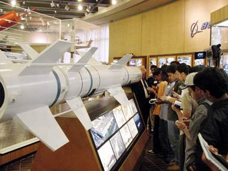

+++
title = "اختراعات شبابية.. في العتمة!"
date = 2009-02-08
authors = ["ناصر القحطاني"]

[taxonomies]
authors = ["nasr-elkhtani"]
sections = ["health"]

[extra]
section_name = "صحة"
share_image = "/media/currentarticleassets/ekhtra3atshababya.jpg"
summary = "شباب سعودي.. ذكور وإناث.. أبدعوا وابتكروا مخترعات تدل على تفوقهم وقدرتهم، وبرغم أن بعضهم كان الحظ ملازما له لبروزه والاحتفاء بابتكاره واختراعه، إلا أن البعض الآ"
section_slug = "health"
section_colour = "#2A9D8F"
thumb = "/media/currentarticleassets/ekhtra3atshababya.jpg"
n_comments = 0
original_url = "http://20at.com/20at/health/11228.html"
archived = "20100105210208"
date_source = "byline/meta"
aliases_20at = ["/20at/health/11228.html"]

[extra.provenance]
original_url = "http://20at.com/20at/health/11228.html"
capture_url = "https://web.archive.org/web/20100105210208/http://20at.com/20at/health/11228.html"
capture_label = "٥ يناير ٢٠١٠، ٢١:٠٢ UTC"
date_note = "من سطر التوقيع في المقال"
other_urls = []
comments = ""
missing_images = ""
+++

<figure></figure>

شباب سعودي.. ذكور وإناث.. أبدعوا وابتكروا مخترعات تدل على تفوقهم وقدرتهم، وبرغم أن بعضهم كان الحظ ملازما له لبروزه والاحتفاء بابتكاره واختراعه، إلا أن البعض الآخر – وهم غالبية- لم تتجاوز ابتكاراتهم محيط مدارسهم أو كلياتهم!.

فالطالب مهند بختاور، من كلية العلوم المالية والإدارية بالمدينة المنورة، ينادي بأن يكون هناك تحرك رسمي سعودي لتلك الابتكارات وتحويلها إلى منتجات سعودية وألا تصبح مجرد ابتكارات يتم وضعها في صالات على سبيل الذكرى.

موضحا أنه نجح في ابتكار جهاز بعنوان "السرير الواقي من تقرحات الفراش"، ويتميز بعدد من الخصائص ومنها تقليب المريض ذاتيا، والتحكم به عن طريق الذكاء الصناعي، مبينا أنه تلقى عدة عروض من شركات لتسويق اختراعه إلا أنه لم يفكر جديا في تلك العروض، وتمنى أن تكون هناك شركة سعودية تحتوى ابتكاره.

<h3>زورق وإنذار</h3>

"نريد أن يهتموا بابتكاراتنا واختراعاتنا" هكذا عبر أصغر مخترع أو مبتكر أحمد عوض الوادعي، 13 سنة، طالب بمدرسة خباب الابتدائية بأبها، يضيف: "وجدت التشجيع من أساتذتي حتى استطعت ولله الحمد من ابتكار زورق متحرك صغير موصولا ببطاريات أشبه بلعبة أطفال تستحق الاهتمام".

ولأن الفتيات يضعن في الغالب أجهزة جوالاتهن داخل حقائب أيديهن؛ قامت أسيل عبد الرحمن الوابل، التي تدرس بالمرحلة الجامعية بجامعة الملك سعود، بابتكار جهاز عبارة عن جزئيين، الأول علبة والثاني جهاز اتصال لاسلكي، والعلبة مزودة بجهاز إنذار يصل إلى مسافة 60 مترا، ومتصلا بجهاز داخل الحقيبة، وفى حال تعرض الحقيبة لسرقة يصدر الجهاز صوت إنذار وخاصة إن كان متصلا بجهاز الجوال.

تتمنى أسيل أن تجد الاهتمام من قبل المسئولين وقطاع رجال الأعمال لتبنى ابتكارها وتصنيعه، وتؤكد أن الجهاز وُثق لدى مدينة الملك عبد العزيز للعلوم والتقنية بالرياض.

أما الطالب بندر جلاله، من أبها، فقد اخترع جهاز يكشف المخالفات المرورية، ويطالب بتشكيل لجنة بين وزارة التربية والتعليم ومدينة الملك عبد العزيز للعلوم والتقنية ووزارة الصناعة لدراسة تحويل بعض تلك المخترعات إلى واقع يمكن أن يفيد الاقتصاد الوطني، وأن يكون لرجال الأعمال دورا في تبنى تلك الابتكارات فلم يسمع أن وزارة الصناعة قد استفادت من أي ابتكارات لطلاب وطالبات.

"نطالب بتشكيل لجنة وطنية لدراسة ابتكاراتنا حتى لا يصبح مصيرها الذبول"، هكذا قال الطالب أسعد غزوانى، طالب في صبيا بمنطقة جازان، والذي حاز اختراع له باسم الخزينة الآمنة على المركز الثالث باسم المملكة في ملتقى علمي عالمي بتايوان.

<h3>سرقات أفكار</h3>

برغم أن النوادي العلمية في المملكة والجهات المعنية بهذه الاختراعات تسعى لإبراز تلك المواهب وتلك المخترعات، إلا أن عرضها بدون توثيق رسمي قد يعرضها للسرقة..

فقد كشف ناصر المقاطي، رئيس برنامج تنمية الاختراع في الإدارة العامة للموهوبين في وزارة التربية السعودية، أنه من خلال عمله في مجال الاختراع وقف على قصة الطالب الذي اخترع جهازا يعمل على توقيف السيارة بالجوّال، وقال: "فوجئ الطالب المخترع بإعلان يملأ شوارع الرياض عن ابتكار يعمل على توقيف السيارة بالجوّال وكان معروضا للبيع بمبلغ 1750 ريالا، وعندها سارع بالاتصال على البائع فوجئ بأنه سعودي يملك مصنعا في الصين، وعندما قابله أشعره بأنه سوف يقيم عليه دعوى لدى الجهات المختصة بأنه تعدى على فكرة اختراعه ما دعا صاحب المصنع بعرض مبلغ 500 ألف ريال مقابل التوصل إلى اتفاق ينهي الخلاف".

أحمد خضران العمري، مشرف علمي بإدارة التعليم في عسير، يؤكد أن الإدارة بادرت بتشكيل لجنة للإشراف على المواهب العلمية وكانت للطلاب مشاركات مميزة في عدد من المعارض العلمية وأبرزت مخترعاتهم، لكنه يؤكد ضرورة التنسيق بين الجهات الحكومية لتحويل حلم تلك الابتكارات إلى واقع يستفاد منه.

بينما يرى الأستاذ عبد الحفيظ محمد أمين، المدير التنفيذي للنادي العلمي السعودي بجده، والذي تأسس عام 1408 هـ، أن دور النادي لا يتعد الاهتمام بأوائل الطلاب المتفوقين والطالبات المتفوقات، والعمل على تنمية قدراتهم وتطوير مواهبهم وتبني ابتكاراتهم العلمية في مختلف مدن المملكة العربية السعودية في المرحلتين الثانوية والجامعية.

من بين تلك البنود لا يوجد بند يختص بتسويق الابتكارات العلمية للطلاب والطالبات، وهذا يعنى أن دور النادي فقط احتواء تلك المواهب وإبراز ابتكاراتها دون خط عملي لتحويلها إلى واقع.

<h3>أين التنسيق الحكومي؟</h3>

طرحنا رؤية المبتكرين على عدد من رجال الأعمال.. فيرى على عبد الله الحسنية، صاحب مصنع بخميس مشيط، أن القصور لدى الجهة التي تتولى الإشراف على المخترعات، وأهمها التنسيق مع رجال الأعمال لعرض وتوضيح تلك الابتكارات بشكل منظم لهم.

أما عبد الوهاب آل مجثل، رجل أعمال في أبها، فيطالب بأن تكون هناك لقاءات واجتماعات بين رجال الأعمال وإدارات التعليم لمناقشة الابتكارات العلمية، فقد يصادف أن يكون هناك ابتكار علمي يفيد المجتمع والوطن، لكنه أوضح أنه لا يستطيع أن يغامر بتبني ابتكار غير مضمون النجاح!.

