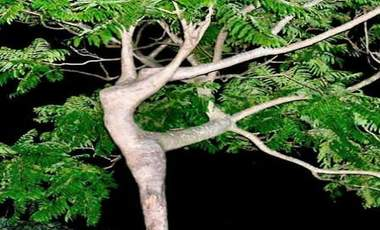

+++
title = "تحب تبقى شجرة إيه؟"
date = 2009-02-11
authors = ["محمد صالح"]

[taxonomies]
authors = ["mohamed-salh"]
sections = ["health"]

[extra]
section_name = "صحة"
share_image = "/media/currentarticleassets/www4photosnet1154122975bs7.jpg"
summary = "تحكي الأساطير أنه كان هناك 3 أمراء أشقاء \"أوجان\" و\"إيجا\" و\"آجا\".. والأخير كان هو الابن الأصغر والأحب إلى قلب أمه بسبب سماحته وحبه للخير، وعندما فتكت الغيرة بقلب"
section_slug = "health"
section_colour = "#2A9D8F"
thumb = "/media/currentarticleassets/www4photosnet1154122975bs7.jpg"
n_comments = 0
original_url = "http://20at.com/20at/health/11269.html"
archived = "20100105210404"
date_source = "byline/meta"
aliases_20at = ["/20at/health/11269.html"]

[extra.provenance]
original_url = "http://20at.com/20at/health/11269.html"
capture_url = "https://web.archive.org/web/20100105210404/http://20at.com/20at/health/11269.html"
capture_label = "٥ يناير ٢٠١٠، ٢١:٠٤ UTC"
date_note = "من سطر التوقيع في المقال"
other_urls = []
comments = ""
missing_images = ""
+++

<figure></figure>

تحكي الأساطير أنه كان هناك 3 أمراء أشقاء "أوجان" و"إيجا" و"آجا".. والأخير كان هو الابن الأصغر والأحب إلى قلب أمه بسبب سماحته وحبه للخير، وعندما فتكت الغيرة بقلب أخويه اتفقا على التخلص منه فأخذاه إلى شاطئ النهر وقتلاه ودفناه هناك.. ونبتت مكانه شجرة جميلة كانت دائما ما تغني "إنني أجا الصغير .. كنت في البيت أمير .. حيث ألهو أو أسير.. يهفو حولي قلب أمي".. علمت الأم بالجريمة وأصبحت الشجرة ملجأها ومسكنها، وعندما رجع الأخوان" ايجا" و"اوجان" إلى صوابها شعرا بالندم وذهبا إلى شجرة شقيقهما وأخذا يبكيان حتى مسخا صخرتين إلى جانب الشجرة.

هكذا كان خيال الأدباء دائما يسبق أفكار العلماء بسنين عديدة، فبعد أن كان تحول الإنسان إلى شجرة لا يتعدى حلم في حدوتة؛ أصبح بحث علمي قابل للتطبيق على أرض الواقع، حيث توصلت الباحثة السويدية "سوزان ماسك" إلى طريقة جديدة للدفن أطلقت عليها "الدفن البيئي"، حيث يوضع الجسد داخل تابوت وينزل في غاز النيتروجين تحت درجة 196 تحت الصفر لتجميده وبعد ذلك يتم هز التابوت بقوة بمساعدة ماكينات خاصة لتفتيته كليا، وبعد أن يتفتت الجسد ويصبح كالبودرة يتحول إلى تراب صالح للزراعة!.

ومنذ أن طرحت "سوزان ماسك" هذا المشروع اتصل بها الكثيرون ممن أعجبتهم الفكرة، يوصون بدفنهم بهذه الطريقة، بل يوجد في السويد الآن أكثر من 10 جثث مثلجة تنتظر منذ فترة موافقة الحكومة على رصد ميزانية للمشروع الذي يتكلف مليونين من الدولارات لإنجازه مبدئيا، والطريف كل واحد منهم قد أوصى بأن يكون تربة للشجرة التي يحبها، فمنهم من اختار أن يكون شجرة توت ومنهم من اختار أن يصبح شجرة ثرو.

ولنفترض أن هذا المشروع تم تطبيقه فعليا ووصل في يوم إلى الدول العربية.. فأي شجرة سيختار كل منا؟.

<h3>ليمون وزيتون</h3>

يقول أحمد عاشور، طالب: "أنا أحب أن أكون شجرة ليمون عشان مفيد في البرد"، ويضيف ضاحكا: "والناس تشرب وتدعي لي واللي ييجي يسلم عليا يعصُرني"!.

عبد العظيم محمد، محاسب، يقول: "أريد أن أصبح شجرة زيتون لأنها شجرة مباركة ومذكورة في القرآن وفي نفس الوقت لها فوائد كثيرة، ومؤخرا قرأت أنه في الصين اكتشفوا أن في زيتها مادة مشعة ممكن استخراج الطاقة منها".

آمنة محمد، طالبة، تقول: "أتمنى أن أكون نخلة ليس لأني قصيرة، لكن النخلة تكون ذات شأن في وسط الأشجار الأخرى، وحتى أنظر على الناس من فوق، وكمان اللي عاوز بلح يطلع ويتعب عشان يأخذه، ففي هذه الحالة سأكون غالية على الكل لأن الشيء الصعب الحصول عليه دائما يكون غالي".

أما ميادة مصطفى، طالبة، فتقول: "نفسي أكون شجرة ورد بلدي أحمر، بس تكون غصوني كلها أشواك عشان اللي يحاول يقطف مني وردة أقوم بشكه فلا يقطفني ثانية".

صفاء شبل، طالبة، توضح أن أمنيتها أن تكون شجرة توت، وتذكر السبب بقولها: "أصل التوت فاكهة الغلابة الذين لا يستطيعون شراء الفاكهة، أكيد سأشعر أنني شجرة مفيدة لما يأتي طفل لا يملك حق تفاحة أو برتقالة ليأكل مني وهو سعيد".

<h3>رغبة في الخلود</h3>

الدكتور مصطفى مبروك، أستاذ البيئة بكلية الزراعة جامعة عين شمس، يقول: "أي كائن حي عندما يموت ترجع عناصره إلى التربة مرة أخرى ويتحلل بالبكتريا والفطريات لعناصر أخرى مفيدة للأرض، والحياة عبارة عن عملية توازن حيث ينتهي شيء ليبدأ شيء آخر، وأعتقد أن هذه الطريقة لا تفيد البيئة بصورة أكثر من طريقة الدفن العادية ولكنها ربما تحقق للإنسان رغبته في الخلود فهو دائما يريد أن يكون متواجدا ولو في صور مختلفة".

بينما يقول الدكتور محمد رأفت عثمان، عضو مجمع البحوث الإسلامية: "مجرد المساس بالجسد بعد الوفاة لا يجوز إلا فيما شرعه لله عز وجل من غسل وتكفين والصلاة عليه ودفنه، ولهذا فإن تفتيته وتحويله إلى بودرة لكي تتغذى منه الشجرة التي يريد صاحب الجسد أن تنمو على حساب جسده من الجرائم التي تدخل في جرائم الاعتداء على جسد المتوفى، وهذا لا يجوز شرعا حتى ولو كان بناءا على وصية المتوفى".

وأنت لو موافق على الفكرة.. فأي شجرة تحب أن تكون؟

