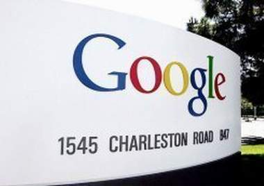

+++
title = "في جوجل.. الصوت تحول لمكتوب!!"
date = 2009-03-15
authors = ["ا ف ب"]

[taxonomies]
authors = ["a-f-b"]
sections = ["nashrat-9"]

[extra]
section_name = "نشرة 9"
share_image = "/media/currentarticleassets/photo.jpg"
summary = "أطلقت المجموعة العملاقة للمعلوماتية جوجل الخميس الماضي خدمة تسمح بالحصول على رقم واحد للمنزل والمكتب الهواتف النقالة ويحول الرسائل الصوتية الى رسائل الكترونية."
section_slug = "nashrat-9"
section_colour = "#004B80"
thumb = "/media/currentarticleassets/photo.jpg"
n_comments = 0
original_url = "http://20at.com/20at/health/11569.html"
archived = "20100105210101"
date_source = "byline/meta"
aliases_20at = ["/20at/health/11569.html"]

[extra.provenance]
original_url = "http://20at.com/20at/health/11569.html"
capture_url = "https://web.archive.org/web/20100105210101/http://20at.com/20at/health/11569.html"
capture_label = "٥ يناير ٢٠١٠، ٢١:٠١ UTC"
date_note = "من سطر التوقيع في المقال"
other_urls = []
comments = ""
missing_images = ""
+++

<figure></figure>

أطلقت المجموعة العملاقة للمعلوماتية جوجل الخميس الماضي خدمة تسمح بالحصول على رقم واحد للمنزل والمكتب الهواتف النقالة ويحول الرسائل الصوتية الى رسائل الكترونية.

ويسمح برنامج "جوجل فويس" بتحويل نص رسالة صوتية الى رسالة الكترونية او رسالة نصية (SMS) ونقل هذه الرسالة الى الهاتف النقال أو الكمبيوتر. لكن جوجل قالت عند اطلاق الخدمة من أن هذا النظام "قد يعاني من أخطاء لأنه آلي بشكل كامل".

وتقدم هذه الخدمة اتصالات مجانية في جميع أنحاء الولايات المتحدة واتصالات دولية برسوم منخفضة للغاية تصل الى 2سنت للدقيقة الواحدة، ومع أنه من المتوقع أن تجذب هذه الخدمة عملاء شركات الهاتف التقليدية فهي تمثل تحديا أيضا لخدمة سكاي بي للاتصالات عبر الانترنت، والتي تقدم أسعاراً مماثلة ولديها بالفعل 400 مليون مستخدم مسجل.

وحاليا لا يمكن سوى لمستخدمي "غراند سنترال" المجموعة التي اشترتها جوجل في يوليو 2007 استخدام هذا النظام الذي سيفتح للجميع في الاسابيع المقبلة. و"غراندسنترال" متخصصة بايجاد رقم واحد لكل الهواتف التي يملكها شخص ما.

وبموجب البرنامج الجديد سيصبح بوسع المستخدمين في 27 دولة بث موقع تواجدهم إلى أشخاص آخرين بصورة دائمة، باستخدام جوجل لاتيتيود. وقالت شركة جوجل في موقعها على شبكة الانترنت إن المستخدم يستطيع التحكم فيمن يمكن إطلاعه على المعلومات، أو قطع الاتصال معه.

ويمكن تتبع أماكن تواجد الأصدقاء عبر خرائط جوجل سواء من جهاز يدوي أو من كمبيوتر شخصي.

وكانت شركة جوجل قد امتلكت خدمة تحديد أماكن تواجد الأشخاص في عام 2005، ثم سرعان ما أوقفت هذه الخدمة التي كانت تعتمد على الرسائل المكتوبة عبر الهاتف المحمول التي تجعل أصدقاء المستخدم يطلعون أولا بأول على مكانه.

